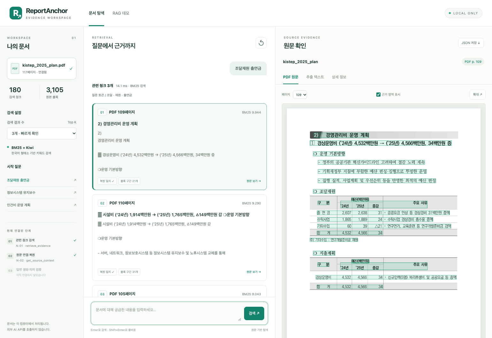

# ReportAnchor

**A local AI agent for evidence-based report review and decision support**

**English** | [한국어](README/readme/README-korean.md)

[Introduction](#introduction) · [Key Features](#key-features) · [How to install](#how-to-install) · [Usage Examples](#usage-examples)

> Find the evidence a review needs, inspect it in the original report, and distinguish supported findings from unresolved conditions.

**Development status:** The current JM working tree supports PDF text extraction, chunking, BM25 retrieval, fixed-length source-context expansion, and a local source-inspection UI. Answer generation, claim verification, and the complete agent workflow are planned. Implemented features and MVP designs are distinguished below.

## Introduction

ReportAnchor is a local document-review agent for **planning, research, and project-review staff in companies and public institutions**. It targets work involving business plans, technology reports, and R&D results, where reviewers need evidence for a specific question, an explicit review criterion, or a comparison.

### Why we started

Reviewing a report involves more than summarizing it. Reviewers move between passages, tables, charts, and footnotes to establish the **subject, year, unit, and measurement conditions** behind each value. Copying information across documents can separate a number from those conditions and lead to an invalid comparison. Sharing a finding also requires explaining which page or table supports it.

Internal plans and unpublished research may additionally be subject to restrictions on external transfer. Adopting a document AI system therefore requires control over where source files, extracted content, questions, indexes, and logs are processed.

ReportAnchor began as an attempt to connect **repeated evidence search, source rechecking, explicit review conditions, and local processing** in one workflow. It aims to run document processing, retrieval, and model inference locally, returning findings alongside the evidence and unresolved conditions. The user retains the final decision. Local execution alone does not establish enterprise security assurance.

### Who it is for

- **Reviewers** who need to locate evidence across reports and inspect criteria-based findings or comparisons against the source.
- **Document AI developers** building local review pipelines with replaceable parsers, VLMs, retrievers, and verification nodes while preserving source references and execution records.

## Key Features

### Available in the current implementation

- **PDF text extraction and chunking:** Extract native text, blocks, page numbers, and coordinates with PyMuPDF, then construct searchable chunks. OCR, table-structure interpretation, and HWP support are not completed in this extraction demo.
- **Korean BM25 retrieval:** Apply the same Kiwi tokenization policy to documents and queries, returning ranked chunks and retrieval scores.
- **Traceable source context:** Reconstruct chunks from original blocks, expand nearby text within the same page, and merge overlapping windows while preserving document versions, block IDs, character spans, and PDF locations. N-02 returns a typed `EvidenceBundle` with scope, integrity, and text-budget checks.
- **Local source-inspection UI:** View document settings, ranked results, and the source PDF side by side. Inspect referenced block regions, extracted text, and the N-01 response JSON, or download the result.



*The current demo displays retrieved chunks rather than generated answers. Green highlights indicate the full bounding boxes of referenced source blocks.*

### MVP under development

The latest JS design follows **request intake and routing → one task-specific fixed workflow → result delivery**. Each valid request selects one of three tasks.

| Task | Intended request | Target output |
| --- | --- | --- |
| **T-01 · Document QA** | Find an answer to a specific document question | Answer, claim-level evidence, unresolved information |
| **T-02 · Criteria Review** | Check explicit user-provided review criteria | Criterion-level findings, evidence, and reasons |
| **T-03 · Comparative Analysis** | Compare documents, periods, or indicators | Comparability checks, quantitative or qualitative differences, sources, and limitations |

Planned components include **hybrid parser/VLM document processing**, **Dense + BM25 + RRF with optional reranking**, **claim, numerical, and citation checks**, and **harness-managed execution status, budgets, and artifacts**. N-02 fixed-length context expansion is implemented in the current text demo; expansion based on table, header, and footnote relationships remains a later improvement.

The agent follows predefined steps and branches. Retrieval retry conditions and limits remain to be finalized. A failed search must not be treated as proof that the document lacks the information, and insufficient evidence must be distinguished from execution failure. Standalone Claim Verification (T-04) and Document Summary (T-05) remain future candidates outside the three-task MVP.

Design references: [JS Query Agent MVP](https://github.com/Jungminii-1114/ReportAnchor/blob/9a54b0e687b9bcd993941492151e02bae3b9d656/docs/query-agent-mvp.md) and [document pipeline](https://github.com/Jungminii-1114/ReportAnchor/blob/9a54b0e687b9bcd993941492151e02bae3b9d656/docs/document-pipeline.md). Current code contracts and remaining nodes are documented in the [RAG development guide](rag/retrieval/README.md).

## How to install

### 1. Prepare the code and environment

These instructions target the **JM development version containing the RAG demo**. Use a checkout containing `scripts/run_rag_demo.py` and the `rag/` package. An existing local working tree can be used directly.

For a new checkout, select the JM branch. If you already have the development folder, use it instead of cloning again.

```bash
git clone --branch JM https://github.com/Jungminii-1114/ReportAnchor.git ReportAnchor
cd ReportAnchor
```

Use **Python 3.13.9 or later**. The following installs the demo dependencies explicitly rather than installing the repository as a Python package.

```bash
python3 -m venv .venv
source .venv/bin/activate
python -m pip install pymupdf==1.28.2 kiwipiepy==0.24.1 rank-bm25==0.2.2
```

The activation command above is for macOS/Linux. On Windows, use `.venv\Scripts\Activate.ps1`. Reuse an existing environment if it already contains the required packages. Currently, `pyproject.toml` only declares PyMuPDF; the RAG demo also needs Kiwi and BM25.

This dependency set was checked in a fresh Python 3.13.9 environment on macOS Apple Silicon, covering PDF extraction, chunking, retrieval, source reconstruction, and PDF rendering.

### 2. Prepare document data

Source PDFs and processed data are excluded from the repository. This example uses a public [KISTEP document](https://www.kistep.re.kr/boardDownload.es?bid=0017&list_no=16371&seq=2), saved as `data/raw/kistep_2025_plan.pdf`. The project is not limited to this document or to budget review.

```bash
mkdir -p data/raw
# Save the PDF at the path above before running extraction.
python 01_extract_pdf.py --pdf data/raw/kistep_2025_plan.pdf

python 02_build_chunks.py \
  --input-dir data/processed/pymupdf_demo/kistep_2025_plan_0530d100e085 \
  --out data/processed/rag/demo
```

The extraction folder includes a prefix of the source-file hash. For another document or a revised download, replace the example path with the extraction command's `output_dir`. Skip this step if you already have the extracted data and chunks.

### 3. Start the local web demo

```bash
python scripts/run_rag_demo.py \
  --chunks data/processed/rag/demo/chunks.jsonl \
  --blocks data/processed/pymupdf_demo/kistep_2025_plan_0530d100e085/blocks.jsonl \
  --pdf data/raw/kistep_2025_plan.pdf
```

After the ready message, open <http://127.0.0.1:8765>. Stop the server with `Ctrl+C`. See the [demo guide](docs/rag-demo-ui.md) for other data paths, a separate PyMuPDF environment, or a different port. The current retrieval and source-inspection demo requires neither an LLM API key nor an Ollama model.

## Usage Examples

### Inspect retrieval results against the source

1. Confirm the connected document and select three results in the left panel.
2. Search for `조달재원 출연금`.
3. Select a result card, then inspect the right panel's **PDF 원문** (source PDF), **추출 텍스트** (extracted text), and **상세 정보** (details) tabs.
4. Check the physical PDF page, block spans, and document version. Use **JSON 저장** to download the result when needed.

The current sample document produces these results.

| Rank | Physical PDF page | BM25 score | Referenced source spans |
| --- | --- | --- | --- |
| 1 | 109 | Approximately 9.944 | 21 |
| 2 | 110 | Approximately 9.290 | 31 |
| 3 | 105 | Approximately 9.043 | 28 |

For example, compare the contribution-funding row on PDF page 109: **2024: 2,607 / 2025: 2,638 / change: 31 million KRW**. Physical PDF pages may differ from printed page labels. BM25 scores rank relevance; they are not accuracy estimates or probabilities.

**Reconstruction match** means that the stored block spans reproduce the chunk text. It does not establish PDF extraction accuracy, correct table structure, or factual answer generation. N-03 claim verification is not implemented yet.

The November 2, 2026 record of 26 web/API checks and 12 existing BM25/contract tests is described in the [demo check record](docs/reports/rag-demo-ui-checks.json) and [source-inspection guide](docs/rag-demo-ui.md). These are functional checks, not retrieval-accuracy evaluations.

For the completed N-02 context contract, CLI options, and node order, see the [source-context guide](docs/n02-source-context.md). The [N-02 validation record](docs/reports/n02-validation.json) covers the new implementation separately from the original demo checks.
