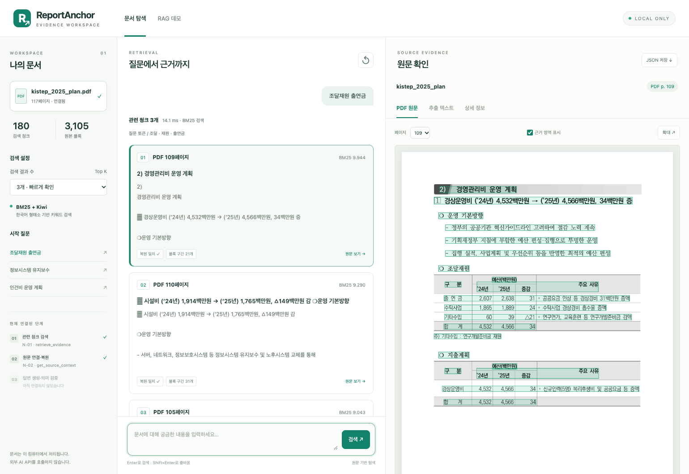

# ReportAnchor

**원문 근거에 기반한 보고서 분석·검토와 의사결정 지원을 위한 로컬 AI Agent**

[English](../../README.md) | **한국어**

[Introduction](#introduction) · [Key Features](#key-features) · [How to install](#how-to-install) · [사용 예시](#사용-예시)

> 보고서에서 필요한 근거를 찾고, 검토 기준에 따라 무엇을 판단할 수 있는지 원문과 함께 확인하는 것을 목표로 한다.

**개발 상태:** 현재 JM 작업 트리에서는 PDF 텍스트 추출·청킹·BM25 검색·고정 길이 문맥 보강·원문 대조 웹 데모를 실행할 수 있다. 답변 생성·주장 검증과 전체 Agent 통합은 개발 예정이다. 아래에서 현재 기능과 MVP 설계를 구분한다.

## Introduction

ReportAnchor는 **기업·공공기관의 기획·연구·사업 검토 담당자**를 위한 로컬 문서 검토 Agent이다. 사업계획서, 기술동향 보고서, 연구개발 성과자료를 검토하면서 필요한 정보를 찾고, 기준 충족 여부나 대안 간 차이를 원문 근거로 확인하는 업무를 대상으로 한다.

### 이 프로젝트가 시작된 이유

보고서 검토는 내용을 요약하는 것으로 끝나지 않는다. 담당자는 본문·표·그래프·주석을 오가며 수치를 찾고, 그 값이 **어떤 대상·연도·단위·측정 조건**에 해당하는지 확인해야 한다. 여러 문서에서 값을 복사해 정리하는 동안 이 관계가 빠지면, 숫자를 올바르게 읽어도 비교와 판단은 잘못될 수 있다. 결과를 공유할 때에는 어떤 페이지와 표를 근거로 판단했는지 다시 설명해야 한다.

또한 내부 사업계획서나 미공개 연구 자료는 외부 전송이 제한될 수 있다. 문서 AI를 도입할 때에는 답변 품질과 함께 원문·추출 데이터·질의·색인·로그를 어디에서 처리하는지도 고려해야 한다.

ReportAnchor는 이러한 **반복 탐색, 원문 재확인, 검토 조건의 누락, 내부 처리 요구**를 하나의 흐름으로 다루기 위해 시작했다. 문서 처리와 검색·모델 추론을 로컬 환경에 구성하고, 근거로 확인된 내용과 판단할 수 없는 부분을 구분해 검토 의견을 제시하는 것이 목표이다. 최종 판단은 사용자가 내리며, 로컬 실행 자체를 기업 수준의 보안 인증이나 검증 완료로 해석하지 않는다.

### 누구를 위한 프로젝트인가

- **검토 담당자:** 여러 보고서에서 필요한 근거를 찾고, 명시한 기준의 충족 여부와 비교 결과를 출처와 함께 확인하려는 사용자이다.
- **문서 AI 개발자:** 파서·VLM·검색기·검증 노드를 교체하면서 원문 참조와 실행 기록을 유지하는 로컬 검토 파이프라인을 구축하려는 개발자이다.

## Key Features

### 현재 실행 가능한 기능

- **PDF 텍스트 추출과 청킹:** PyMuPDF로 본문·블록·페이지·좌표를 추출하고 검색용 청크로 구성한다. 현재 추출 데모는 native text 기반이며 OCR·표 구조 해석·HWP 처리를 완성한 버전은 아니다.
- **한국어 BM25 검색:** Kiwi로 문서와 질문에 동일한 토큰화 정책을 적용하고 관련 청크의 순위·점수를 반환한다.
- **출처를 보존하는 원문 문맥:** 원본 블록으로 청크를 복원하고 같은 페이지의 앞뒤 문맥을 보강한다. 겹치는 문맥은 병합하며 문서 버전·블록·문자 구간·좌표를 보존한다. N-02는 범위·무결성·문자 예산을 검사해 `EvidenceBundle`로 반환한다.
- **원문 대조 웹 화면:** 문서 설정·검색 결과·PDF 원문을 나란히 제공한다. 참조 블록 영역, 추출 텍스트, N-01 응답 JSON을 확인하고 결과를 다운로드할 수 있다.



*현재 데모 화면이다. 가운데에는 생성 답변 대신 검색된 청크가 표시된다. 초록색 영역은 원문 참조 블록 전체의 위치이다.*

### 개발 중인 MVP

최신 JS 설계는 **요청 확인·라우팅 → 업무별 고정 워크플로 하나 → 결과 전달** 구조이다. 사용자의 목적에 따라 다음 세 업무 중 하나를 선택하도록 설계한다.

| 업무 | 지원하려는 요청 | 목표 결과 |
| --- | --- | --- |
| **T-01 · Document QA** | 특정 항목이나 설명을 문서에서 확인 | 답변, 주장별 원문 근거, 미확인 내용 |
| **T-02 · Criteria Review** | 사용자가 명시한 검토 기준의 충족 여부 확인 | 기준별 충족·미충족·확인 불가, 근거와 사유 |
| **T-03 · Comparative Analysis** | 문서·기간·지표별 차이 비교 | 비교 가능성, 정량·정성 차이, 출처와 제한 조건 |

이를 위해 **파서와 선택적 VLM을 결합한 문서 처리**, **Dense + BM25 + RRF 및 선택형 리랭킹**, **주장·수치·인용 검증**, **하네스의 실행 상태·예산·아티팩트 관리**를 개발 대상으로 둔다. 현재 텍스트 데모의 N-02 고정 길이 문맥 보강은 구현된 상태이며, 표·헤더·각주 관계를 활용한 구조 기반 확장은 후속 고도화 대상이다.

Agent는 사전 정의된 순서와 분기 안에서 동작하며, 재검색 조건과 한도는 후속 구현에서 확정한다. 검색 결과가 없다는 이유만으로 문서에 정보가 없다고 단정하지 않고, 근거 부족과 처리 실패를 구분해 전달하도록 설계한다. 독립적인 주장 검증(T-04)과 문서 전체 요약(T-05)은 후속 후보이며 현재 MVP의 세 업무에 포함하지 않는다.

설계 기준은 [JS 브랜치 Query Agent MVP](https://github.com/Jungminii-1114/ReportAnchor/blob/9a54b0e687b9bcd993941492151e02bae3b9d656/docs/query-agent-mvp.md)와 [문서 처리 파이프라인](https://github.com/Jungminii-1114/ReportAnchor/blob/9a54b0e687b9bcd993941492151e02bae3b9d656/docs/document-pipeline.md)이다. 현재 코드의 입출력과 남은 노드는 [RAG 개발 안내](../../rag/retrieval/README.md)에 정리되어 있다.

## How to install

### 1. 코드와 실행 환경 준비

아래는 **현재 RAG 데모를 포함한 JM 개발 버전**을 위한 절차이다. `scripts/run_rag_demo.py`와 `rag/` 패키지를 포함한 체크아웃을 사용한다. 기존 로컬 작업 트리에서도 그대로 진행할 수 있다.

새로 코드를 내려받는 경우 다음과 같이 JM 브랜치를 선택한다. 기존 개발 폴더가 있다면 clone을 반복하지 않고 그 폴더에서 진행한다.

```bash
git clone --branch JM https://github.com/Jungminii-1114/ReportAnchor.git ReportAnchor
cd ReportAnchor
```

**Python 3.13.9 이상**을 사용한다. 다음 설치는 프로젝트를 패키지로 설치하는 대신 현재 데모에 필요한 의존성을 명시적으로 설치하는 방식이다.

```bash
python3 -m venv .venv
source .venv/bin/activate
python -m pip install pymupdf==1.28.2 kiwipiepy==0.24.1 rank-bm25==0.2.2
```

위 활성화 명령은 macOS·Linux 기준이다. Windows에서는 `.venv\Scripts\Activate.ps1`로 활성화한다. 이미 개발 환경이 있다면 재생성하지 않고 필요한 패키지가 설치된 Python을 사용한다. `pyproject.toml`에는 현재 PyMuPDF만 등록되어 있으므로 RAG 실행에는 Kiwi·BM25 의존성도 필요하다.

위 패키지 구성으로 macOS Apple Silicon·Python 3.13.9의 새 가상환경에서 PDF 추출 → 청킹 → 검색 → 원문 복원·PDF 렌더링을 확인했다.

### 2. 문서 데이터 준비

원본 PDF와 가공 데이터는 저장소에 포함하지 않는다. 다음은 공개된 [KISTEP 문서](https://www.kistep.re.kr/boardDownload.es?bid=0017&list_no=16371&seq=2)를 `data/raw/kistep_2025_plan.pdf`로 저장한 예시이다. 프로젝트의 활용 범위를 이 문서나 예산 분석으로 한정하는 것은 아니다.

```bash
mkdir -p data/raw
# PDF를 위 경로에 저장한 뒤 실행한다.
python 01_extract_pdf.py --pdf data/raw/kistep_2025_plan.pdf

python 02_build_chunks.py \
  --input-dir data/processed/pymupdf_demo/kistep_2025_plan_0530d100e085 \
  --out data/processed/rag/demo
```

추출 결과 폴더 이름에는 원본 해시가 포함된다. 위 경로는 현재 예시 PDF 기준이며 다른 문서나 갱신된 파일을 사용하면 추출 실행 결과의 `output_dir`로 변경한다. 이미 추출·청킹한 데이터가 있다면 이 단계를 반복할 필요는 없다.

### 3. 로컬 웹 데모 실행

```bash
python scripts/run_rag_demo.py \
  --chunks data/processed/rag/demo/chunks.jsonl \
  --blocks data/processed/pymupdf_demo/kistep_2025_plan_0530d100e085/blocks.jsonl \
  --pdf data/raw/kistep_2025_plan.pdf
```

준비 메시지 이후 <http://127.0.0.1:8765>에 접속한다. 종료는 `Ctrl+C`이다. 다른 데이터 경로·별도 PyMuPDF 환경·포트 변경은 [실행 안내](../../docs/rag-demo-ui.md)를 참고한다. 현재 검색·원문 대조 데모에는 LLM API 키나 Ollama 모델이 필요하지 않다.

## 사용 예시

### 검색 결과를 원문과 대조하기

1. 왼쪽에서 연결된 문서와 검색 결과 수 `3개`를 확인한다.
2. `조달재원 출연금`을 검색한다.
3. 결과 카드를 선택하고 오른쪽 **PDF 원문 → 추출 텍스트 → 상세 정보**를 순서대로 확인한다.
4. 원문 페이지·블록 구간·문서 버전을 대조하고, 필요하면 **JSON 저장**으로 결과를 보관한다.

현재 예시 문서의 검색 결과는 다음과 같다.

| 순위 | PDF 물리 페이지 | BM25 점수 | 연결된 원문 구간 |
| --- | --- | --- | --- |
| 1 | 109 | 약 9.944 | 21개 |
| 2 | 110 | 약 9.290 | 31개 |
| 3 | 105 | 약 9.043 | 28개 |

109페이지 출연금 행의 **2024년 2,607 / 2025년 2,638 / 증감 31백만원**을 PDF와 추출 텍스트에서 대조할 수 있다. PDF 페이지는 인쇄된 쪽번호와 다를 수 있다. BM25 점수는 관련성 순위용이며 정확도나 확률은 아니다.

**복원 일치**는 저장된 블록 구간과 청크 텍스트가 같다는 의미이다. PDF 인식 정확도나 표 구조, 생성 답변의 사실성을 검증했다는 의미는 아니다. 현재 N-03 주장 검증은 미구현이다.

웹·API 기능 검사 26개와 기존 BM25·계약 테스트 12개가 통과한 2026-11-02 기록은 [데모 검사 기록](../../docs/reports/rag-demo-ui-checks.json)과 [원문 확인 안내](../../docs/rag-demo-ui.md)에 정리되어 있다. 이는 기능 검사 결과이며 검색 정확도 평가를 대신하지 않는다.

완성한 N-02의 문맥 계약·CLI 설정·노드 실행 순서는 [원문 문맥 안내](../../docs/n02-source-context.md)에 있다. 기존 데모 기록과 구분한 [N-02 추가 검증 기록](../../docs/reports/n02-validation.json)도 확인할 수 있다.
