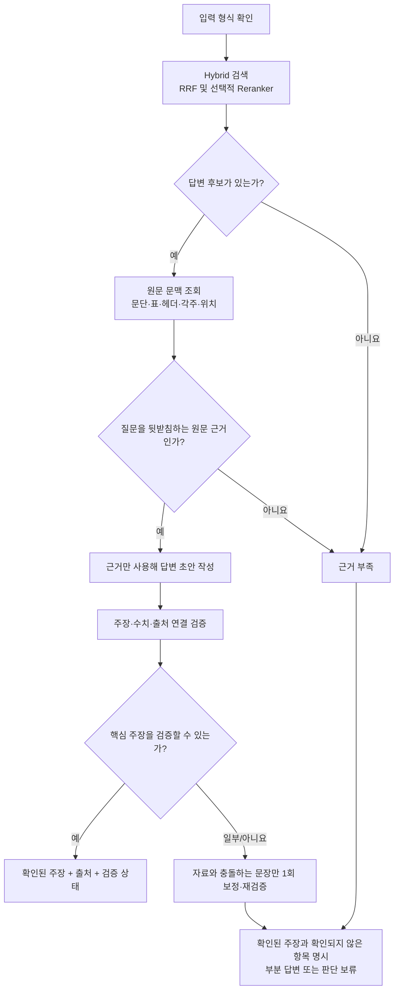
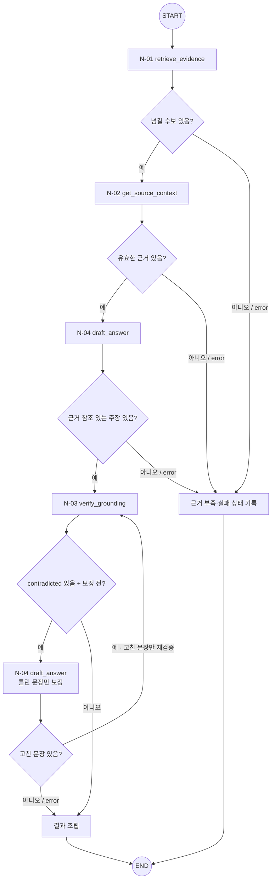

# T-01 · Document QA — 문서 근거 질의응답

> **상태:** MVP 우선, **개념 계약 확정(2026-11-05) / 구현 미착수.** 세부 타입·실행 예산은 구현 시 결정.
>
> **상위 구조:** [Query Agent MVP](../query-agent-mvp.md) · [Big Node 목록](README.md).
>
> **외부 입구/출구:** [N-10](../small-nodes/N-10.md) → 이 Big Node → [N-11](../small-nodes/N-11.md). 두 공통 Small Node는 내부 노드 수에 포함하지 않는다.
>
> **호출 방식:** T-01은 메인 에이전트가 호출하는 tool이다. 결과를 사용자에게 직접 전달하지 않고 메인 에이전트에게 돌려준다. [상세](../query-agent-mvp.md#1-전체-실행-흐름)

## 1. 목적·입력·업무별 검증 정책

**목적:** 질문에 해당하는 보고서의 내용을 찾고, 그 내용으로 뒷받침되는 주장을 돌려준다. 단순한 관련 청크 반환이나 문서 전체 요약과는 구별한다.

**입력 (2026-11-05 결정):** `RoutedTask`의 `request_ref`, `question`, `document_scope`, `retrieval_profile`, `context_profile`. 메인 에이전트의 LLM은 tool만 고르고 인자는 하네스가 채운다. 범위·권한·명확화 판단은 N-10이 끝내며 T-01은 형식만 검사한다. **MVP에서 `question`은 사용자 쿼리 원문 그대로다.** 쿼리 증폭은 T-01 내부에서 수행하지 않으며, 도입하면 T-01 밖의 별도 노드로 붙인다.

**고정 워크플로(초안)**



| 단계 | 구체적 수행 및 확인 사항 | 보존할 결과(개념) |
|---|---|---|
| Q1. 입력 형식 확인 | 필수 입력의 형식만 검사. 범위·권한·명확화는 N-10 책임. 임의의 조건 추가 금지 | `RoutedTask` 참조 |
| Q2. 검색 | 동일 쿼리로 하이브리드 검색. 최종 검색 전략은 실험 결과에 따라 선택 | `RetrievalCandidates` |
| Q3. 원문 조회·적합성 확인 | 관련성뿐 아니라 질문에 직접 답하는지, 표의 헤더·단위·각주가 맞는지 확인 | 근거 항목별 `source_ref`, 추출·검증 상태 |
| Q4. 답변 초안 | 확인된 정보만 사용하고 정보가 없는 부분은 미확인으로 유지 | `ReviewDraft`, 주장별 근거 참조 |
| Q5. 인용 검증·결과 | 주장마다 근거를 대조. 자료와 충돌하는 주장만 1회 보정 후 재검사하고, 통과하지 못한 내용은 확인되지 않은 항목으로 명시 | `VerificationReport`, QA형 `WorkflowResult` |

**분기·판단 보류:** 검색된 내용이 질문과 관련 있어도 직접적인 답이 아닐 수 있다. 후보가 없거나 수치·시점·원문 위치가 불확실하면 다시 검색하지 않고 `insufficient_evidence` 또는 확인되지 않은 항목으로 명시한다. 일부 주장만 근거가 있으면 그 부분만 설명하고 나머지를 미확인으로 표시한다.

**결과 예시(형태):** 뒷받침된 주장 목록, 주장별 출처 위치/문서 버전, 확인되지 않은 항목과 사유, 실행·검증 상태. 사용자에게 보이는 답변 문장은 N-11이 구성한다. 문서 전체를 요약하지 않는다.

**평가 후보:** 답변 가능 여부 판단, 주장별 출처 지지율, 사실·숫자 오류율, 근거 부족 시 보류율, 검색 및 전체 실행 지연.

## 2. 사용 Small Node 문서

**기본 실행 순서:** [N-01](../small-nodes/N-01.md) → [N-02](../small-nodes/N-02.md) → [N-04](../small-nodes/N-04.md) → [N-03](../small-nodes/N-03.md). 자료 충돌 주장이 있으면 N-04(보정) → N-03(재검증)을 1회 추가한다.

| 실행 단계 | Small Node 상세 문서 | 역할 | 주요 산출물 |
|---|---|---|---|
| 1 | [N-01](../small-nodes/N-01.md) · `retrieve_evidence` | 검색 후보 탐색 | `RetrievalCandidates` |
| 2 | [N-02](../small-nodes/N-02.md) · `get_source_context` | 후보와 원문·표·헤더·각주·위치 연결 | `EvidenceBundle` |
| 3 | [N-04](../small-nodes/N-04.md) · `draft_answer` | 원문 근거를 이용한 질문 답변 초안 작성 | `ReviewDraft` |
| 4 | [N-03](../small-nodes/N-03.md) · `verify_grounding` | 주장·판정·비교 결과와 원문 근거의 정합성 검사 | `VerificationReport` |

- **N-01은 `RetrievalCandidates`, N-02는 문맥을 더한 `EvidenceBundle`을 반환한다.** 둘의 계약을 섞지 않는다.
- 여러 검토 기준·비교 대상을 처리하는 반복과 취합은 Big Node가 관리한다. 동일 Small Node를 재사용하더라도 Tiny Node를 생성하지 않는다.
- 각 Small Node의 **내부 함수·입출력 타입·오류 처리**는 연결된 `N-xx.md`에만 상세화한다.

## 3. LangGraph 노드·조건부 엣지 (설계안)



**도식 설명:** `N-xx`만 Small Node다. 분기 마름모는 조건부 Edge이고 '상태 기록'과 '결과 조립' 박스는 별도 Small Node가 아닌 그래프 상태 처리다. 'N-04 틀린 문장만 보정'은 같은 N-04의 두 번째 호출이다. START/END는 LangGraph의 특수 노드다.

**호출 기준 (2026-11-05 결정):** 앞 노드가 `error`가 아니고 다음 노드에 넘길 항목이 1개 이상이면 호출한다. 다음 노드를 정하는 것은 T-01의 분기뿐이며, 노드가 다음 노드를 직접 부르지 않는다.

| 지점 | 넘길 항목 | 조건을 만족하지 않으면 |
|---|---|---|
| N-01 → N-02 | `candidates` | 종료 (N-02 이후 생략) |
| N-02 → N-04 | `evidence_items` | 종료 (N-04 이후 생략) |
| N-04 → N-03 | `evidence_refs`가 있는 주장 | 종료 (N-03 생략) |
| N-03 → N-04 보정 | `contradicted` 주장 + 보정 전 | 결과 조립 |
| N-04 보정 → N-03 | 고친 주장 | 결과 조립 |

`partial`이어도 넘길 항목이 있으면 진행한다. 유효한 근거가 1건 이상이면 N-04로 넘어가며, 충분한지에 대한 실제 판단은 N-04와 N-03이 한다.

**N-01 이후 분기:** 검색 후보가 있고 정상 또는 `partial` 결과일 때만 N-02를 호출한다. 후보 없음·실패는 근거 부족/오류로 처리한다. **MVP에서 재검색은 0회다(2026-11-05 결정).** 같은 검색어로는 같은 후보가 나오고 검색어 변경은 T-01 밖의 책임이기 때문이다. 일시적 실행 실패도 T-01에서 재시도하지 않고 `retryable`만 기록한다. **상위 Big Node가 다음 노드를 정하고 N-01은 N-02를 직접 호출하지 않는다.**

**N-04 이후 분기 (MVP):** `status=success`이고 주장이 생성되었다면 **전체 답변(`outcome=null`)과 일부 답변(`outcome=partial_answer`) 모두 N-03을 수행**한다. 일부 답변에서는 근거가 있는 사실 주장만 검증하고, N-04의 `unanswered_items[]`는 후속 결과에서 미확인으로 표시한다. `status=success, outcome=insufficient_evidence`이면 `claims=[]`로 N-03을 생략하고 근거 부족으로 종료한다. `status=error`는 **근거 부족으로 간주하지 않고** 생성 오류로 보류한다. **주장을 작성했는데 모든 근거 ID가 비어 있으면 N-04는 `error`를 반환**하며, 상위 워크플로는 미검증 답변을 N-03으로 전달하지 않는다. 세부적인 최종 사용자 안내는 N-11에서 처리한다([N-04 예외 계약](../small-nodes/N-04.md)).

**N-03 이후 분기 (2026-11-05 결정):**

- **보정 대상:** `contradicted` 주장만 N-04로 보낸다. `supported` 주장은 그대로 유지하고, `insufficient` 주장은 보정하지 않는다.
- **보정 횟수:** 1회다. 검색과 원문 조회는 다시 하지 않고 같은 `EvidenceBundle`을 쓴다. [N-04 보정 호출 계약](../small-nodes/N-04.md)을 따른다.
- **재검증:** 고친 주장만 N-03에 넘긴다. N-03의 입력 계약은 바뀌지 않으며, 주장별로 가장 마지막 판정을 사용한다.
- **재실패:** 고친 주장이 다시 `contradicted` 또는 `insufficient`이거나, N-04가 고치지 못했거나, 보정·재검증 호출이 `error`면 다시 보정하지 않는다. 해당 내용을 `unconfirmed_items[]`에 명시하고 tool 호출을 종료한다.
- **1차 검증 `error`:** 보정 대상을 알 수 없으므로 보정 없이 결과 조립으로 넘어가며, 검증되지 않은 주장을 `verified_claims[]`에 넣지 않는다.

## 4. 결과 계약과 미정 사항

- `WorkflowResult`에 업무별 결과, 원문 참조·문서 버전·검증 상태·미확인 원인·실행 오류를 연결한다.
- **출력 주장 (2026-11-05 결정):** T-01은 답변 문자열을 만들지 않고, 자료와 일치함을 확인한 주장을 `verified_claims[]`로, 확인되지 않은 내용을 `unconfirmed_items[]`로 내보낸다. 두 필드 이름은 설명용이다.
- **판정별 처리 (2026-11-05 결정):** `contradicted`만 N-04 보정 대상이고, `insufficient`는 보정하지 않고 `unconfirmed_items[]`에 명시한다. 보정 후에도 `contradicted`인 주장은 `claim_text` 없이 사유만, `insufficient` 주장은 `claim_text`와 사유를 함께 넣는다.
- **미확인 표현 (2026-11-05 결정):** "문서에 없음"이 아니라 "확보한 자료에서 확인되지 않음"으로 표현한다. N-03은 검색으로 확보한 근거만 보기 때문이다.
- **참조 없는 주장 (2026-11-05 결정):** 일부 주장에만 근거 참조가 없으면 N-03이 건너뛰므로, 해당 주장은 사유 `no_evidence_ref`와 함께 `unconfirmed_items[]`에 넣는다.
- **근거 누락 표시 (2026-11-05 결정):** 근거 수집이 일부 실패하면 결과에 `evidence_incomplete: true`를 표시한다. 조건은 N-01의 Dense 또는 BM25 실패, N-02의 `partial`, N-02의 출력 상한 초과로 제외된 후보다. Reranker만 실패한 경우는 후보가 빠지지 않았으므로 제외한다. 조회하지 못한 근거의 내용은 알 수 없으므로 항목별로 표시하지 않는다. `verified_claims[]`에는 영향이 없다.
- **검증 실행 실패 (2026-11-05 결정):** N-03의 `failed_items[]`에 기록된 주장은 `verified_claims[]`에 넣지 않고, `claim_text`와 검증 실행 실패 사유를 함께 `unconfirmed_items[]`에 넣는다.
- **N-04 항목 통합 (2026-11-05 결정):** N-04의 `unanswered_items[]`도 `unconfirmed_items[]`에 합치고 출처만 구분한다.
- 검색 누락만으로 정보 부재를 확정하지 않고, 수치/인용/비교 가능성도 검증되지 않았다면 보류한다.
- 임계값·테스트·실행 코드의 확정은 후속 설계 항목이다.

### 결과 상태 (2026-11-05 결정)

`status`는 실행 상태이고 `outcome`은 확인 결과다.

- **`status`:** `success`는 호출한 노드가 모두 정상, `partial`은 일부 실패했지만 안전한 결과가 남음, `error`는 안전한 결과가 없음이다.
- **`outcome`:** `null`은 전부 확인됨, `partial_answer`는 확인된 주장과 확인되지 않은 항목이 함께 있음, `insufficient_evidence`는 확인된 주장이 없음이다.

| 상황 | `status` | `outcome` | `evidence_incomplete` |
|---|---|---|---|
| 전부 확인됨 | `success` | `null` | `false` |
| 일부만 확인됨 (보정 재실패 포함) | `success` | `partial_answer` | `false` |
| Dense 실패, 일부만 확인됨 | `partial` | `partial_answer` | `true` |
| 재검증 또는 보정 호출 `error`, 확인된 주장 있음 | `partial` | `partial_answer` | `false` |
| Reranker만 실패, 전부 확인됨 | `partial` | `null` | `false` |
| 검색 정상, 후보 0개 | `success` | `insufficient_evidence` | `false` |
| Dense 실패, 후보 0개 | `partial` | `insufficient_evidence` | `true` |
| 주장은 있었으나 전부 미확인 | `success` | `insufficient_evidence` | `false` |
| N-01, N-02, N-04 `error` | `error` | `null` | `false` |
| 1차 검증 N-03 `error` | `error` | `null` | `false` |

보정 재실패는 검증이 제대로 작동한 결과이므로 실행 실패로 보지 않는다.

**오류 정보:** `status=error`일 때만 `error`에 실패 위치를 넣는다. 재호출하지 않고 사용자에게 안내하는 데에만 쓴다.

```json
{
  "status": "error",
  "outcome": null,
  "error": {"node": "N-02", "error_code": "VERSION_MISMATCH", "retryable": false}
}
```

**호출되지 않은 노드:** 별도 기록 필드를 두지 않는다. 호출된 노드는 실패해도 `NodeResult`가 남으므로, 그래프 상태에 결과가 없으면 호출되지 않은 것이다. 생략 이유는 앞 노드의 결과로 판단한다. 아티팩트도 호출된 노드만 기록한다.
