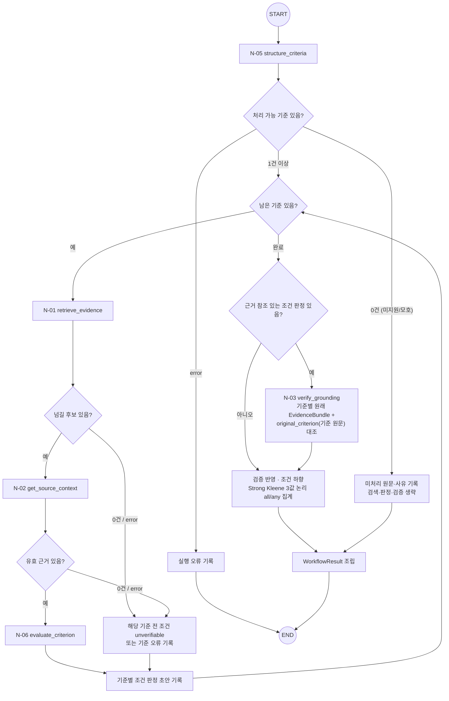

# T-02 · Criteria Review — 명시적 기준 충족 검토

> **상태:** MVP 우선, **개념 계약 확정(2026-11-28) / 구현 미착수.** 세부 타입·실행 예산은 구현 시 결정.
>
> **상위 구조:** [Query Agent MVP](../query-agent-mvp.md) · [Big Node 목록](README.md).
>
> **외부 입구/출구:** [N-10](../small-nodes/N-10.md) → 이 Big Node → [N-11](../small-nodes/N-11.md). 두 공통 Small Node는 내부 노드 수에 포함하지 않는다.
>
> **호출 방식:** T-02는 메인 에이전트가 호출하는 tool이다. 결과를 사용자에게 직접 전달하지 않고 `WorkflowResult`로 메인 에이전트에게 돌려준다. [상세](../query-agent-mvp.md#1-전체-실행-흐름)

## 1. 목적·입력·업무별 검증 정책

**목적:** 사용자가 명시한 검토 기준을 항목별로 확인해 **`met`(충족) / `not_met`(미충족) / `unverifiable`(확인 불가)**를 판정하고, 원문 근거와 검증 상태를 함께 반환한다. 단순 정보 조회와 달리 조건·임계값·논리 결합(`all`/`any`)·확인 범위가 판정의 핵심이다.

**입력 (2026-11-28 확정):** `request_ref`, `question`, `criteria_texts[]`, `document_scope`, `retrieval_profile`, `context_profile`.
- 범위·권한·명확화 사전 판단은 N-10이 끝내며 T-02는 입력 형식만 검사한다.
- 사용자가 명시하지 않은 기준·임계값을 임의로 추가하지 않는다.
- 기준별 검색 입력은 새 질의를 생성하지 않고 **각 구조화된 독립 기준의 원문(`original_text`)**을 사용한다. 쿼리 증폭(Multi-query/PRF/HyDE)은 T-02 내부에서 수행하지 않는다.

**특별 규칙:** **검색 결과에 안 나온다는 이유만으로 `not_met` 판정하지 않는다.** 부재 주장은 대상 문서 범위 전체를 빠짐없이 확인한 완전성 검사가 보장될 때만 허용하며, 단순 Top-k 검색 누락은 `unverifiable`이다.

**평가 후보:** 기준별 판정 정확도, 충족·미충족·확인 불가 혼동률, 근거 지지율, 부재 과잉 확정 비율, 정량 임계값 비교 정확도, 기준 수에 따른 실행 지연.

## 2. 사용 Small Node 문서

**기본 실행 순서:** [N-05](../small-nodes/N-05.md) → (처리 가능한 기준별 [N-01](../small-nodes/N-01.md) → [N-02](../small-nodes/N-02.md) → [N-06](../small-nodes/N-06.md)) → (기준별 근거 격리 유지한 [N-03](../small-nodes/N-03.md)) → 조건 하향 및 3값 논리 `all`/`any` 집계.

| 실행 단계 | Small Node 상세 문서 | 역할 | 주요 산출물 |
|---|---|---|---|
| 1 | [N-05](../small-nodes/N-05.md) · `structure_criteria` | 명시된 검토 기준을 평면 `all`/`any` + 조건 목록으로 구조화 | `CriteriaSet` |
| 2 | [N-01](../small-nodes/N-01.md) · `retrieve_evidence` | 기준 원문으로 검색 후보 탐색 | `RetrievalCandidates` |
| 3 | [N-02](../small-nodes/N-02.md) · `get_source_context` | 후보와 원문·위치 연결, 고정 길이 확장(`source_refs[]`·`expanded_source_refs[]`), 표 청크의 사전 보존 `table_context` 전달 | `EvidenceBundle` |
| 4 | [N-06](../small-nodes/N-06.md) · `evaluate_criterion` | 조건별 `met`/`not_met`/`unverifiable` 판정 (정성 AI + 정량 Python 하이브리드) | `CriterionFinding` |
| 5 | [N-03](../small-nodes/N-03.md) · `verify_grounding` | 조건별 판정과 해당 기준의 `EvidenceBundle` 정합성 + 사용자 기준 원문 충실도 검사 | `VerificationReport` |

- **기준별 근거 격리 및 원문 기준 충실도 대조 (2026-11-28 보강):** 서로 다른 기준에서 같은 `chunk_id`가 조회되더라도 기준 간 `EvidenceBundle`을 임의로 합치지 않고, 각 기준의 원래 `EvidenceBundle`로 N-03을 대조한다. 또한 N-03 호출 시 판정 초안(주장별 `condition_id`·`numeric_check` 포함)과 함께 **`original_criterion`(`criterion_id`, 사용자 기준 원문 `original_text`, 구조화된 `conditions[]`)을 전달**해, N-05/N-06에서 연산자(`이상`/`이하`/`초과`/`미만`)·임계값·범위가 원문 기준과 뒤바뀌었는지까지 검증한다. 원문 기준과 일치하지 않으면 N-03 `insufficient` 판정을 거쳐 해당 조건을 `unverifiable`로 하향한다.
- **N-05의 기준별 부분 처리(B 방식):** 처리 가능한 독립 기준(`criteria[]`)만 검색·판정·검증으로 넘기고, 미처리 기준(`unprocessed_criteria[]`)은 임의로 `not_met` 처리하지 않고 원문·사유를 최종 결과에 보존한다.
- 여러 기준의 반복 실행, 검증 탈락 조건 하향, 기준 단위 `all`/`any` 집계는 T-02의 그래프 상태 처리가 맡으며 별도 Small/Tiny Node를 추가하지 않는다.

## 3. LangGraph 노드·조건부 엣지 (확정)

**도식 설명:** `N-xx`만 Small Node다. 분기 마름모는 조건부 Edge이고, '기준별 기록'·'조건 하향 및 3값 논리 집계'·'결과 조립'은 별도 Small Node가 아닌 그래프 상태 처리다.

### 호출·분기 기준 (2026-11-28 확정)

| 지점 | 진행 조건 | 조건 미충족 시 처리 |
|---|---|---|
| N-05 → 기준 반복 | `N-05.status != error` 및 `criteria[]` ≥ 1건 | `error`면 즉시 오류 종료; 0건이면 미처리 원문·사유만 담아 종료 |
| N-01 → N-02 | `N-01.status != error` 및 `candidates[]` ≥ 1건 | 해당 기준은 N-02/N-06 생략, 전 조건 `unverifiable` (또는 기준 `error`) 기록 |
| N-02 → N-06 | `N-02.status != error` 및 `evidence_items[]` ≥ 1건 | 해당 기준은 N-06 생략, 전 조건 `unverifiable` (또는 기준 `error`) 기록 |
| 기준 반복 → N-03 | `evidence_refs[]`가 있는 조건 판정이 1건 이상 | N-03 생략 후 바로 집계·결과 조립 |

- **재검색 0회 · 보정 0회 (MVP 확정):** T-01과 동일하게 MVP에서 재검색은 하지 않는다. 또한 [N-06 계약](../small-nodes/N-06.md#6-n-03-연동-및-보정-미도입-정책-mvp-확정)에 따라 N-03에서 `contradicted`나 `insufficient`가 나와도 **보정 호출을 하지 않고 바로 `unverifiable`로 하향**한다.
- **실행 예산의 알려진 한계 (백로그):** 현재 구조는 모든 기준의 `N-01 → N-02 → N-06` 루프가 끝난 뒤 N-03을 일괄 실행하므로, 기준 목록이 길면 검증 시작 전에 요청 예산이 소진될 수 있다. 기준별·소배치 검증과 예산 소진 시 부분 완료 반환은 [백로그 4.12](../idea-backlog.md#412-t-02-후속-개선--기준별소배치-검증-파이프라인-및-예산-소진-시-부분-완료-반환-2026-11-28)에서 관리하며 MVP 그래프는 위 도식을 유지한다.
- **독립 기준 오류 격리:** 일부 독립 기준에서만 N-01/N-02/N-06 `error`가 발생하고 다른 독립 기준의 안전한 결과가 남아 있으면, 실패 기준은 진단·오류 목록에 기록하고 나머지 기준의 결과는 보존해 전체 `status=partial`로 반환한다. 처리 대상 기준 전부가 `error`이거나 N-05가 `error`이면 전체 `status=error`다.

## 4. 검증 반영 및 Strong Kleene 3값 논리 집계 (2026-11-28 확정)

### 4.1 조건별 최종 판정 확정 규칙

| N-06 판정 초안 | N-03 검증 결과 | 조건 최종 판정 |
|---|---|---|
| `met` | `supported` | **`met`** |
| `not_met` | `supported` | **`not_met`** |
| `met` 또는 `not_met` | `contradicted` / `insufficient`(기준 원문 불일치 포함) / 검증 실행 실패(`failed_items[]`) | **`unverifiable`** *(탈락 사유 보존)* |
| `unverifiable` | 건너뜀 *(또는 검증 완료)* | **`unverifiable`** |

### 4.2 기준 단위 `all` / `any` 집계 (Strong Kleene 3값 논리)

검증이 끝난 조건들의 최종 판정값으로만 기준의 `operator`(`all` 또는 `any`)를 집계한다.

| 조건 A | 조건 B | `all` (AND) | `any` (OR) |
|---|---|---|---|
| `met` | `met` | **`met`** | **`met`** |
| `met` | `unverifiable` | **`unverifiable`** | **`met`** |
| `met` | `not_met` | **`not_met`** | **`met`** |
| `unverifiable` | `unverifiable` | **`unverifiable`** | **`unverifiable`** |
| `unverifiable` | `not_met` | **`not_met`** | **`unverifiable`** |
| `not_met` | `not_met` | **`not_met`** | **`not_met`** |

- **다수 조건 일반화 규칙:**
  - **`all` (AND):** 하나라도 `not_met`이면 **`not_met`**, 전부 `met`이면 **`met`**, 나머지는 **`unverifiable`**.
  - **`any` (OR):** 하나라도 `met`이면 **`met`**, 전부 `not_met`이면 **`not_met`**, 나머지는 **`unverifiable`**.
- **다수 독립 기준의 상위 합산 금지:** 서로 다른 독립 기준 여러 개를 "전체 합격/불합격" 하나로 묶는 집계는 사용자가 명시한 규칙이 있을 때만 산출하며 임의로 합산하지 않는다.

## 5. 결과 계약과 상태 3축 (2026-11-28 확정)

T-02는 T-01과 동일한 세 축(`status` · `outcome` · `evidence_incomplete`)으로 `WorkflowResult`를 반환하며, 사용자에게 보이는 문장 구성은 N-11에 맡긴다.

- **`status` (실행 상태):** `success`(호출 노드 전부 정상) / `partial`(일부 검색기·원문 조회·검증·독립 기준 실패가 있었으나 안전한 결과 보존) / `error`(N-05 실패 또는 안전한 기준 결과 없음).
- **`outcome` (업무 결과):**
  - `null`: 모든 입력 기준이 정상 구조화·검증되어 `met` 또는 `not_met`으로 확정됨
  - `partial_review`: 확정된 기준(`met`/`not_met`)과 함께 `unverifiable` 기준 또는 `unprocessed_criteria[]`가 공존
  - `insufficient_evidence`: 처리 가능한 기준은 있었으나 최종 확정(`met`/`not_met`)된 기준이 0건(전부 `unverifiable`)
  - `unsupported_structure` / `needs_clarification`: N-05에서 처리 가능한 기준이 0건으로 종료
- **`evidence_incomplete` (근거 수집 완전성):** 기준 처리 중 N-01의 Dense 또는 BM25 실패, N-02의 `partial`, N-02 출력 상한 제외가 1건이라도 발생하면 `true` *(Reranker 단독 실패는 후보 누락이 아니므로 제외)*.

| 상황 | `status` | `outcome` | `evidence_incomplete` |
|---|---|---|---|
| 모든 기준이 검증을 통과해 `met`/`not_met` 확정 | `success` | `null` | `false` |
| 일부 기준만 `met`/`not_met` 확정 + 나머지 `unverifiable` 또는 미처리 기준 존재 | `success` | `partial_review` | `false` |
| Dense 실패가 있었으나 일부 기준 `met`/`not_met` 확정 | `partial` | `partial_review` | `true` |
| 처리 가능 기준은 있었으나 모두 `unverifiable` (후보 0건·검증 탈락 등) | `success` | `insufficient_evidence` | `false` |
| 일부 독립 기준 실행 오류(`error`), 나머지 기준 정상 판정 | `partial` | `partial_review` | `false` *(검색·조회 누락 시 `true`)* |
| N-05 결과 처리 가능 기준 0건 (중첩식 미지원 / 모호) | `success` | `unsupported_structure` / `needs_clarification` | `false` |
| N-05 실행 `error`, 또는 모든 처리 대상 기준 `error` | `error` | `null` | `false` |

**N-11 전달 계약 (2026-11-28):**
- `WorkflowResult`는 위 3축과 함께 기준별 결과(`criteria_results[]`), `unprocessed_criteria[]`(원문·미처리 사유), 확정 조건의 `evidence_refs[]`가 가리키는 근거 항목별 문서 ID·버전·`source_refs[]`·`expanded_source_refs[]`를 담아 넘긴다.
- N-11은 확인 항목 개수보다 **`outcome`을 먼저 매핑**한다. 따라서 `unsupported_structure` / `needs_clarification`은 `insufficient_evidence`(근거 부족)로 표시되지 않고 `result.kind="criteria_review"` 안에서 미처리 사유와 함께 안내된다([N-11 매핑 표](../small-nodes/N-11.md#32-워크플로-결과--사용자-상태-결정적-매핑-2026-11-28)).

**호출되지 않은 노드:** T-01과 동일하게 별도 기록 필드를 두지 않으며, 호출된 노드만 `NodeResult`와 아티팩트에 남긴다.

---

> **설계 근거 주석 (참고 문헌·실무 기준)**
> - **조건 분해 → 조건별 판정 → 논리 집계 분리:** 규제·지시 준수 평가 연구(*ARCCS*, EMNLP 2026; *ContractNLI*, EMNLP Findings 2021; *ComplexBench*, NeurIPS 2024)에서 복합 요건을 원자 조건으로 나눠 각각 근거 대조한 뒤 원래 논리식으로 집계하는 3단계 구조가 오류 국소화와 재현성에 유리함을 근거로 채택했다.
> - **사후 검증 후 최종 집계 & 탈락 시 `unverifiable` 하향:** 인용 충실도 검증(*ALCE*, EMNLP 2023; *Regulatory Evidentiary Closure*, 2026)과 *Sufficient Context* 연구에 따라 근거 검증을 통과하지 못한 조건은 확정 판정에서 제외하고, 확정된 조건값만으로 상위 논리를 계산하도록 설계했다.
> - **Strong Kleene 3값 논리(`met`/`not_met`/`unverifiable`):** 일부 조건이 미확정이어도 이미 결론이 정해지는 경우(`AND`에 `not_met` 존재 → `not_met`, `OR`에 `met` 존재 → `met`)를 손실 없이 처리하는 표준 3값 논리(*Many-Valued Logic* / SQL `TRUE·FALSE·NULL`)를 채택했다.
> - **검색 부재 시 `unverifiable` 기본값:** 일반 Top-k 검색 누락은 정보 부재의 증명이 아니므로 Open-World 가정(*FEVER* `NotEnoughInfo`, *W3C OWL 2*)을 따르고, 전체 범위 완전성이 입증될 때만 예외적으로 `not_met`을 허용한다.
