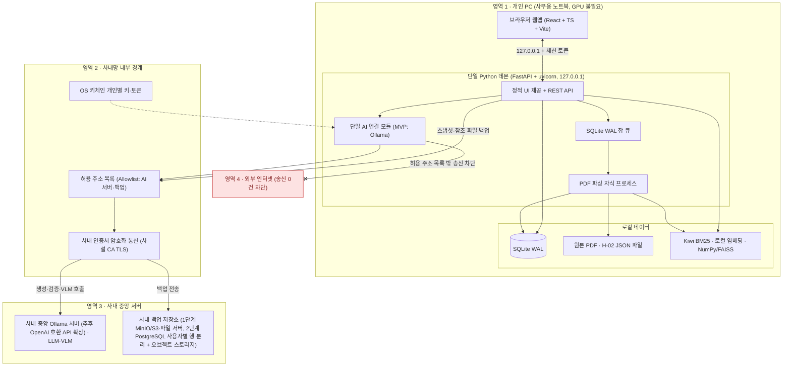
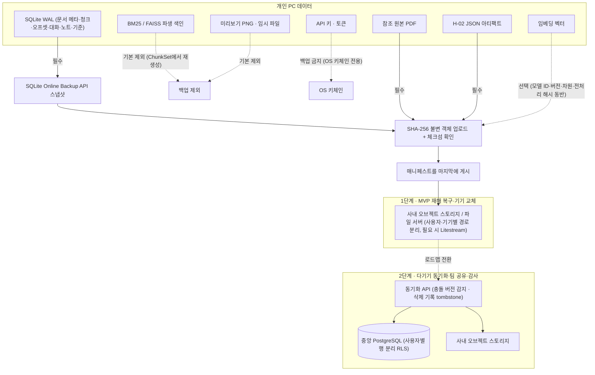
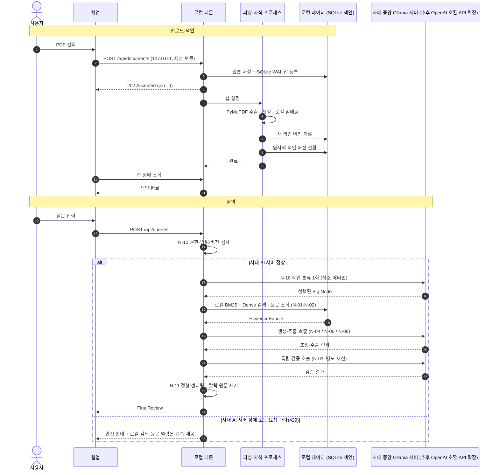

# 로컬 데몬 · 사내망 AI · DB·백업 아키텍처

> **상태:** **실행·배포 아키텍처와 운영 전제 확정(2026-11-28)** — 웹앱 + 개인 PC 초경량 단일 Python 데몬 + 경량 로컬 임베딩 + 사내망 중앙 Ollama 서버(추후 OpenAI 호환 API 확장 가능) + 개인 DB(`SQLite WAL`) & 사내 중앙 백업. **구현은 일시 중단 상태**이며 이 문서는 설계 기준이다. 모델 크기·지연·용량 수치는 2026-11 조사 시점 값이므로 도입 전에 다시 확인한다.
>
> 관련 문서: [아이디어 백로그 §0.1 모델 운용 방침](idea-backlog.md#01-모델-운용-방침-2026-11-24) · [백로그 4.11 모델 실행 경계](idea-backlog.md#411-하네스-모델-실행-경계--로컬-전용-강제-및-개발-클라우드-공개-자료-검증-정책-2026-11-28) · [Query Agent MVP](query-agent-mvp.md) · [문서 처리 파이프라인](document-pipeline.md) · [H-02 아티팩트 저장](artifact-capture.md) · [디자인 가이드](../design/README.md)

## 1. 개요 및 운영 전제 (2026-11-28 확정)

| 항목 | 확정 내용 |
|---|---|
| **UI 방향** | Chrome 확장 중심에서 **로컬 웹앱(`React 19 + TypeScript + Vite`)**으로 전환. [디자인 가이드](../design/README.md)의 Material 3 3열 워크스페이스를 따른다. 추후 필요하면 `Tauri v2`로 감싸 설치형으로 배포할 수 있게 호환을 유지한다 |
| **AI 실행 전제 (MVP 확정)** | **LLM·VLM 추론은 개인 PC가 아니라 사내망 중앙 서버**(기업 자체 오픈웨이트 모델)에서 받아 쓴다. **MVP 1차는 기존 JM/NW 구현과 같은 `Ollama` 호출 방식(`/api/chat`)으로 통일**한다. 제품 배포는 **사내망 중앙 Ollama 서버**, 개발·테스트는 **공개 자료에 한해 Ollama Cloud**를 쓰며, 둘 사이는 **주소·모델명 설정만 바꿔** 전환한다([모델 운용 방침](idea-backlog.md#01-모델-운용-방침-2026-11-24)). `vLLM`·`SGLang` 같은 **OpenAI 호환 API는 추후 확장 시 연결할 호환 대상**으로 둔다. **외부 인터넷 송신은 0건**이다 |
| **로컬 임베딩** | `EmbeddingGemma 2`(텍스트 270M, GGUF/ONNX) 또는 `multilingual-e5-small`(ONNX INT8 118MB)을 **PyTorch 없이** 개인 PC CPU에서 실행한다. 원문 청크 전체를 임베딩하려고 서버로 보내는 전송을 줄인다 |
| **DB 구성** | 개인 PC: **단일 `SQLite WAL` + 파일시스템 + `NumPy`(규모가 커지면 `FAISS`)**. 사내망: **백업용 중앙 저장소/DB**(1단계 스냅샷 → 2단계 중앙 PostgreSQL) |

- **개인 PC는 GPU가 필요 없다.** 사무용 노트북에서 데몬·파싱·BM25·경량 임베딩만 실행하고, 생성·검증·VLM처럼 무거운 추론은 사내 서버가 맡는다.
- **"외부 전송 0건"의 의미(2026-11-28 구체화):** 데이터가 조직 경계 밖 인터넷으로 나가지 않는다는 뜻이다. 승인된 사내망 주소(AI 서버·백업 저장소)만 허용 주소 목록(Allowlist)에 올려 허용한다.

### 1.1 우리 팀 개발 집중 범위 vs 사내 인프라 전제

**우리 팀이 직접 개발·집중하는 핵심 범위 (개인 PC 쪽)**

| # | 구성 요소 | 범위 |
|---|---|---|
| 1 | **로컬 웹앱** | `React 19 + TypeScript + Vite`, Material 3 3열 워크스페이스 · 불필요한 안내 문구를 덜어낸 UI · 근거/원문 바로가기 ([디자인 가이드](../design/README.md)) |
| 2 | **단일 Python 데몬** | `FastAPI + uvicorn`, 정적 UI 서빙 + REST API + `SQLite WAL` 잡 큐 + PDF 파싱 자식 프로세스 + `N-01`~`N-11` / `T-01`~`T-03` 워크플로 ([Query Agent MVP](query-agent-mvp.md)) |
| 3 | **로컬 파싱·경량 색인** | `PyMuPDF` + `Kiwi BM25` + 경량 로컬 임베딩(`EmbeddingGemma 2` / `multilingual-e5-small`) + `NumPy`/`FAISS` ([문서 처리 파이프라인](document-pipeline.md)) |
| 4 | **단일 AI 연결 모듈 (MVP: Ollama)** | 기존 JM Ollama 클라이언트 재사용 · 허용 주소 목록(Allowlist) 강제 · 사내 인증서(사설 CA) 기반 암호화 통신(TLS) · OS 키체인 연동 · 요청 과다(429)·시간 초과·장애 격리. 추후 OpenAI 호환 API 연결 추가 ([§6](#6-보안운영-체크포인트)) |
| 5 | **1단계 스냅샷 백업 클라이언트** | `SQLite Online Backup API` + SHA-256 파일 업로드·복원 절차 ([§3](#3-시각화-2--개인-db--사내-중앙-백업-경계-및-2단계-로드맵)) |

**사내 인프라 전제 범위 (회사가 제공·운영, 우리 팀은 표준 인터페이스로 연동)**

| # | 구성 요소 | 우리 팀이 기대하는 인터페이스 |
|---|---|---|
| 1 | **사내 중앙 Ollama 서버** | 자체 오픈웨이트 LLM/VLM 호스팅, **MVP: Ollama API(`/api/chat`)**. 추후 OpenAI 호환 API(`/v1/chat/completions`, 예: `vLLM`·`SGLang`)로 확장 가능 |
| 2 | **사내 백업 저장소** | 1단계 MinIO/S3 호환 API·파일 서버, 2단계 중앙 PostgreSQL 서버 |
| 3 | **사내 인증·보안 인프라** | 사설 CA 발급, 개인별 API 키/토큰 발급·회수, 외부 인터넷 방화벽 차단 |

- 우리 팀은 사내 인프라를 직접 구축·운영하지 않는다. 연동 지점은 **Ollama API(추후 OpenAI 호환 API), S3 호환 API(또는 파일 경로), 사설 CA 인증서, 발급받은 키/토큰**으로 한정해, 회사 인프라가 바뀌어도 AI 연결 모듈 설정만 바꾸면 되게 한다.
- 개발·테스트 단계에서는 사내 서버 대신 공개 자료에 한해 Ollama Cloud로 같은 AI 연결 모듈을 검증한다(같은 Ollama API라 주소·모델명만 다름).
- Ollama 자체에는 사용자 인증·TLS 기능이 없으므로, 사내 Ollama 서버 앞단의 **사내 프록시(게이트웨이)가 TLS와 개인별 키/토큰 확인**을 맡는 것을 인프라 전제로 둔다.

**후속 확장 (MVP 이후 필요 시)**
- 2단계 중앙 동기화 API · 팀 공유([§3](#3-시각화-2--개인-db--사내-중앙-백업-경계-및-2단계-로드맵))
- 3순위 `Tauri v2` 설치형 셸 · 트레이([§5.5](#55-로컬-데몬-운영-로드맵))

## 2. 시각화 1 — 전체 시스템·네트워크 토폴로지

**읽는 법:** 개인 PC 안에서는 웹앱과 데몬이 `127.0.0.1`로만 통신한다. 데몬 밖으로 나가는 호출은 **단일 AI 연결 모듈(및 백업 경로)을 거쳐 허용 주소 목록(Allowlist)과 사내 인증서 암호화 통신(사설 CA TLS)을 통과한 경우에만** 사내 중앙 서버에 닿는다. 외부 인터넷으로 향하는 호출은 연결 모듈에서 차단한다.

## 3. 시각화 2 — 개인 DB ↔ 사내 중앙 백업 경계 및 2단계 로드맵

| 구분 | 대상 | 규칙 |
|---|---|---|
| **필수 백업** | `SQLite WAL` 스냅샷(문서 메타·청크·오프셋·대화·노트·기준), 참조 원본 PDF, H-02 JSON | SHA-256 이름의 불변 객체로 올리고, 체크섬을 확인한 뒤 **매니페스트를 마지막에 게시**한다. 매니페스트가 없는 업로드는 복원 대상이 아니다 |
| **선택 백업** | 임베딩 벡터 | 모델 ID·버전·차원·전처리 해시를 함께 기록할 때만 복원 가속용으로 쓴다. 조건이 다르면 다시 생성한다 |
| **기본 제외** | BM25/FAISS 파생 색인, 미리보기 PNG·임시 파일 | `ChunkSet`과 원본에서 다시 만들 수 있다 |
| **백업 금지** | API 키·토큰 | **OS 키체인에만** 둔다. DB·파일·백업에 넣지 않는다 |

- **1단계 (MVP 재해 복구·기기 교체):** `SQLite Online Backup API`로 일관된 스냅샷을 만들고, 참조 파일과 함께 사내 오브젝트 스토리지나 파일 서버에 사용자·기기별 경로로 나눠 올린다. 연속 복제가 필요하면 `Litestream`을 검토한다.
- **2단계 (다기기 동기화·팀 공유·감사):** 동기화 API가 중앙 `PostgreSQL`(사용자별 행 분리(RLS): 각 사용자가 자기 데이터 행만 읽고 쓰도록 DB가 강제)과 사내 오브젝트 스토리지를 관리한다. 동시 수정은 버전으로 충돌을 감지하고, 삭제는 삭제 기록(`tombstone`)을 남겨 다른 기기에도 전파한다.

## 4. 시각화 3 — 업로드·색인 및 질의 실행 시퀀스

> 아래 질의 흐름은 [백로그 4.13](idea-backlog.md#413-워크플로-llm-호출실행-복잡도-경량화-2026-11-28)의 경량화(N-11 정형 렌더링 기본화, AI 요약 기본 OFF)를 **적용한 뒤의 목표 흐름**이다. 현재 MVP 계약의 N-11 선택형 AI 요약 호출은 그리지 않았다.

- **업로드·색인:** 무거운 PDF 파싱은 **자식 프로세스**에서 실행해 데몬 본체가 멈추지 않게 한다. 새 색인은 별도 버전으로 다 만든 뒤 **한 번에 전환**해, 색인 도중 질의가 반쯤 만든 색인을 읽지 않게 한다.
- **질의:** 검색·원문 조회는 개인 PC에서 끝나고, 사내 AI 서버에는 **해당 단계에 필요한 질문·근거 문맥만** 전달한다. 호출 수 축소 방향(N-11 AI 요약 기본 OFF, N-03 소배치 고정 등)은 [백로그 4.13](idea-backlog.md#413-워크플로-llm-호출실행-복잡도-경량화-2026-11-28)을 따른다.

## 5. 기술 스택 선정 이유

### 5.1 프론트엔드

| 선택 | 이유 |
|---|---|
| `React 19 + TypeScript + Vite` | 팀이 익숙한 생태계, 빠른 개발 서버, 정적 빌드 결과를 데몬이 그대로 제공 가능. `Tauri v2`가 Vite 프런트엔드를 공식 지원해 추후 설치형 전환이 쉽다 |
| 순수 CSS Variables (M3 토큰) | [디자인 가이드](../design/README.md)의 Material 3 토큰을 변수로 옮겨 쓰고, 무거운 UI 프레임워크 의존을 피한다 |
| PDF 뷰어: 1차 JM PNG 호환 → 2차 `pdf.js` | 1차는 기존 JM 서버의 페이지 PNG 렌더링과 호환해 빠르게 연결하고, 2차에서 `pdf.js`로 텍스트 레이어·정밀 하이라이트([백로그 4.8](idea-backlog.md#48-후속-확장--원문-구절표-셀-정밀-추적-및-원문-바로가기-2026-11-28))를 지원한다 |
| React hooks + 타입 있는 `api.ts` | 별도 상태 관리 라이브러리 없이 시작하고, API 호출은 한 파일의 타입 있는 함수로 모은다 |
| 추후 `Tauri v2` 호환 | 트레이 아이콘·자동 시작·데몬 사이드카 관리가 필요해지면 같은 프런트엔드를 감싼다 |

### 5.2 백엔드

| 선택 | 이유 |
|---|---|
| `FastAPI + uvicorn` | Python 파이프라인(파싱·검색·LangGraph)과 같은 프로세스에서 API를 제공하고 OpenAPI 스키마를 자동 생성한다. **단기 데모는 JM 서버 프록시**로 연결하고, 제품 경계는 FastAPI + **OpenAPI → TypeScript 타입 생성**으로 고정한다 |
| `PyMuPDF` | 빠른 텍스트·좌표 추출. **AGPL 라이선스이므로 배포 형태에 맞는지 확인**하고, 맞지 않으면 대안 `pypdfium2`를 쓴다 |
| `Kiwi + rank_bm25` | 한국어 형태소 기반 BM25를 GPU 없이 가볍게 실행 |
| `LangGraph + Pydantic + Python Decimal` | 고정 워크플로 그래프, `NodeResult` 계약 검증, 정량 비교의 결정적 10진 계산([N-06](small-nodes/N-06.md) · [N-09](small-nodes/N-09.md)) |
| `SQLite WAL + 파일시스템 + NumPy/FAISS` | 설치가 필요 없는 단일 파일 DB, 동시 읽기에 강한 WAL 모드, 개인 문서 규모에서는 NumPy 전수 비교로 충분하고 커지면 FAISS로 교체 |

### 5.3 로컬 임베딩 비교 (조사 시점 수치)

| 모델 | 크기 | 특징 | 용도 |
|---|---|---|---|
| `EmbeddingGemma 2` (텍스트) | 270M | 입력 8,192토큰, Matryoshka 768~128차원, GGUF Q8_0 약 310MB, LiteRT CPU 기준 71.7ms·211MB | 1순위 후보 (긴 청크·차원 축소 유연성) |
| `multilingual-e5-small` | 118M | ONNX INT8 약 118MB, `onnxruntime`(약 16.7MB)만으로 실행해 **PyTorch 제거** | 1순위 후보 (가장 가벼운 설치) |
| `BGE-M3` | 568M | 다국어 고품질, 개인 PC 상시 실행에는 무거움 | **품질 비교 기준용** |

- 두 1순위 후보를 평가셋 Recall@k·지연·메모리로 비교해 기본 모델을 고른다. 선택한 모델 ID·버전·차원·전처리 설정은 `EmbeddingArtifact`에 기록한다([문서 처리 파이프라인](document-pipeline.md#3-출력-및-저장-저장할-데이터)).

### 5.4 DB

| 계층 | 선택 | 역할 |
|---|---|---|
| 개인 PC | `SQLite WAL` | 문서 메타·청크·오프셋·대화·노트·기준·잡 큐의 정본 |
| 개인 PC | 파일시스템 | 원본 PDF, H-02 JSON, 미리보기 PNG |
| 개인 PC | `NumPy` → `FAISS` | 벡터 검색(규모에 따라 교체) |
| 사내망 1단계 | MinIO/S3 호환 오브젝트 스토리지 또는 파일 서버 | 스냅샷·참조 파일 백업 |
| 사내망 2단계 | 중앙 `PostgreSQL`(사용자별 행 분리(RLS)) + 오브젝트 스토리지 | 다기기 동기화·팀 공유·감사 |

### 5.5 로컬 데몬 운영 로드맵

| 순위 | 형태 | 설명 |
|---|---|---|
| 1순위 | **단일 Python 데몬** | `127.0.0.1`에서 정적 UI + API + 잡 큐를 한 프로세스로 실행. 파싱만 자식 프로세스 |
| 2순위 | OS 네이티브 자동 시작 | Windows `Task Scheduler`, macOS `launchd`, Linux `systemd --user`로 로그인 시 시작 |
| 3순위 | `Tauri v2` 트레이/설치형 셸 | 데몬을 사이드카로 관리하고 설치·업데이트를 제공 |

*Docker Compose는 개발·재현 환경 전용이며 사용자 PC 배포 형태로 쓰지 않는다.*

## 6. 보안·운영 체크포인트

| 항목 | 기준 |
|---|---|
| **단일 AI 연결 모듈 · 허용 주소 목록(Allowlist)** | 모든 LLM·VLM 호출은 **단일 AI 연결 모듈 하나를 거치고, 이 모듈이 허용 주소 목록을 강제**한다. **제품 프로필의 연결 모듈은 승인된 사내 Ollama 서버만, 백업 경로는 승인된 사내 저장소만 허용한다. 개발·테스트 프로필은 공개 자료에 한해 Ollama Cloud를 허용한다.** JM의 기존 Ollama 클라이언트(`base_url` 전환 가능)는 그대로 살려 이 모듈의 기본 구현으로 쓰고, **코드에 고정된 주소(특히 NW의 `ollama.com` 직접 호출)는 설정으로 분리**해 모든 호출이 이 모듈을 거치도록 정리한다. OpenAI 호환 API 연결은 추후 같은 모듈에 추가한다([백로그 4.11](idea-backlog.md#411-하네스-모델-실행-경계--로컬-전용-강제-및-개발-클라우드-공개-자료-검증-정책-2026-11-28)) |
| **사설 CA TLS** | 사내 AI 서버·백업 저장소와는 사내 사설 CA로 검증한 TLS로만 통신한다 |
| **OS 키체인** | 개인별 API 키·토큰은 `keyring`(Windows Credential Manager, macOS Keychain 등)에만 저장한다 |
| **로컬 API 보호** | `127.0.0.1`에만 바인딩하고, `Host`/`Origin` 헤더 검사와 세션 토큰(Bearer)으로 다른 웹사이트·프로세스의 접근을 막는다 |
| **장애 격리** | 사내 AI 서버의 요청 과다(`429`) 응답은 재시도 대기 시간(`Retry-After`)을 따르고, 호출마다 타임아웃을 둔다. **AI 서버가 멈춰도 로컬 검색(BM25·로컬 임베딩 Dense)·원문 열람은 계속 동작**한다 |
| **저장 암호화** | 개인 PC는 BitLocker/FileVault 전체 디스크 암호화를 기본으로 하고, 필요하면 `SQLCipher`로 DB를 추가 암호화한다 |
| **퇴사·권한 회수** | 퇴사·이동 시 키·토큰을 회수하고 중앙 백업은 보존 정책에 따라 보관·삭제한다 |

> **설계 근거 주석 (참고 문헌·실무 기준)**
> - **경량 로컬 임베딩:** *Google EmbeddingGemma 2* (2026) 모델 카드와 *intfloat/multilingual-e5-small* 모델 카드의 크기·차원·입력 길이, *ONNX Runtime*의 CPU 추론·INT8 양자화 문서를 근거로 PyTorch 없는 CPU 실행 구성을 잡았다.
> - **사내 추론 서버 (MVP: Ollama, 추후 OpenAI 호환):** *Ollama API* 문서의 `/api/chat`을 MVP 기준으로 삼아 주소·모델명만 바꿔 사내 Ollama 서버와 개발용 Ollama Cloud를 오가게 한다. 추후 확장 대상은 *vLLM / SGLang OpenAI-Compatible Server* 문서의 `/v1/chat/completions` 호환 엔드포인트다.
> - **개인 DB와 백업:** *SQLite Write-Ahead Logging* 및 *Online Backup API* 문서에 따라 WAL 모드로 동시 읽기를 유지하면서 실행 중에도 일관된 스냅샷을 만든다. 2단계 사용자별 행 격리는 *PostgreSQL Row Security Policies*를 따른다.
> - **경계·인증·장애 처리:** 네트워크 위치만으로 신뢰하지 않고 요청마다 인증·허용 목록을 확인하는 *NIST SP 800-207* (Zero Trust Architecture), 로컬 API 세션 토큰 전달의 *RFC 6750* (Bearer Token), 요청 과다 응답(`429`)의 *RFC 6585*를 참고했다.
> - **설치형 확장:** *Tauri v2* 공식 문서의 Sidecar(외부 바이너리 관리)와 Vite 프런트엔드 통합 가이드를 3순위 운영 형태의 근거로 삼았다.

[아이디어 백로그](idea-backlog.md) · [Query Agent MVP](query-agent-mvp.md) · [문서 처리 파이프라인](document-pipeline.md) · [설계 취약점 정리](design-risks-and-mitigations.md)
