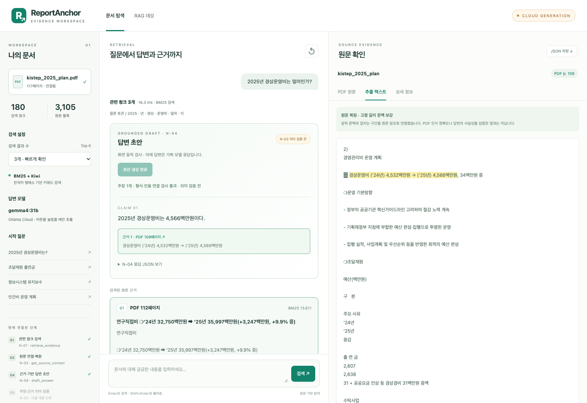

# N-04 · 원문 근거 기반 답변 초안 생성

N-04는 **사용자의 원래 질문과 N-02의 `EvidenceBundle`**을 받아, 주장별 인용을 포함한 `ReviewDraft`를 생성하는 Small Node이다. 로컬 Ollama와 Ollama Cloud를 선택할 수 있다. 이 문서는 JM 브랜치의 현재 구현 설명이며, 팀 공통 최종 계약 확정을 대신하지 않는다.

## 1. 파이프라인에서의 위치

```text
N-01 retrieve_evidence     관련 청크 후보 검색
          ↓
N-02 get_source_context   원본 블록 연결·문맥 보강 → EvidenceBundle
          ↓
N-04 draft_answer         모델 호출 → JSON·인용 연결 검사 → ReviewDraft
          ↓
N-03 verify_grounding     주장·근거의 의미 및 수치 정합성 검증 [미구현]
```

**N-04의 `success`는 실행·형식·인용 연결 검사를 통과했다는 뜻이다.** 인용문의 존재만으로 주장의 사실성, 표의 행·열 관계, 연도·단위 해석이 검증되지는 않는다. 웹 화면도 결과를 ‘답변 초안 / N-03 의미 검증 전’으로 표시한다.

## 2. 입력과 출력

| 구분 | 데이터 | 목적 |
| --- | --- | --- |
| 입력 | `question: str` | 검색 키워드가 아닌 사용자의 원래 질문 |
| 입력 | `EvidenceBundle` | N-02가 확보한 원문·근거 ID·문서 버전·페이지·원문 위치 |
| 출력 | `NodeResult[ReviewDraft]` | 초안과 처리 상태·단계별 진단 |

`EvidenceBundle`에 질문 자체는 포함되어 있지 않으므로 별도 인자로 전달한다. 모델에는 근거별 `evidence_id`, `pdf_pages`, `text`, `verification_status`를 전달하고, 원본 위치·블록 구간은 기존 근거 묶음에 보존한다.

```python
node = DraftAnswerNode(
    model="gemma4:31b",
    base_url="https://ollama.com",
    provider="cloud",
    api_key=os.environ["OLLAMA_API_KEY"],
)
result = node.run(question, evidence_bundle)
```

모델이 생성하는 JSON 구조는 다음과 같다. 아래 값은 형식 설명용 예시이다.

```json
{
  "claims": [
    {
      "text": "2025년 경상운영비는 4,566백만원이다.",
      "citations": [
        {
          "evidence_id": "evidence_demo_001",
          "quote": "2025년 경상운영비는 4,566백만원"
        }
      ]
    }
  ],
  "missing_information": []
}
```

Python은 검사 후 `claim_id`를 부여하고, 원래 `request_ref`와 질문을 함께 `ReviewDraft`로 구성한다. 모델이 요청 ID나 질문을 다시 작성하도록 맡기지 않는다.

## 3. 코드 구성

| 위치 | 역할 |
| --- | --- |
| [`rag/contracts.py`](../rag/contracts.py) | `DraftCitation`, `DraftClaim`, `ReviewDraft`, 공통 결과 계약 |
| [`rag/nodes/draft_answer.py`](../rag/nodes/draft_answer.py) | `DraftAnswerNode`, 근거 파일 복원, CLI |
| [`scripts/run_rag_demo.py`](../scripts/run_rag_demo.py) | 기존 검색·N-02와 N-04를 로컬 웹 API에 연결 |
| [`demo/`](../demo/) | 답변 초안, 인용 이동, 원문 표시, JSON 다운로드 |
| [`tests/test_draft_answer.py`](../tests/test_draft_answer.py) | 초안·오류 처리·JSON 파일·CLI 검사 |
| [`tests/test_rag_demo.py`](../tests/test_rag_demo.py) | 검색·생성 분리, 서버 근거 재사용, 캐시·실패 처리 검사 |

`DraftAnswerNode`의 메서드는 다음 순서로 동작한다.

1. `run()`: 질문·근거·모델 설정을 확인하고 각 단계의 결과와 오류를 공통 형식으로 반환한다.
2. `_prepare_evidence()`: 모델에게 필요한 근거 필드만 선택한다. 원문 텍스트는 수정하지 않는다.
3. `_build_prompt()`: 근거 한정 답변, 수치·단위 보존, 원문 인용, 부족 정보, JSON 출력 규칙을 구성한다.
4. `_call_ollama()`: `/api/chat`에 `stream: false`로 요청하고 `message.content` 문자열을 반환한다.
5. `_parse_and_validate_draft()`: JSON 구조·자료형, 비어 있지 않은 주장·인용, 근거 ID 존재, 해당 원문의 연속 구간과 인용문 일치를 확인한다.

유효하지 않은 응답을 빈 성공 결과로 바꾸거나 인용문을 임의로 정규화하지 않는다. 숫자 의미·단위·연도 관계를 판정하는 기능은 N-03에 남아 있다. 자동 재시도·자동 로컬/클라우드 전환은 수행하지 않는다.

## 4. 로컬과 클라우드

| 설정 | 로컬 | 클라우드 |
| --- | --- | --- |
| `--provider` | `local` | `cloud` |
| 기본 서버 | `http://localhost:11434` | `https://ollama.com` |
| 모델 | 다운로드한 로컬 모델 | 클라우드 API가 제공하는 정확한 모델명 |
| API 키 | 사용하지 않음 | 서버 환경변수 `OLLAMA_API_KEY` |
| 준비 | Ollama 서버 실행 | 유효한 키와 네트워크 연결 |
| 자료 처리 | 로컬 모델에 질문·근거 전달 | 질문과 선택된 N-02 근거 텍스트를 외부로 전송 |

`.env` 파일을 자동으로 읽지는 않는다. 키는 서버를 시작하는 셸에 환경변수로 설정하며, 브라우저에 입력하거나 소스·로그·응답 JSON에 넣지 않는다. 클라우드의 모델 목록과 API용 이름은 [공식 안내](https://docs.ollama.com/cloud)에서 확인한다.

현재 [공식 문서](https://docs.ollama.com/capabilities/structured-outputs)는 클라우드 structured outputs 미지원을 명시한다. 현재 구현은 공통 프롬프트로 JSON 출력을 요청하고 Python에서 검사한다. 모델 응답의 형식 준수가 보장되는 것은 아니다.

## 5. CLI 실행

저장소 루트에서 실행한다. 데이터는 저장소에 포함하지 않으므로 먼저 본인의 추출·청킹 결과 경로를 지정한다. 다음 예시는 현재 KISTEP 문서를 기준으로 한다.

```bash
mkdir -p outputs
python -B -m rag.nodes.retrieve_evidence \
  --chunks data/processed/rag/kistep_2025_plan_0530d100e085/3382f591c928/chunks.jsonl \
  --query "2025년 경상운영비는 얼마인가?" --top-k 3 \
  > outputs/n01_draft_demo.json

python -B -m rag.nodes.get_source_context \
  --chunks data/processed/rag/kistep_2025_plan_0530d100e085/3382f591c928/chunks.jsonl \
  --blocks data/processed/pymupdf_demo/kistep_2025_plan_0530d100e085/blocks.jsonl \
  --retrieval-result outputs/n01_draft_demo.json \
  > outputs/n02_draft_demo.json

python -B -m rag.nodes.draft_answer \
  --provider cloud --model "gemma4:31b" \
  --query "2025년 경상운영비는 얼마인가?" \
  --evidence-bundle outputs/n02_draft_demo.json
```

각 단계의 `status`를 확인한 뒤 다음 명령으로 진행한다. 로컬 실행은 마지막 명령에서 `--provider local --model "설치한_로컬_모델명"`으로 변경한다. `--timeout` 기본값은 통신 작업의 120초 제한이며, 전체 워크플로의 총 소요 시간 상한을 뜻하지 않는다.

`--evidence-bundle`은 N-02의 성공·부분 성공 `NodeResult` JSON 또는 순수 `EvidenceBundle` JSON을 받는다. 중첩된 원문 구간·검색 청크 연결도 계약 객체로 복원한다. 파일 내용을 실제 PDF와 다시 대조하는 기능은 아니다. CLI는 결과 JSON을 출력하며 실행 오류 시 종료 코드 2를 반환한다.

## 6. 웹에서 사용

기존 데모 명령에 모델 옵션을 추가한다.

```bash
python scripts/run_rag_demo.py \
  --chunks data/processed/rag/kistep_2025_plan_0530d100e085/3382f591c928/chunks.jsonl \
  --blocks data/processed/pymupdf_demo/kistep_2025_plan_0530d100e085/blocks.jsonl \
  --pdf data/raw/kistep_2025_plan.pdf \
  --provider cloud --model "gemma4:31b"
```

1. <http://127.0.0.1:8765>에서 질문을 검색한다. 검색만으로는 모델을 호출하지 않는다.
2. 검색 결과와 실행 모드를 확인한 뒤 **근거로 답변 생성**을 누른다.
3. 주장과 인용문을 확인한다. 인용을 누르면 대응 원문으로 이동하고 인용 구간이 강조된다.
4. PDF 탭에서 원문을 대조한다. PDF의 초록 표시는 인용문 문자 단위가 아닌 검색 청크의 참조 블록 전체이다.
5. N-04 응답 JSON을 펼치거나 **JSON 저장**으로 N-01·N-02·N-04 결과를 함께 다운로드한다.

웹의 `/api/draft`는 브라우저가 보낸 원문이 아니라 `request_ref`로 서버에 보관된 원래 질문과 N-02 객체를 찾아 사용한다. 최근 검색 16개를 메모리에 보관하며, 같은 검색의 성공한 초안은 재사용한다. 서버 재시작·검색 만료 후에는 다시 검색해야 한다. 생성 오류가 나도 검색된 근거는 유지한다.

`--model`을 생략하면 기존 검색·원문 조회 모드이다. 클라우드를 선택해도 키는 서버에만 있고, 브라우저의 통신 대상은 로컬 웹 서버이다. 이는 서버가 클라우드로 데이터를 전송하지 않는다는 뜻이 아니다.



화면 검사용 캡처이다. 실제 KISTEP 검색·원문에 **가짜 모델 응답**을 연결했으며 화면에도 이를 표시했다.

## 7. 검증 범위와 남은 작업

2026-11-03 사용자 제공 실제 실행에서는 `gemma4:31b`가 KISTEP 근거 3개로 경상운영비 **4,566백만원**을 답했고, 주장 1개와 원문 인용 3개가 N-04 검사를 통과했다. 이는 한 질문의 실제 실행 확인이며 전체 생성 정확도 평가가 아니다.

Python 자동 검사 83개와 브라우저·API 검사 32개를 통과했다. 코드 자동 검사와 웹 검사는 별도로 수행한다. 웹 검사는 실제 KISTEP 검색·원문과 **가짜 모델 응답**을 사용하며, 새 클라우드 추론 결과를 측정한 실험은 아니다. 검사 항목과 수치는 [N-04 검사 기록](reports/n04-validation.json)에 기록한다.

- [x] 질문·근거 입력 검사와 `ReviewDraft` 반환
- [x] 로컬·클라우드 선택, API 인증, 통신·응답 오류 구분
- [x] JSON 구조·근거 ID·원문 인용 존재 검사
- [x] 근거 부족 시 답변 보류와 모델 호출 생략
- [x] N-02 결과 파일을 읽는 CLI와 웹 생성·인용 이동
- [ ] N-03의 주장·근거 의미 및 수치 정합성 검증
- [ ] 여러 질문·문서에서 생성 품질과 인용 적절성 평가
- [ ] 로컬 모델별 성능·지연·JSON 준수율 비교
- [ ] 팀 하네스와 최종 공통 계약 통합
