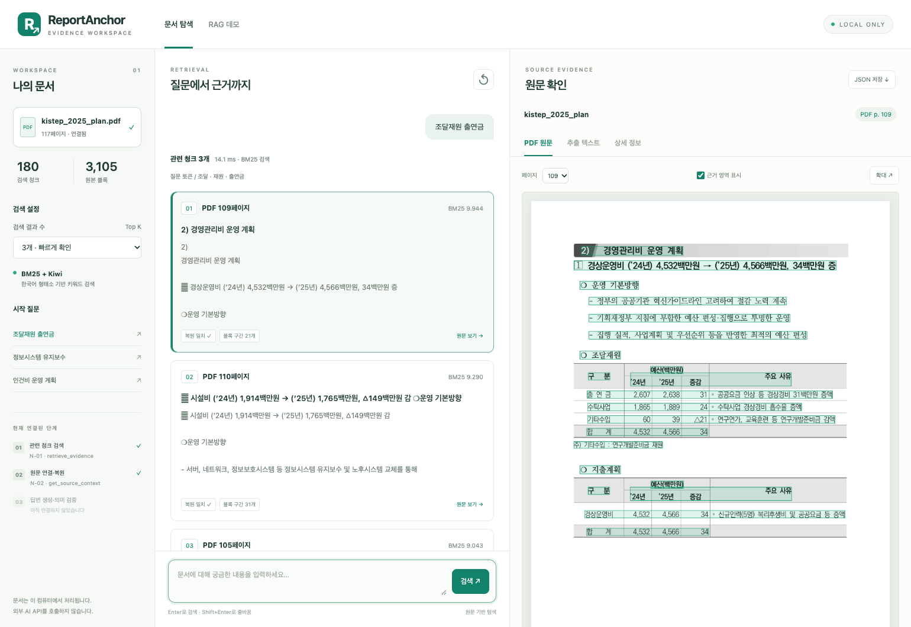

# ReportAnchor 로컬 RAG 데모

Kotaemon의 문서 / 검색 / 원문 패널 구성을 참고한 독립적인 데모 화면이다.
Kotaemon을 설치하거나 그 검색 파이프라인으로 교체하지 않는다.

## 실행

저장소 루트에서 실행한다. 서버가 준비되면 브라우저에서
<http://127.0.0.1:8765>를 연다. 종료는 실행 터미널에서 `Ctrl+C`이다.

```bash
cd "/Users/ijeongmin/ai_study/Personal_project/Report Agent"

/Users/ijeongmin/.pyenv/versions/3.11.9/bin/python scripts/run_rag_demo.py \
  --chunks "data/processed/rag/kistep_2025_plan_0530d100e085/3382f591c928/chunks.jsonl" \
  --blocks "data/processed/pymupdf_demo/kistep_2025_plan_0530d100e085/blocks.jsonl" \
  --pdf "data/raw/kistep_2025_plan.pdf"
```

다른 컴퓨터에서는 위 Python 경로 대신 해당 환경의 `python`을 사용한다.
검색 환경에는 `kiwipiepy`, `rank-bm25`가 필요하다. 기존 실행 환경을 그대로
사용하면 추가 설치가 필요 없다. PDF 렌더링은 현재 Python에 PyMuPDF가 있으면
그 환경을 사용하고, 없으면 프로젝트 `.venv/bin/python`을 사용한다.
다른 환경을 쓰려면 `--pdf-python /path/to/python`을 추가한다.
PDF 미리보기가 필요 없다면 `--pdf`를 생략할 수 있다.
포트가 사용 중이면 `--port 8767`처럼 변경한다.

## 확인할 수 있는 것

1. 왼쪽 시작 질문을 누르거나 가운데 입력창에서 검색한다.
2. 관련 청크의 순위·BM25 점수·페이지·복원 상태를 확인한다.
3. 청크 카드를 누르면 오른쪽 PDF에 참조 블록이 표시된다.
4. `추출 텍스트`에서는 앞뒤 문맥을 포함한 원문과 원본 블록의 문자 구간을 본다.
5. `상세 정보`에서는 문서 버전, 문맥 길이·근거 ID, N-01 및 N-02 응답 JSON을 확인한다.
6. 모델 옵션이 있으면 **근거로 답변 생성**을 눌러 N-04 초안을 확인한다. 인용을 누르면 원문 텍스트로 이동하고 해당 구간을 강조한다.
7. `JSON 저장`은 검색 응답·연결된 원문·생성한 N-04 결과를 다운로드한다. 서버에는 기록을 저장하지 않는다.

빈 질문은 기존 N-01의 `INVALID_SEARCH_TEXT` 오류를 보여 준다.
검색 결과가 없다는 사실은 해당 정보가 문서에 없다는 증거가 아니다.
브라우저의 검색 기록은 현재 탭의 메모리에만 있으며 새로고침하면 사라진다.

## 기존 코드와 연결

```text
demo/index.html + app.js + style.css
                 ↓ 로컬 HTTP 요청
scripts/run_rag_demo.py
  ├─ BM25Retriever: 시작 시 한 번 생성, 여러 검색에서 재사용
  ├─ N-01 retrieve_evidence: 기존 계약 형식으로 검색 결과 반환
  ├─ N-02 get_source_context → NodeResult[EvidenceBundle]
  ├─ N-04 DraftAnswerNode: 생성 버튼을 눌렀을 때 원문 근거로 초안 작성
  └─ scripts/render_rag_preview.py: PyMuPDF로 한 페이지 PNG 렌더링
```

시작 시 전체 청크를 원본 블록으로 복원해 일치를 검사한다.
PDF를 지정하면 SHA-256이 청크의 문서 버전과 같은지도 확인한다.
서버는 한 문서·한 버전의 데이터만 받으며, `127.0.0.1`에만 연결된다.
N-02의 고정 길이 문맥 확장·겹침 병합·전체 문자 예산을 연결했다. 선택형 N-04 답변 생성을 연결했으며, 파일 업로드·문서 전환·N-03 의미 검증은 아직 포함하지 않았다.
FastAPI 등 실제 서비스의 프론트/백엔드 구성을 대신하는 최종 제품은 아니다.

## 해석 시 주의점

- `복원 일치`는 저장된 블록 구간을 연결했을 때 청크 텍스트와 같다는 뜻이다.
  PDF 인식의 정확성이나 표의 행·열 관계를 검증한 것은 아니다.
- PDF의 초록 표시는 원래 검색 청크가 참조한 블록 전체의 bbox이다. 추가 문맥은 추출 텍스트 탭에 표시한다. 일부 문자 구간을 사용해도
  블록 전체가 표시되며, 지원하지 않는 좌표계는 강조하지 않는다.
- 표시 페이지는 PDF 물리 페이지이다. 인쇄된 쪽번호와 다를 수 있다.
- BM25 점수는 순위 산정용이다. 정확도·신뢰도·확률이 아니다.
- 미리보기 결과는 프로세스 메모리에 최대 24개 캐시하며 원본 PDF를 변경하지 않는다.
- 검색 전용 모드에서는 외부 AI 모델이나 CDN을 호출하지 않는다. 클라우드 생성 모드는 버튼을 눌렀을 때 서버가 질문·선택된 원문 근거를 Ollama Cloud로 전송한다. 실제 사내 보안 서비스 수준의
  인증·사용자별 접근 통제를 구현한 것은 아니다.

## 원문 대조 예시와 검사 기록

`조달재원 출연금`을 Top K=3으로 검색하면 현재 데이터에서는 PDF 109·110·105페이지가 차례로 나온다. 첫 결과를 선택한 뒤 다음 순서로 확인한다.

1. `PDF 원문`의 페이지가 109인지, 초록색 참조 영역이 해당 본문·표와 대응되는지 확인한다.
2. `추출 텍스트`에서 출연금 행의 2024년 2,607 / 2025년 2,638 / 증감 31백만원을 PDF와 대조한다.
3. `상세 정보`의 청크·문서·버전을 확인하고 N-01 JSON의 순위·점수와 비교한다.
4. 다른 결과를 선택해 페이지 전환을 확인하고, 필요한 경우 `JSON 저장`으로 원문을 포함한 결과를 내려받는다.



2026-11-02 수행 기록 기준으로 웹·API 26개 검사와 기존 BM25·공통 계약 테스트 12개가 통과한 상태이다. [검사 항목 JSON](reports/rag-demo-ui-checks.json)과 [검색 모듈 README의 결과·잔여 노드](../rag/retrieval/README.md#9-웹-데모에서-검색-결과와-원문-확인)에 상세 범위를 기록했다. 이는 기능·원문 연결 검사이며 검색 정확도나 생성 답변의 사실성 검증 결과는 아니다.

참고 UI: <https://github.com/Cinnamon/kotaemon>

N-02의 설정·범위·병합·예산 정책과 실행 순서는 [N-02 안내](n02-source-context.md)에 있다. 새 노드·웹 연결에 대한 [추가 검증 기록](reports/n02-validation.json)도 별도로 보존한다.

## N-04 답변 생성 활성화

위 실행 명령에 `--provider local --model "설치한_로컬_모델명"`을 추가한다. Ollama 서버가 실행 중이어야 한다. 클라우드는 서버를 실행하는 셸에 `OLLAMA_API_KEY`를 설정하고 `--provider cloud --model "gemma4:31b"`를 추가한다. `.env` 파일은 자동으로 읽지 않는다.

검색 후 생성 버튼을 눌러야 모델을 호출하며, 같은 검색의 성공한 결과는 재사용한다. N-04 오류가 나도 검색 근거를 계속 확인할 수 있다. 원문 인용 존재 검사와 N-03 의미 검증은 구분한다.

[입출력·오류·CLI·웹 동작을 정리한 N-04 설명](n04-draft-answer.md)과 [새 검사 기록](reports/n04-validation.json)을 참고한다.
