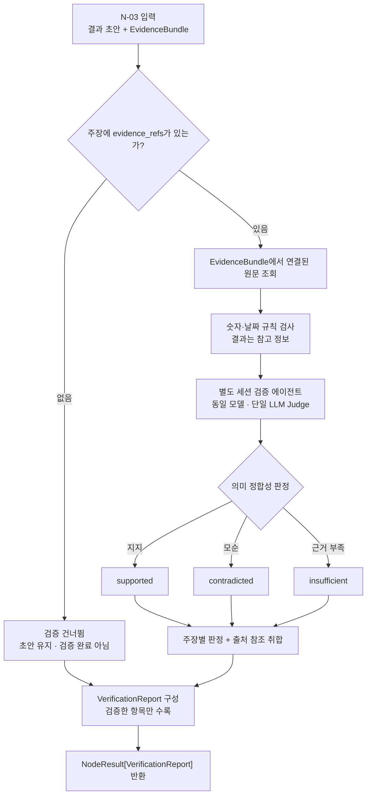
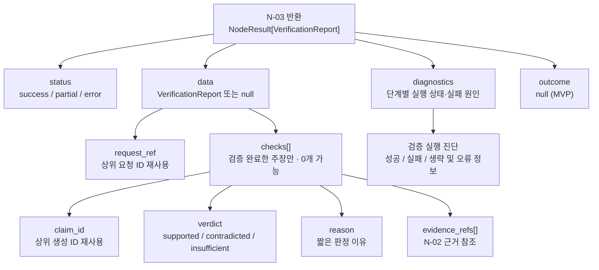

# N-03 · verify_grounding — 근거 정합성 검증

> **상태:** **MVP 개념 설계 완료(2026-11-03)** — 검증 범위·입출력·ID 재사용·실행 상태·출력 구조도 확정. 판정은 **동일 모델의 별도 세션 검증 에이전트가 수행하는 단일 LLM Judge**가 하고, 숫자·날짜 규칙 검사 결과는 참고 정보로 전달한다. Python 스키마·모델명·실제 구현/테스트는 미완료.

## 1. 단일 책임

주장·판정·비교 결과와 원문 근거의 정합성 검사.

## 2. 최소 입출력 (개념 수준)

| 구분 | 현재 등록된 내용 |
|---|---|
| 입력 | **상위에서 생성한 `request_ref`**, 결과 초안(검증 대상별 `claim_id`, `claim_text`, 연결된 `evidence_refs[]`), N-02의 `EvidenceBundle`, 검증 설정(세부 필드 미정) |
| 출력 | `NodeResult[VerificationReport]` (공통 `status`, `data`, `diagnostics`, `outcome` 적용). `VerificationReport`는 상위 `request_ref`와 검증된 주장별 기존 `claim_id`를 그대로 보존 |

### 상위 ID 재사용 및 추적 규칙 (MVP 확정)

| 식별자 | 생성·관리 주체 | N-03의 처리 |
|---|---|---|
| `request_ref` | 사용자 요청 접수/라우팅 등 **상위 실행 계층**에서 생성·전달 | **그대로 입력받아 `VerificationReport`에 반환**. N-02 `EvidenceBundle.request_ref`와 일치하는지 확인 |
| `claim_id` | N-04(답변), N-06(기준 판정), N-09(비교 결과) 등 **초안/판정 생성 노드**가 검증 대상별로 부여 | 원래 값을 그대로 입력받아 주장별 결과에 반환. **N-03 검증 순서로 새 `claim_001`, `claim_002`를 발급하지 않음** |
| `evidence_refs[]` | 초안/판정 생성 단계에서 연결한 근거 참조 | 값은 `chunk_id`. 연결된 `EvidenceBundle` 항목을 조회하여 검증. 원문 위치·문서 버전 정보는 N-02의 출처 참조 재사용 |
| `run_id` | 하네스 실행·H-02 기록 계층의 실행 식별자 | N-03이 새로 생성하지 않음. 같은 요청을 여러 번 실행한 기록은 **실행 메타데이터의 `run_id`**와 함께 구별 |

- `claim_id`는 적어도 **같은 요청의 초안/판정 집합 안에서 유일**해야 한다. `claim_001` 같은 순번도 생성 노드가 부여하는 건 괜찮지만, **검증 순서·검증 생략 여부 때문에 번호를 다시 매기지 않는다**.
- `request_ref`와 `EvidenceBundle.request_ref`가 불일치하거나, 검증 대상으로 전달된 `claim_id`가 누락·중복되어 대조할 수 없다면 **검증 결과를 임의로 다른 주장에 연결하지 않고 입력 무결성 오류**로 취급한다. 구체 진단 코드는 추후 정한다.
- 사용자 **원본 질의 텍스트는 `request_ref`에 연결된 상위 요청 기록에서 조회**한다. 식별자만으로 문장을 복원할 수는 없으므로 하네스/요청 저장소는 해당 연결 관계를 보존해야 한다.
- H-02의 `run_id` 및 초안 아티팩트 참조는 **실행 간 비교**에 사용한다. N-03 입력·출력에 원본 질문 전문이나 새 ID를 불필요하게 복제하지 않는다.

## 3. MVP 검증 범위 (확정)

**N-03은 결과 초안의 개별 주장·판정·비교 항목 중 명시적인 근거 참조가 연결된 항목만 검증한다.** 원문 위치와 내용은 N-02의 `EvidenceBundle`에서 참조 ID를 통해 가져온다. 검증 노드가 원문 위치를 새로 탐색하거나 근거를 자동 할당하지 않는다.

| 입력 주장/문장 상태 | MVP 처리 |
|---|---|
| `evidence_refs[]`가 있는 주장 | 연결된 `EvidenceBundle`의 원문과 대조하는 **검증 대상** |
| **`evidence_refs[]`가 없거나 빈 주장·문장** | **검증 단계에서 건너뜀**. 근거를 추가 검색하지 않고, 자동으로 `insufficient` 등 검증 판정을 부여하지 않음 |
| 근거 없는 문장이 초안에 포함됨 | 원문 초안에서 **삭제·수정하지 않고 그대로 유지**. 단, **검증 완료·`supported`로 간주하지 않음** |

- 이 건너뜀은 **의도적인 MVP 범위 제한**이다. 실행 오류나 검증 실패를 뜻하지 않으므로 이 사실만으로 `NodeResult.status=partial`로 바꾸지 않는다.
- **검증하지 않은 문장까지 검증 완료로 집계하지 않는다.** 다만 MVP의 `VerificationReport`에는 **`skipped_count`를 두지 않는다**. 필요하면 상위 초안의 `evidence_refs[]`와 검증 결과를 대조해 별도로 계산한다.
- N-04(답변), N-06(기준 판정), N-09(비교 결과) 등 생성 노드는 자신이 제시한 주장과 근거 참조를 연결할 수 있다. **참조가 없는 주장까지 N-03이 보완하는 기능은 MVP 범위 밖**이다.
- N-03의 결과가 `success`여도 이는 **실제로 검증을 수행한 대상의 작업이 정상 종료**됐다는 의미이지, 결과 초안의 모든 문장이 검증됐다는 보증은 아니다. 후속 출력 단계에서 이 경계를 유지한다.

## 4. MVP 검증 방식 (확정)

### 4.1 검증 단계의 역할

- **숫자·날짜 (2026-11-05 결정):** 주장의 숫자·날짜가 연결된 근거에 그대로 있는지 **규칙으로 확인해 LLM에 참고 정보로 전달**한다. 근거에 그대로 없다는 것만으로 불일치로 보지 않는다. 합계·증감처럼 근거 값에서 계산한 값일 수 있기 때문이다. 계산값이 맞는지는 LLM이 판단하고, 그 내용을 `reason`에 남긴다.
- **문장 의미:** 원문 표현과 주장 표현이 다르거나 함의·인과관계 등을 따져야 할 때 **LLM-as-a-Judge 방식으로 주장별 단일 의미 판정**을 수행한다.
- **근거 입력 제한:** LLM은 해당 주장의 `claim_id`, `claim_text`, 연결된 `evidence_refs[]` 및 그 참조에 해당하는 `EvidenceBundle` 원문 문맥만 판단 근거로 사용한다. 추가 검색·무관한 문서 조회·근거 자동 보강은 수행하지 않는다.
- **판정값(개념):** `supported`(원문이 지지), `contradicted`(원문과 모순), `insufficient`(판정에 필요한 근거가 부족). 참조가 **있지만** 근거가 불충분한 경우의 `insufficient`는 **근거 참조가 아예 없어 건너뛰는 경우**와 구별한다.
- **판정 주체:** 모든 검증 대상 주장은 LLM 판정을 거치며 최종 판정은 LLM이 한다. 계산 오류는 구현 후 테스트에서 측정하고, 많으면 공통 계산 기능을 N-03에도 쓰도록 넓힌다. 오류 상태 코드는 구현 시 정의한다.
- **단일 판단:** 각 검증 대상 주장은 기본적으로 **한 번의 LLM 의미 판정**을 사용한다. 다중 모델 투표·반복 자기검증·재탐색을 MVP에 넣지 않는다. 호출 단위(주장별 단독 호출/여러 주장 묶음)는 추후 성능·비용 실험에서 정한다.

### 4.2 별도 세션 검증 에이전트 (확정)

**MVP에서 N-03 내부의 전용 검증 에이전트는 답변·판정 생성 노드와 같은 기반 LLM 모델을 사용하되, 생성 과정과 분리된 별도 세션/대화 컨텍스트에서 동작한다.**

- 검증 에이전트에는 **검증 전용 시스템 지침과 입력**(주장·연결된 원문 근거·필요한 검증 설정)만 제공한다. 생성 에이전트의 대화 기록·이전 추론 과정·자기평가를 그대로 전달하지 않는다.
- **별도 검증 세션은 새로운 LangGraph Small Node를 뜻하지 않는다.** N-03은 한 개의 Small Node이며 내부에 검증 모델 호출/어댑터를 둔다.
- 같은 모델을 사용하므로 세션을 분리하더라도 **독립 모델에 의한 교차 검증을 수행한 것과 같지 않고**, 편향이나 오류가 반복될 수 있다.
- 로컬 모델을 기본으로 사용하며, 검증 모델의 실제 이름·프롬프트·세션 수명·실패 시 처리 정책은 구현·평가 과정에서 결정한다.

### 4.3 실행 플로우차트 (MVP)

아래 그림의 박스는 **N-03 단일 Small Node 내부의 처리 단계**이며 새로운 Tiny Node나 Big Node 조건부 엣지가 아니다.



**상태 주의:** `NodeResult.status=success`는 검증 노드가 정상 실행됐다는 의미이지, 모든 문장의 사실성 보증이나 모든 주장 `supported`를 뜻하지 않는다. 또한 근거 없는 주장을 의도적으로 건너뛰었다는 사실만으로 `partial`이 되지 않는다. LLM 호출 실패·일부 판정 실패의 `partial/error` 처리는 [6절](#6-예외-상황-및-실행-상태-mvp-원칙-확정)을 따른다.

## 5. 출력 계약: `NodeResult[VerificationReport]` (MVP 개념 필드 확정)

공통 `NodeResult[T]`의 **`status`, `data`, `diagnostics`, `outcome` 네 필드는 그대로 사용**한다([공통 반환 계약](common-result-contract.md)). 이 절은 `data: VerificationReport`의 최소 구조와 N-03 상태 처리 원칙을 정한다.

| `data` 내부 필드 | 요구 | 의미 |
|---|---|---|
| `request_ref` | 필수 | 상위 요청에서 받은 ID 그대로 반환. N-02의 `EvidenceBundle.request_ref`와 일치 |
| `checks[]` | 필수(빈 배열 가능) | **실제로 검증 완료한** 주장별 결과만 포함. 근거 참조 없는 주장은 입력 초안에 남기되 여기에 포함하지 않음 |

각 `checks[]` 항목의 필드는 다음 **4개만** 사용한다.

| 주장별 필드 | 요구 | 의미 |
|---|---|---|
| `claim_id` | 필수 | 결과 생성 노드에서 부여한 주장 ID를 변경 없이 보존 |
| `verdict` | 필수 | `supported` / `contradicted` / `insufficient` |
| `reason` | 필수 | 판정 이유에 대한 짧은 설명 |
| `evidence_refs[]` | 필수 | 실제 대조한 원문 근거 참조. 출처 위치·원문 전문은 N-02의 `EvidenceBundle`을 재사용 |

### 출력 구조 시각화 (MVP 확정)

아래 그림은 **반환 객체의 데이터 포함 관계**를 나타낸다. 내부 처리 단계·LangGraph 노드·실행 순서를 나타내는 플로우차트는 [4.3절](#43-실행-플로우차트-mvp)을 참고한다.



- `status=error`인 경우 `data=null`이 원칙이며, `checks[]`는 생성되지 않는다.
- 근거 참조가 없어 **의도적으로 검증을 생략한 문장**, 실행에 실패하여 판정할 수 없는 문장은 **`checks[]`의 검증 완료 항목으로 넣지 않는다**.
- `checks[]`가 비어 있어도 모든 주장이 올바르다는 뜻은 아니다. `run_id`, `claim_text`, `skipped_count`는 출력 구조에 추가하지 않는다.

**의도적으로 제외:** `skipped_count`, 전체 `passed`/`needs_revision` 등의 집계 판정, `confidence` 점수, `claim_text`·원문 텍스트·원본 질의 전문의 출력 중복. `run_id`는 별도 하네스 실행 기록에서 관리한다. **최종 답변 수정·보류와 전체 합격 여부는 상위 워크플로의 책임**이다.

**공통 `outcome`:** MVP의 N-03은 기본적으로 `null`로 반환한다. 각 주장에 대한 업무 판단은 `data.checks[].verdict`에 담고, 노드 전체를 별도 합격/불합격으로 판정하지 않는다.

### 반환 예시 (가상 데이터)

```json
{
  "status": "success",
  "data": {
    "request_ref": "req_001",
    "checks": [
      {
        "claim_id": "claim_002",
        "verdict": "insufficient",
        "reason": "원문에 원인과 결과의 연결이 명시되지 않음",
        "evidence_refs": ["chunk_042"]
      }
    ]
  },
  "diagnostics": {},
  "outcome": null
}
```

예시의 다른 주장에 근거 참조가 없었다면 **그 주장에는 판정을 생성하지 않고 `checks[]`에서 제외**한다. 따라서 `checks[]` 항목 수만으로 초안의 모든 주장을 검증했다고 판단하면 안 된다.

## 6. 예외 상황 및 실행 상태 (MVP 원칙 확정)

| 상황 | 처리 |
|---|---|
| 검증 대상 주장 전부 정상적으로 검사 완료 | `status=success`, `data.checks[]` 보존. `contradicted`나 `insufficient`도 정상 판정이므로 실행 오류가 아님 |
| 근거 참조가 없어 처음부터 건너뛴 주장 | 해당 주장을 `checks[]`에 넣지 않음. 이것만으로 `partial` 처리하지 않음 |
| 모든 주장에 근거 참조가 없는 정상 입력 | `status=success`, `data={request_ref, checks: []}`, `outcome=null`. **검증된 주장은 0개**라는 뜻이며, 모든 문장이 올바르다는 의미가 아님 |
| 일부 검증 대상에서 LLM 호출·규칙 검사 실행 실패 | `status=partial`, **정상 완료한 판정만** `checks[]`에 보존. 실패한 주장은 `diagnostics`의 `failed_items[]`에 `claim_id`로 기록 |
| 검증 대상에 대한 필수 검사 모두 실패하여 안전한 판정이 없음 | `status=error`, 원칙적으로 `data=null`. 실패한 주장은 `failed_items[]`에 기록 |
| 요청 ID/원문 버전 불일치, 누락·중복된 주장 ID 등 입력 무결성 오류 | `status=error`, `data=null`. 다른 요청이나 주장으로 자동 대체하지 않음 |

- **업무상 근거 부족**(`verdict=insufficient`)과 **검증 실행 실패**(`status=partial/error`)는 구분한다.
- 참조는 있지만 연결된 원문을 실제로 조회할 수 없는 경우, 이를 근거 부족 판정으로 둔갑시키지 않고 **참조·조회 실패로 진단**한다. 일부 결과만 유효할 때는 위의 `partial` 원칙에 따른다.
- 숫자·날짜 규칙 검사는 판정을 막지 않는 참고 정보다. 규칙 검사 자체가 실행에 실패해도 LLM 판정이 정상이면 판정을 유지한다.

## 7. 추후 개선 백로그 (MVP 제외)

- **무참조 주장 근거 복원:** 참조가 없는 주장에 대해 기존 `EvidenceBundle`에서 근거를 재매칭하거나, 필요시 N-01/N-02를 통한 제한적 재검색을 검토한다.
- **JEV식 선택형 검증 모델:** MVP는 생성/검증에 **동일 기반 모델 + 세션 분리**만 적용한다. 추후 JEV식 모델 선택 구조를 검토할 수 있도록 경계를 열어 두되, **JEV 방식의 구체 정의·모델 선택 정책·라우팅 조건은 현재 확정하지 않는다**.
- **추가 검증 전략:** 별도 검증 모델, 다중 모델 교차 판단, 근거 구절 추출 등은 실제 오류율·비용·지연을 측정한 뒤 도입 여부를 결정한다.

[하네스 아이디어 백로그](../idea-backlog.md)에 후속 후보를 기록한다.

## 8. 후속 구현·검증 항목

- 확정한 입력·출력 **개념 계약**을 Python/Pydantic 타입 및 직렬화 스키마로 구현하고 근거 참조 식별 방식 검증
- 숫자·날짜 규칙 검사의 표기 정규화 범위와 LLM 프롬프트 전달 방식, 계산값 판정의 정확도, `diagnostics` 오류 코드·타임아웃 정책과 테스트
- 별도 세션 생성·종료 방식, 검증 모델·프롬프트 설정, LLM 출력 파싱과 일부 검증 실패 시나리오 테스트
- 모델/프롬프트 버전·실행 계보 기록 및 실제 성능 실험

**경계:** 업무별 노드 조합·Big Node 조건부 엣지는 이 문서에 두지 않는다. 내부 보조 함수는 Tiny Node로 분할하지 않는다.

[Small Node 문서 목록](README.md) · [명칭 통일](../naming-conventions.md)
