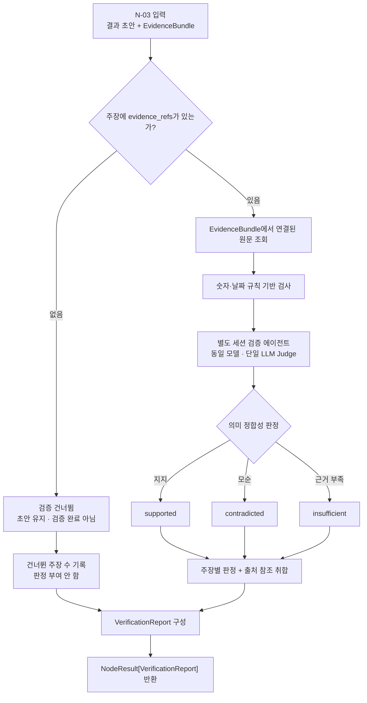

# N-03 · verify_grounding — 근거 정합성 검증

> **상태:** **MVP 주장 단위 검증·무참조 생략·검증 방식 확정(2026-11-03)**. 숫자·날짜는 규칙 기반, 의미 정합성은 **동일 모델의 별도 세션 검증 에이전트가 수행하는 단일 LLM Judge**를 사용한다. 상세 입출력 스키마·모델명·오류 처리·구현은 미정.

## 1. 단일 책임

주장·판정·비교 결과와 원문 근거의 정합성 검사.

## 2. 최소 입출력 (개념 수준)

| 구분 | 현재 등록된 내용 |
|---|---|
| 입력 | 결과 초안(주장 ID·문장·연결된 `evidence_refs[]`), N-02의 `EvidenceBundle`, 검증 설정(세부 필드 미정) |
| 출력 | `NodeResult[VerificationReport]` (공통 `status`, `data`, `diagnostics`, `outcome` 적용) |

## 3. MVP 검증 범위 (확정)

**N-03은 결과 초안의 개별 주장·판정·비교 항목 중 명시적인 근거 참조가 연결된 항목만 검증한다.** 원문 위치와 내용은 N-02의 `EvidenceBundle`에서 참조 ID를 통해 가져온다. 검증 노드가 원문 위치를 새로 탐색하거나 근거를 자동 할당하지 않는다.

| 입력 주장/문장 상태 | MVP 처리 |
|---|---|
| `evidence_refs[]`가 있는 주장 | 연결된 `EvidenceBundle`의 원문과 대조하는 **검증 대상** |
| **`evidence_refs[]`가 없거나 빈 주장·문장** | **검증 단계에서 건너뜀**. 근거를 추가 검색하지 않고, 자동으로 `insufficient` 등 검증 판정을 부여하지 않음 |
| 근거 없는 문장이 초안에 포함됨 | 원문 초안에서 **삭제·수정하지 않고 그대로 유지**. 단, **검증 완료·`supported`로 간주하지 않음** |

- 이 건너뜀은 **의도적인 MVP 범위 제한**이다. 실행 오류나 검증 실패를 뜻하지 않으므로 이 사실만으로 `NodeResult.status=partial`로 바꾸지 않는다.
- 검증 결과·검증률 등을 집계할 때 **검증하지 않은 문장까지 검증 완료로 집계하지 않는다**. 별도 문장별 상세 판정이 필요하지 않다면 건너뛴 문장 수만 간단히 기록하는 수준으로 충분하다.
- N-04(답변), N-06(기준 판정), N-09(비교 결과) 등 생성 노드는 자신이 제시한 주장과 근거 참조를 연결할 수 있다. **참조가 없는 주장까지 N-03이 보완하는 기능은 MVP 범위 밖**이다.
- N-03의 결과가 `success`여도 이는 **실제로 검증을 수행한 대상의 작업이 정상 종료**됐다는 의미이지, 결과 초안의 모든 문장이 검증됐다는 보증은 아니다. 후속 출력 단계에서 이 경계를 유지한다.

## 4. MVP 검증 방식 (확정)

### 4.1 검증 단계의 역할

- **숫자·날짜:** 값·시점 등 명확히 비교할 수 있는 내용은 **규칙 기반**으로 검사한다. 숫자·날짜 자체를 LLM의 추론 결과만으로 확정하지 않는다.
- **문장 의미:** 원문 표현과 주장 표현이 다르거나 함의·인과관계 등을 따져야 할 때 **LLM-as-a-Judge 방식으로 주장별 단일 의미 판정**을 수행한다.
- **근거 입력 제한:** LLM은 해당 주장의 `claim_id`, `claim_text`, 연결된 `evidence_refs[]` 및 그 참조에 해당하는 `EvidenceBundle` 원문 문맥만 판단 근거로 사용한다. 추가 검색·무관한 문서 조회·근거 자동 보강은 수행하지 않는다.
- **판정값(개념):** `supported`(원문이 지지), `contradicted`(원문과 모순), `insufficient`(판정에 필요한 근거가 부족). 참조가 **있지만** 근거가 불충분한 경우의 `insufficient`는 **근거 참조가 아예 없어 건너뛰는 경우**와 구별한다.
- **숫자·날짜 결과와 결합:** 규칙 기반 검사에서 이미 확인된 불일치를 의미 검증 단계가 `supported`로 덮어쓰지 않는다. 판정 결합의 구체 우선순위와 오류 상태 코드는 구현 시 정의한다.
- **단일 판단:** 각 검증 대상 주장은 기본적으로 **한 번의 LLM 의미 판정**을 사용한다. 다중 모델 투표·반복 자기검증·재탐색을 MVP에 넣지 않는다. 호출 단위(주장별 단독 호출/여러 주장 묶음)는 추후 성능·비용 실험에서 정한다.

### 4.2 별도 세션 검증 에이전트 (확정)

**MVP에서 N-03 내부의 전용 검증 에이전트는 답변·판정 생성 노드와 같은 기반 LLM 모델을 사용하되, 생성 과정과 분리된 별도 세션/대화 컨텍스트에서 동작한다.**

- 검증 에이전트에는 **검증 전용 시스템 지침과 입력**(주장·연결된 원문 근거·필요한 검증 설정)만 제공한다. 생성 에이전트의 대화 기록·이전 추론 과정·자기평가를 그대로 전달하지 않는다.
- **별도 검증 세션은 새로운 LangGraph Small Node를 뜻하지 않는다.** N-03은 한 개의 Small Node이며 내부에 검증 모델 호출/어댑터를 둔다.
- 같은 모델을 사용하므로 세션을 분리하더라도 **독립 모델에 의한 교차 검증을 수행한 것과 같지 않고**, 편향이나 오류가 반복될 수 있다.
- 로컬 모델을 기본으로 사용하며, 검증 모델의 실제 이름·프롬프트·세션 수명·실패 시 처리 정책은 구현·평가 과정에서 결정한다.

### 4.3 실행 플로우차트 (MVP)

아래 그림의 박스는 **N-03 단일 Small Node 내부의 처리 단계**이며 새로운 Tiny Node나 Big Node 조건부 엣지가 아니다.

**상태 주의:** `NodeResult.status=success`는 검증 노드가 정상 실행됐다는 의미이지, 모든 문장의 사실성 보증이나 모든 주장 `supported`를 뜻하지 않는다. 또한 근거 없는 주장을 의도적으로 건너뛰었다는 사실만으로 `partial`이 되지 않는다. LLM 호출 실패·일부 판정 실패에 대한 `partial/error` 세부 기준은 아직 미정이다.

## 5. 추후 개선 백로그 (MVP 제외)

- **무참조 주장 근거 복원:** 참조가 없는 주장에 대해 기존 `EvidenceBundle`에서 근거를 재매칭하거나, 필요시 N-01/N-02를 통한 제한적 재검색을 검토한다.
- **JEV식 선택형 검증 모델:** MVP는 생성/검증에 **동일 기반 모델 + 세션 분리**만 적용한다. 추후 JEV식 모델 선택 구조를 검토할 수 있도록 경계를 열어 두되, **JEV 방식의 구체 정의·모델 선택 정책·라우팅 조건은 현재 확정하지 않는다**.
- **추가 검증 전략:** 별도 검증 모델, 다중 모델 교차 판단, 근거 구절 추출 등은 실제 오류율·비용·지연을 측정한 뒤 도입 여부를 결정한다.

[하네스 아이디어 백로그](../idea-backlog.md)에 후속 후보를 기록한다.

## 6. 후속 검토

- 주장·판정·비교 항목의 실제 입력 자료형, 근거 참조 식별 방식과 `VerificationReport` 세부 필드
- 규칙 기반 수치·날짜 검사와 LLM 판정의 구체 결합 정책, 검증 생략·검증 실패에 대한 진단 필드
- 별도 세션 생성·종료 방식, LLM 출력 파싱, 실패·타임아웃·부분 판정 처리 및 테스트
- 모델/프롬프트 선택 및 재현성 기록, 실제 구현·실험

**경계:** 업무별 노드 조합·Big Node 조건부 엣지는 이 문서에 두지 않는다. 내부 보조 함수는 Tiny Node로 분할하지 않는다.

[Small Node 문서 목록](README.md) · [명칭 통일](../naming-conventions.md)
