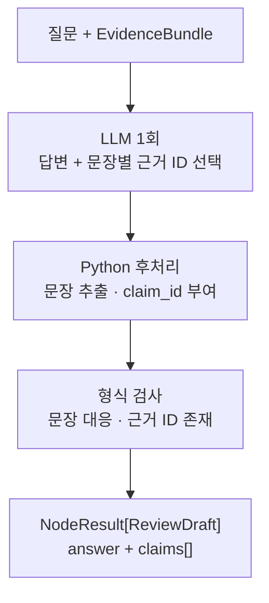

# N-04 · draft_answer — 문서 근거 답변 초안 생성

> **상태:** **MVP 출력 A 방식(`answer + claims[]`) 및 문장 단위 주장 추출·입출력 개념 계약 확정(2026-11-03)**. 예외 처리·실제 Python 스키마·구현은 미정.

## 1. 단일 책임

사용자 질문과 N-02의 `EvidenceBundle`에 포함된 원문을 활용하여 **답변 초안과 문장별 근거 참조**를 만든다. 검색·문맥 확장(N-01/N-02), 의미 정합성 검증(N-03)은 하지 않는다.

## 2. 입력 계약 (MVP 개념 필드 확정)

| 입력 필드 | 요구 | 의미 |
|---|---|---|
| `request_ref` | 필수 | 상위에서 받은 요청 ID 그대로 사용 |
| `question` | 필수 | 사용자의 질문 텍스트 |
| `evidence_bundle` | 필수 | N-02의 `NodeResult.data: EvidenceBundle`; `context_text`와 원문 참조/문서 버전 사용 |

- 입력 `request_ref`와 `evidence_bundle.request_ref`는 일치해야 한다. N-02의 상태·진단은 상위 실행 기록에서 따로 보존한다.
- 모델·프롬프트 설정 등은 하네스 실행 설정에서 제공하며, 상세 타입은 구현 때 결정한다.

## 3. 출력 계약: `NodeResult[ReviewDraft]` (MVP 개념 필드 확정)

공통 `NodeResult[T]`의 `status`, `data`, `diagnostics`, `outcome`은 그대로 사용한다([공통 반환 계약](common-result-contract.md)).

| `data: ReviewDraft` | 요구 | 의미 |
|---|---|---|
| `request_ref` | 필수 | 상위 요청 ID 그대로 보존 |
| `answer` | 필수 | 사용자가 읽을 답변 초안 |
| `claims[]` | 필수 (빈 배열 가능) | `answer`에 **실제로 포함된 검증 대상 문장** 목록 |

각 `claims[]` 요소는 세 필드만 사용한다.

| 요소 필드 | 요구 | 의미 |
|---|---|---|
| `claim_id` | 필수 | **N-04 생성 단계에서 부여**; 같은 초안 내 유일, N-03에서 재발급 금지 |
| `claim_text` | 필수 | **`answer`에서 가져온 문장 텍스트**. 원문 청크를 복사하거나 별도 검증 문장을 창작하지 않음 |
| `evidence_refs[]` | 필수 (빈 배열 가능) | 해당 문장에 사용한 N-02 원문 근거 참조 ID |

### 가상 출력 예시

```json
{
  "status": "success",
  "data": {
    "request_ref": "req_001",
    "answer": "A 기업의 매출은 10% 증가했다. 해외 지점도 신설했다.",
    "claims": [
      {
        "claim_id": "claim_001",
        "claim_text": "A 기업의 매출은 10% 증가했다.",
        "evidence_refs": ["chunk_010"]
      },
      {
        "claim_id": "claim_002",
        "claim_text": "해외 지점도 신설했다.",
        "evidence_refs": ["chunk_020"]
      }
    ]
  },
  "diagnostics": {},
  "outcome": null
}
```

## 4. 문장 단위 A 방식 (MVP 확정)

**답변의 한 문장을 하나의 검증 대상으로 취급한다.** 한 문장에 여러 사실이 있어도 MVP에서 자동으로 원자적 주장 여러 개로 분해하지 않는다. 제목·접속 표현처럼 사실 주장이 아닌 부분은 주장 목록에 넣지 않을 수 있다.

**권장 내부 처리:** LLM 호출 **1회**로 `answer`와 사용한 **문장별 기존 근거 ID**를 함께 생성하고, Python 후처리 함수에서 실제 `answer`의 문장을 가져와 `claim_id`를 부여한다. 별도 LLM 호출로 새로운 `claim_text`를 창작하지 않는다.

Python에서는 `claim_text`가 `answer`에 실제 존재하는지, 주장 ID가 중복되지 않았는지, 제시된 `evidence_refs[]`가 입력 `EvidenceBundle`에서 조회 가능한지 확인한다. 단, **ID가 존재한다는 사실은 의미적 지지가 아니다**. 근거의 적합성 검증은 N-03이 맡는다.



**근거 참조가 없는 주장**은 `evidence_refs: []`로 남기며 N-03은 검증하지 않는다. 미검증을 `supported`로 취급하지 않는다. N-04는 기존 N-02에서 제공한 출처 이외의 근거를 검색하거나 생성하지 않는다.

## 5. N-03 연결과 남은 결정

상위 `request_ref`를 유지하고 N-04가 `claim_id`를 부여한다. 검증 순서와 무관하게 N-03은 기존 ID를 재사용한다. `run_id`는 하네스 실행 기록에서 관리한다.

**추후 결정:** 근거가 없거나 답변 생성이 실패했을 때 `status=success/partial/error`의 세부 기준, 답변 불가 표시, Markdown·복합 문장 분할, 구조화 출력 파싱 실패 처리, Python 타입·모델/프롬프트 및 테스트.

**경계:** Small Node는 N-04 하나로 유지한다. 보조 기능을 Tiny Node로 분리하지 않는다.

[Small Node 문서 목록](README.md) · [N-03 검증](N-03.md) · [명칭 통일](../naming-conventions.md)
