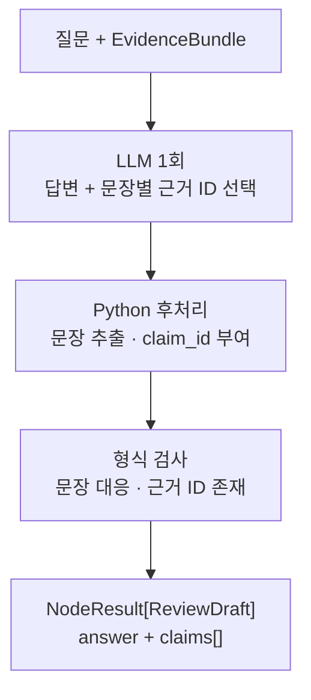

# N-04 · draft_answer — 문서 근거 답변 초안 생성

> **상태:** **MVP 출력 A 방식(`answer + claims[]`)·문장 단위 주장 추출·입출력 개념 계약·기본 예외 처리 및 부분 답변 규칙 확정(2026-11-04)**. **모든 사실 주장에 근거 ID가 없는 경우의 반환 정책은 미정**이며, 실제 Python 스키마·프롬프트·구현/테스트는 미완료.

## 1. 단일 책임

사용자 질문과 N-02의 `EvidenceBundle`에 포함된 원문을 활용하여 **답변 초안과 문장별 근거 참조**를 만든다. 검색·문맥 확장(N-01/N-02), 의미 정합성 검증(N-03)은 하지 않는다.

## 2. 입력 계약 (MVP 개념 필드 확정)

| 입력 필드 | 요구 | 의미 |
|---|---|---|
| `request_ref` | 필수 | 상위에서 받은 요청 ID 그대로 사용 |
| `question` | 필수 | 사용자의 질문 텍스트 |
| `evidence_bundle` | 필수 | N-02의 `NodeResult.data: EvidenceBundle`; `context_text`와 원문 참조/문서 버전 사용 |

- 입력 `request_ref`와 `evidence_bundle.request_ref`는 일치해야 한다. N-02의 상태·진단은 상위 실행 기록에서 따로 보존한다.
- 모델·프롬프트 설정 등은 하네스 실행 설정에서 제공하며, 상세 타입은 구현 때 결정한다.

## 3. 출력 계약: `NodeResult[ReviewDraft]` (MVP 개념 필드 확정)

공통 `NodeResult[T]`의 `status`, `data`, `diagnostics`, `outcome`은 그대로 사용한다([공통 반환 계약](common-result-contract.md)).

| `data: ReviewDraft` | 요구 | 의미 |
|---|---|---|
| `request_ref` | 필수 | 상위 요청 ID 그대로 보존 |
| `answer` | 필수 (`""` 허용) | 답변 초안 텍스트. `outcome=insufficient_evidence`이면 빈 문자열로 반환하고 안내 문구는 N-11 등 최종 출력 단계가 구성 |
| `claims[]` | 필수 (빈 배열 가능) | `answer`에 **실제로 포함된 검증 대상 문장** 목록 |

각 `claims[]` 요소는 세 필드만 사용한다.

| 요소 필드 | 요구 | 의미 |
|---|---|---|
| `claim_id` | 필수 | **N-04 생성 단계에서 부여**; 같은 초안 내 유일, N-03에서 재발급 금지 |
| `claim_text` | 필수 | **`answer`에서 가져온 문장 텍스트**. 원문 청크를 복사하거나 별도 검증 문장을 창작하지 않음 |
| `evidence_refs[]` | 필수 (빈 배열 가능) | 해당 문장에 사용한 N-02 원문 근거 참조 ID |

### 가상 출력 예시

```json
{
  "status": "success",
  "data": {
    "request_ref": "req_001",
    "answer": "A 기업의 매출은 10% 증가했다. 해외 지점도 신설했다.",
    "claims": [
      {
        "claim_id": "claim_001",
        "claim_text": "A 기업의 매출은 10% 증가했다.",
        "evidence_refs": ["chunk_010"]
      },
      {
        "claim_id": "claim_002",
        "claim_text": "해외 지점도 신설했다.",
        "evidence_refs": ["chunk_020"]
      }
    ]
  },
  "diagnostics": {},
  "outcome": null
}
```

## 4. 문장 단위 A 방식 (MVP 확정)

**답변의 한 문장을 하나의 검증 대상으로 취급한다.** 한 문장에 여러 사실이 있어도 MVP에서 자동으로 원자적 주장 여러 개로 분해하지 않는다. 제목·접속 표현처럼 사실 주장이 아닌 부분은 주장 목록에 넣지 않을 수 있다.

**권장 내부 처리:** LLM 호출 **1회**로 `answer`와 사용한 **문장별 기존 근거 ID**를 함께 생성하고, Python 후처리 함수에서 실제 `answer`의 문장을 가져와 `claim_id`를 부여한다. 별도 LLM 호출로 새로운 `claim_text`를 창작하지 않는다.

Python에서는 `claim_text`가 `answer`에 실제 존재하는지, 주장 ID가 중복되지 않았는지, 제시된 `evidence_refs[]`가 입력 `EvidenceBundle`에서 조회 가능한지 확인한다. 단, **ID가 존재한다는 사실은 의미적 지지가 아니다**. 근거의 적합성 검증은 N-03이 맡는다.



**근거 참조가 없는 주장**은 `evidence_refs: []`로 남기며 N-03은 검증하지 않는다. 미검증을 `supported`로 취급하지 않는다. N-04는 기존 N-02에서 제공한 출처 이외의 근거를 검색하거나 생성하지 않는다.

## 5. 예외 처리 및 반환 상태 (MVP 확정)

**업무상 답변 불가능과 생성 처리 자체의 실패를 구분**한다. N-04의 LLM 생성은 기본적으로 1회이므로 MVP에서는 안전한 부분 초안만 별도로 반환하는 `partial` 경로를 두지 않는다.

| 상황 | `status` | `data` | `outcome` |
|---|---|---|---|
| 근거를 이용해 질문의 모든 요청 항목에 답변 초안을 정상 생성 | `success` | `ReviewDraft`: 유효한 `answer`, `claims[]` | `null` |
| **질문의 일부 항목만 근거로 답변 가능** | **`success`** | 근거가 있는 부분만 답하고 **확인할 수 없는 항목은 명시**한 `answer` 및 해당 사실 주장 `claims[]` | **`"partial_answer"`** |
| 입력된 근거가 0건이거나, 질문에 답할 수 있는 항목이 하나도 없음 | `success` | `ReviewDraft`: `request_ref`, `answer: ""`, `claims: []` | `"insufficient_evidence"` |
| LLM 호출 실패·타임아웃 | `error` | `null` | `null` |
| LLM 응답을 필요한 구조로 파싱할 수 없음, 잘못된 `evidence_refs[]`, 문장·주장 ID 유효성 실패 | `error` | `null` | `null` |
| `request_ref` 불일치, 원문 버전·권한 등 입력 무결성 문제 | `error` | `null` | `null` |

- **부분 답변:** 근거로 답할 수 있는 항목은 유지하고, 부족한 항목은 추측하지 않고 `answer` 안에 '제공된 자료로 확인할 수 없음'처럼 명시한다. 확인 불가 안내 문장은 사실 주장으로 꾸며 `claims[]`에 넣지 않는다. `outcome=partial_answer`는 **업무상 응답 범위**이며, `status=partial`(노드 실행 실패)과 다르다. 근거 연결이 있는 사실 주장은 이후 N-03에서 검증한다.
- **정상적인 근거 부족:** 답변 가능한 요청 항목이 전혀 없다면 `insufficient_evidence`를 반환한다. 이는 **이번에 전달된 근거로는 답을 만들 수 없다는 의미**이지, 전체 문서에 답이 없다는 증명이 아니다. 근거 항목 자체가 0개인 정상 입력이라면 LLM을 호출하지 않는다.
- **상위 워크플로 분기:** N-01 후보 0건, N-02 조회 오류로 유효한 근거가 없는 경우엔 상위 Big Node가 **N-04를 호출하지 않고** 결과를 보류하는 게 기본이다. 유효한 빈 `EvidenceBundle`이 N-04로 직접 전달된 경우에는 위 `success/insufficient_evidence` 규칙으로 안전하게 처리한다. **N-02의 `data=null`을 빈 `EvidenceBundle`로 바꾸어 정상 처리하지 않는다.**
- **답변 불가능 시 N-03 생략:** `answer=""`와 `claims=[]`이므로 주장 검증을 수행할 대상이 없다. 최종 사용자 안내 문구는 N-11(또는 상위 결과 처리 단계)의 책임이다.
- **실행 실패 진단:** LLM 호출·출력 파싱·근거 ID 확인 등 실패한 단계와 원인을 공통 `diagnostics`에 기록한다. 실행 오류를 `insufficient_evidence`로 위장하지 않는다. **참조 ID가 일부만 잘못되어도 `error`로 처리**하고, 잘못된 ID만 몰래 제거하거나 다른 근거로 대체하지 않는다. **JSON 파싱·문장 대응·출력 구조 검증에 실패해도 `error`**로 처리하며, MVP에서는 자동 LLM 재호출·수정 시도를 추가하지 않는다.
- **단일 LLM 호출:** MVP N-04는 **`status=partial`을 사용하지 않는다**. LLM 실행 후 안전한 초안 구성이 완료되면 `success`, 실패하면 `error`다. 상위 N-02가 `partial`이었더라도 N-04가 자신에게 전달된 유효 근거만으로 정상 완료하면 N-04의 `status`는 `success`일 수 있다. 노드 내부 재시도·추가 LLM 호출은 MVP 필수로 두지 않는다.

### 부분 답변 반환 예시 (가상 데이터)

사용자가 매출과 영업이익 증가율을 함께 물었는데, 전달된 근거로 매출 증가율만 확인한 상황이다.

```json
{
  "status": "success",
  "data": {
    "request_ref": "req_001",
    "answer": "매출 증가율은 10%야. 영업이익 증가율은 제공된 자료에서 확인할 수 없어.",
    "claims": [
      {
        "claim_id": "claim_001",
        "claim_text": "매출 증가율은 10%야.",
        "evidence_refs": ["chunk_010"]
      }
    ]
  },
  "diagnostics": {},
  "outcome": "partial_answer"
}
```

확인 불가 안내 문장은 원문에서 나온 숫자·사실 주장이 아니므로 검증 대상 주장으로 별도 기재하지 않는다. **실제 판정의 정확성은 N-03의 결과에 좌우**되며, N-04의 `success`가 문장 내용의 검증 완료를 뜻하지 않는다.

### 근거 부족 반환 예시 (가상 데이터)

```json
{
  "status": "success",
  "data": {
    "request_ref": "req_001",
    "answer": "",
    "claims": []
  },
  "diagnostics": {},
  "outcome": "insufficient_evidence"
}
```

### LLM 호출 실패 반환 예시 (가상 데이터)

```json
{
  "status": "error",
  "data": null,
  "diagnostics": {
    "generate_answer": {
      "status": "failed",
      "error_code": "TIMEOUT",
      "retryable": true
    }
  },
  "outcome": null
}
```

## 6. N-03 연결과 후속 구현

상위 `request_ref`를 유지하고 N-04가 `claim_id`를 부여한다. 검증 순서와 무관하게 N-03은 기존 ID를 재사용한다. `run_id`는 하네스 실행 기록에서 관리한다.

**남은 설계 결정:** **답변에 사실 주장은 있지만 모든 `evidence_refs[]`가 빈 경우**를 어떻게 처리할지. LLM은 사용 근거를 선택하지만, Python은 근거 ID의 존재 여부만 검사하므로 **근거 연결 누락**과 **실제 근거 부족**을 자동으로 동일시하지 않는다. 이 상황은 아직 `success`·`insufficient_evidence`·`error` 중 무엇으로 반환할지 확정하지 않았다.

**후속 구현·시험:** Markdown·복합 문장 분할 및 일부만 답변 가능한 요청을 판단하는 세부 규칙, Python 타입/직렬화·모델/프롬프트 설정, 출력 파싱·근거 참조 유효성·타임아웃·실패 진단 코드의 테스트. 구체 오류 코드 목록과 운영 재시도 정책은 하네스 구현 단계에서 결정한다.

**경계:** Small Node는 N-04 하나로 유지한다. 보조 기능을 Tiny Node로 분리하지 않는다.

[Small Node 문서 목록](README.md) · [N-03 검증](N-03.md) · [명칭 통일](../naming-conventions.md)
