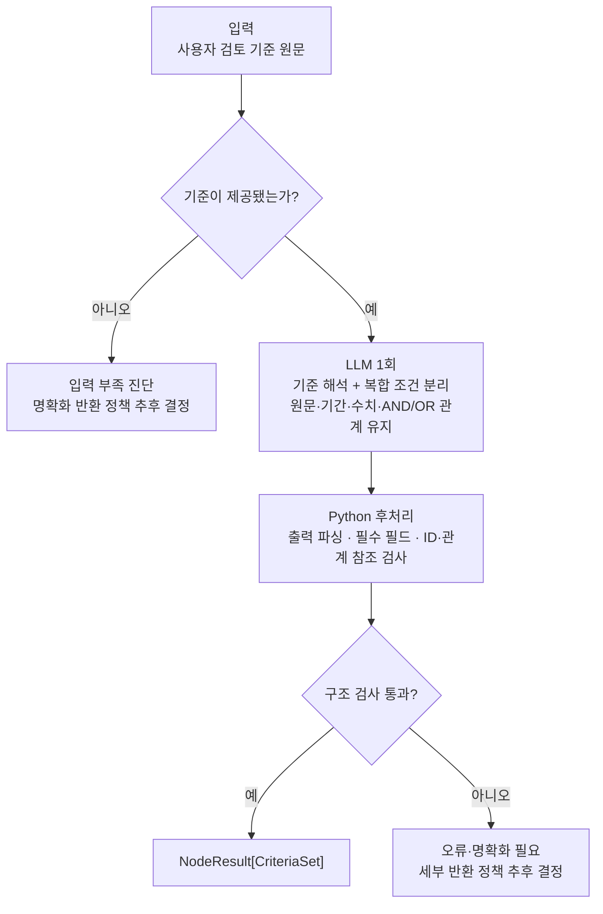

# N-05 · structure_criteria — 검토 기준 구조화

> **상태:** **복합 기준의 세부 조건 분리(B 방식) 및 내부 처리 'LLM 1회 해석·분해 → Python 구조 검사' 확정(2026-11-04)**. 사용자 기준 원문·조건 간 논리 관계 보존은 확정. 상세 `CriteriaSet` 스키마·모호한 기준 처리·예외 상태·실제 구현은 미정.

## 1. 단일 책임

**사용자가 명시한 검토 기준**을 N-06이 판정할 수 있는 **개별 검사 조건**으로 구조화한다. N-05는 원문 근거 검색(N-01/N-02)이나 기준 충족 판정(N-06), 정합성 검증(N-03)을 수행하지 않는다.

## 2. 확정된 분해 원칙 — B 방식

- **사용자 기준 원문 그대로 보존:** 조건을 분해한 뒤에도 원래 기준을 삭제·수정하지 않는다.
- **복합 조건만 개별 검사 단위로 분리:** 예를 들어 매출액 기재와 영업이익 기재를 각각 확인 가능한 조건으로 나눈다. 이미 단일 조건이면 불필요하게 쪼개지 않는다.
- **조건 사이의 논리 관계를 함께 보존:** '모두', '중 하나', '제외', 시점·기간, 대상, 수치 임계값 등이 분해 때문에 사라지거나 바뀌지 않도록 한다.
- **사용자가 제시하지 않은 검토 기준·수치 임계값·기간을 임의로 추가하지 않는다.** 모호한 기준을 억지로 해석해 확정하지 않는다.
- 이 분해 과정은 **N-05 Small Node 내부 처리**이며, 세부 조건마다 Tiny Node/LangGraph 노드를 추가하는 뜻이 아니다.

### 예시

원본 기준: **"최근 3년간 매출액과 영업이익이 모두 기재되어 있어야 한다."**

```text
기준 C-01 (원문 보존)
├── 결합 관계: ALL (두 조건 모두 충족)
├── 조건 C-01-1: 최근 3년간 매출액 기재 여부
└── 조건 C-01-2: 최근 3년간 영업이익 기재 여부
```

'최근 3년'의 정확한 연도 기준점이 없으면 특정 연도 3개를 만들어 채우지 않는다. 정확한 기간 계산·명확화 방식은 별도 결정한다.

## 3. 최소 입출력 (개념 수준)

| 구분 | 내용 |
|---|---|
| 입력 | 사용자 검토 기준 원문(상위 요청과 연결) |
| 출력 | `NodeResult[CriteriaSet]` — 공통 `status`, `data`, `diagnostics`, `outcome` 준수 |

`CriteriaSet`에는 **원본 기준, 세부 검사 조건, 조건 간 결합 관계**를 보존해야 한다. 실제 `criterion_id`/`condition_id` 필드명·중첩 구조 및 범위·기간·임계값을 어디에 배치할지는 아직 결정하지 않았다.

## 4. 내부 워크플로 (MVP 처리 방식 확정)

**LLM 1회 구조화 → Python 후처리·구조 검사**로 진행한다. LLM은 **한 번의 호출 안에서** 기준 문장을 해석하고 복합 조건을 나누며, 원본 기준·조건 간 AND/OR 관계·대상·기간·수치 임계값 등 사용자가 명시한 정보를 보존해야 한다. Python은 출력 형식과 ID·참조의 **구조적 유효성**을 검사한다. 별도의 LLM 호출이나 Small/Tiny Node를 추가하여 조건별로 다시 해석하지 않는다.



- **LLM 담당:** 사용자 기준에 없는 조건을 창작하지 않고, 복합 조건을 검증 가능한 항목으로 나누며 결합 관계를 보존한다.
- **Python 담당:** 출력 파싱, 필수 필드 누락, 중복 ID, 누락·잘못된 조건 참조 등의 검사. 실제 ID 발급 및 필드 타입의 세부 규칙은 입출력 설계 시 정한다.
- **N-05 비담당:** 구조화된 조건의 충족 여부 판정, 근거 검색, 사용자 기준의 임의 보완.

**한계와 미정 사항:** Python의 구조 검사는 **원래 기준의 의미가 완전히 보존됐는지 보증하지 않는다**. 모호한 입력의 명확화 조건, 의미 누락 탐지·재시도, `status=success/partial/error`와 `outcome`의 구체 규칙은 별도로 결정한다.

## 5. 다음 설계 항목

1. `CriteriaSet`의 최소 출력 필드와 조건 ID/논리 관계 표현
2. 출력에 사용할 조건 ID·논리 관계 참조와 JSON 스키마의 세부 규칙
3. 불완전·모호한 기준, 구조화 실패, 일부 기준만 처리 가능한 경우의 예외 정책
4. 실제 Python/Pydantic 타입, 프롬프트·테스트

**경계:** Big Node의 조건별 반복·분기는 [T-02](../big-nodes/T-02.md)에 둔다. N-05 내부 도우미를 별도 Tiny Node로 분리하지 않는다.

[Small Node 문서 목록](README.md) · [공통 반환 계약](common-result-contract.md) · [명칭 통일](../naming-conventions.md)
