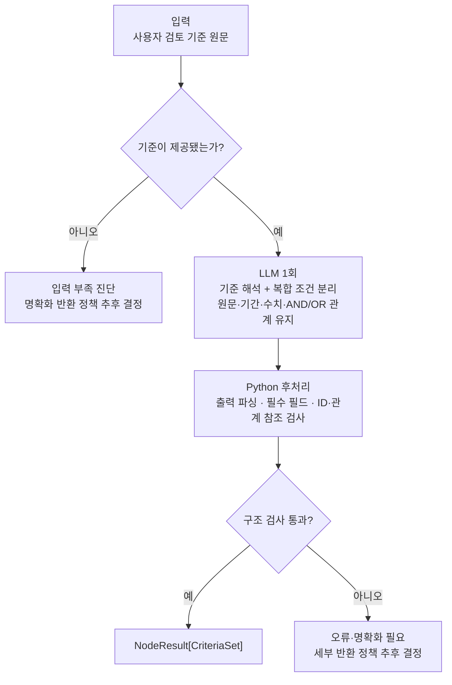

# N-05 · structure_criteria — 검토 기준 구조화

> **상태:** **복합 기준 B 방식 분리·LLM 1회 + Python 검사·평면형 AND/OR 한 단계 지원 확정(2026-11-04)**. 원본 기준 보존, 표현 불가능한 중첩 논리의 임의 단순화 금지 확정. **독립 기준별 부분 처리(B 방식) 및 `status=success`, `outcome=partial_criteria`**를 확정했으며, `CriteriaSet` 상세 스키마·나머지 예외 상태·실제 구현은 미정. 중첩 논리는 [후속 백로그](../idea-backlog.md#44-n-05-후속-확장--중첩-andor-기준-표현-2026-11-04)에 보류.

## 1. 단일 책임

**사용자가 명시한 검토 기준**을 N-06이 판정할 수 있는 **개별 검사 조건**으로 구조화한다. N-05는 원문 근거 검색(N-01/N-02)이나 기준 충족 판정(N-06), 정합성 검증(N-03)을 수행하지 않는다.

## 2. 확정된 분해 원칙 — B 방식

- **사용자 기준 원문 그대로 보존:** 조건을 분해한 뒤에도 원래 기준을 삭제·수정하지 않는다.
- **복합 조건만 개별 검사 단위로 분리:** 예를 들어 매출액 기재와 영업이익 기재를 각각 확인 가능한 조건으로 나눈다. 이미 단일 조건이면 불필요하게 쪼개지 않는다.
- **조건 사이의 논리 관계를 함께 보존:** '모두', '중 하나', 시점·기간, 대상, 수치 임계값 및 명시된 예외 조건이 분해 때문에 사라지거나 바뀌지 않도록 한다. **MVP 스키마로 표현하지 못하는 관계는 임의의 AND/OR 하나로 바꾸지 않는다.**
- **사용자가 제시하지 않은 검토 기준·수치 임계값·기간을 임의로 추가하지 않는다.** 모호한 기준을 억지로 해석해 확정하지 않는다.
- 이 분해 과정은 **N-05 Small Node 내부 처리**이며, 세부 조건마다 Tiny Node/LangGraph 노드를 추가하는 뜻이 아니다.

### 예시

원본 기준: **"최근 3년간 매출액과 영업이익이 모두 기재되어 있어야 한다."**

```text
기준 C-01 (원문 보존)
├── 결합 관계: ALL (두 조건 모두 충족)
├── 조건 C-01-1: 최근 3년간 매출액 기재 여부
└── 조건 C-01-2: 최근 3년간 영업이익 기재 여부
```

'최근 3년'의 정확한 연도 기준점이 없으면 특정 연도 3개를 만들어 채우지 않는다. 정확한 기간 계산·명확화 방식은 별도 결정한다.

### 논리 연산 범위 (MVP 확정)

- **지원:** 기준 하나마다 **단일 연산자 `all`(AND) 또는 `any`(OR)** 를 선택하고, 그 아래에 검사 조건들을 **한 단계의 평면 배열**로 나열한다. 예: `A AND B`, `A OR B OR C`.
- **미지원:** 서로 다른 논리 연산을 중첩하는 `A AND (B OR C)`, `(A OR B) AND (C OR D)`와 같이 **괄호·그룹이 필요한 구조**. 단일 `operator`에 넣기 위해 원문의 의미를 잘못 변환하지 않는다. `NOT` 등 별도 논리 연산 지원도 MVP 범위에 포함하지 않는다.
- **표현 불가 입력:** 원본을 유지하고 상위에 **지원하지 않는 구조/명확화 필요**를 알릴 수 있도록 진단한다. 단일 기준이 미지원인 경우와 **전체 기준을 처리하지 못한 경우**의 `status/outcome`은 예외 설계에서 결정한다. **여러 독립 기준 중 일부만 지원되는 경우에는 지원 가능한 기준만 구조화하고, 처리하지 못한 기준의 원문·사유를 함께 보존하며 `status=success`, `outcome=partial_criteria`로 반환한다.**
- **후속 개선:** 중첩 조건 그룹을 추가하는 것은 [아이디어 백로그 4.4](../idea-backlog.md#44-n-05-후속-확장--중첩-andor-기준-표현-2026-11-04)에 기록하고 MVP 구현에서는 제외한다.

### 여러 기준 중 일부만 처리 가능한 경우 (MVP 확정)

**B 방식 — 기준 단위 부분 처리**를 사용한다.

- **독립 기준별 처리:** 입력된 기준 여러 개 중 일부만 유효하다면 **구조화 가능한 기준은 `criteria[]`에 보존**하고, 지원되지 않거나 의미가 모호한 **기준 전체는 미처리 목록에 원문과 사유를 남긴다**.
- **기준 내부 부분 처리 금지:** `A AND (B OR C)`처럼 **하나의 기준 자체가 미지원 중첩식이면, 그 안의 `A`만 발췌해 정상 기준으로 반환하지 않는다**. 다른 독립 기준은 계속 처리할 수 있다.
- **누락 방지:** 입력 기준은 반드시 **처리 완료 또는 미처리 중 정확히 한 곳에 대응**해야 한다. 원본 입력 순서/ID로 대조할 수 있도록 한다. LLM이 일부 입력을 **아무 설명 없이 누락한 상황은 허용된 부분 처리로 간주하지 않는다**.
- **T-02 연동:** 상위 T-02는 처리 가능한 기준만 N-01/N-02/N-06으로 전달한다. 미처리 기준은 **충족/미충족 판정으로 바꾸지 않고**, 최종 결과에서 사유와 함께 표시한다.
- **확정된 반환 상태:** 일부 기준만 업무상 구조화할 수 있어도 **N-05 실행이 정상 종료했다면 `status=success`, `outcome=partial_criteria`**. `status=partial`은 내부 실행 단계에서 실제로 일부 실패했지만 안전한 결과를 제공할 수 있을 때 사용하는 공통 실행 상태다. **업무상 미지원/모호함만으로 `status=partial`로 만들지 않는다.**
- **남은 결정:** 실제 필드 이름·미처리 사유 코드, **모든 기준이 처리 불가능한 경우**, 실행 일부 실패 시 어떤 결과까지 안전하게 보존할지와 구체적인 반환 정책. 이 경우는 아직 확정하지 않는다.

예: 기준 3개 중 2개는 평면 AND/OR, 1개는 중첩식인 경우 **정상 기준 2개 + 미처리 기준 1개(원문·미지원 사유)**를 반환하도록 설계한다.

### 기준별 부분 처리 반환 예시 (가상 데이터)

독립 기준 3개 중 2개를 정상 구조화하고, 1개가 중첩 AND/OR로 미지원인 경우의 **개념적 출력**이야. 정확한 필드명·세부 스키마는 구현 전에 정한다.

```json
{
  "status": "success",
  "data": {
    "request_ref": "req_001",
    "criteria": [
      {
        "criterion_id": "criterion_001",
        "original_text": "매출액이 기재되어 있어야 한다.",
        "operator": "all",
        "conditions": [
          {"condition_id": "condition_001", "text": "매출액 기재 여부"}
        ]
      },
      {
        "criterion_id": "criterion_002",
        "original_text": "영업이익이 기재되어 있어야 한다.",
        "operator": "all",
        "conditions": [
          {"condition_id": "condition_002", "text": "영업이익 기재 여부"}
        ]
      }
    ],
    "unprocessed_criteria": [
      {
        "input_index": 2,
        "original_text": "A와 (B 또는 C)를 모두 충족해야 한다.",
        "reason": "중첩 AND/OR 구조 미지원"
      }
    ]
  },
  "diagnostics": {},
  "outcome": "partial_criteria"
}
```

**주의:** 위 `partial_criteria`는 **업무상 일부 기준 미지원**을 나타낸다. 실제 LLM 호출·구조 검사 등의 **일부 실행 실패**에서 쓰는 `status=partial`과 섞지 않는다. 전체 기준이 정상 구조화되면 `status=success`, `outcome=null`이다.

## 3. 최소 입출력 (MVP 개념 구조)

| 구분 | 내용 |
|---|---|
| 입력 (필드 제안) | 상위 `request_ref`, 원문 기준 목록 `criteria_texts[]` |
| 출력 | `NodeResult[CriteriaSet]` — 공통 `status`, `data`, `diagnostics`, `outcome` 준수 |

`CriteriaSet`에는 **처리된 기준과 미처리 기준을 함께 보존**한다(개념적 요구 확정). 처리된 기준의 `operator`는 **한 개의 `all` 또는 `any`**다. 아래 필드명은 현재 제안이며, 실제 Python 타입·ID 발급과 미처리 사유 표현은 후속 입출력 설계에서 정한다.

```text
data: CriteriaSet
├── request_ref
├── criteria[]                  (처리 완료 기준)
│   ├── criterion_id
│   ├── original_text           (원문 그대로)
│   ├── operator                ("all" | "any", 한 단계만)
│   └── conditions[]            (중첩 그룹 없음)
│       ├── condition_id
│       └── text
└── unprocessed_criteria[]      (미처리 기준; 필드명 제안)
    ├── original_text           (원문 그대로)
    ├── input_ref / input_index (원래 입력과 매핑)
    └── reason                  (미처리 사유; 코드 미정)
```

예시: 한 기준의 `operator="all"`에 '최근 3년간 매출액 기재 여부', '최근 3년간 영업이익 기재 여부'를 나란히 배치한다. 복합식 `A AND (B OR C)`는 이 구조로 표현하지 않는다.

## 4. 내부 워크플로 (MVP 처리 방식 확정)

**LLM 1회 구조화 → Python 후처리·구조 검사**로 진행한다. LLM은 **한 번의 호출 안에서** 기준 문장을 해석하고 복합 조건을 나누며, 원본 기준·조건 간 AND/OR 관계·대상·기간·수치 임계값 등 사용자가 명시한 정보를 보존해야 한다. Python은 출력 형식과 ID·참조의 **구조적 유효성**을 검사한다. 별도의 LLM 호출이나 Small/Tiny Node를 추가하여 조건별로 다시 해석하지 않는다.



- **LLM 담당:** 사용자 기준에 없는 조건을 창작하지 않고 복합 조건을 검증 가능한 항목으로 나누며, **평면형 `all`/`any`의 한 단계 결합**만 구조화한다. 중첩 논리가 있으면 잘못된 단일 연산자로 평탄화하지 않는다.
- **Python 담당:** 출력 파싱, 필수 필드 누락, 중복 ID, 누락·잘못된 조건 참조, **허용 연산자(`all`/`any`) 및 중첩 그룹 불허**, **입력 기준 전체가 처리/미처리 중 하나에 정확히 대응하는지** 등의 구조 검사. 실제 ID 발급 및 필드 타입의 세부 규칙은 입출력 설계 시 정한다. 형식 검사는 LLM이 원문의 모든 의미를 보존했음을 보증하지는 않는다.
- **N-05 비담당:** 구조화된 조건의 충족 여부 판정, 근거 검색, 사용자 기준의 임의 보완.

**한계와 미정 사항:** Python의 구조 검사는 **원래 기준의 의미가 완전히 보존됐는지 보증하지 않는다**. 모호한 입력의 명확화 조건, 의미 누락 탐지·재시도, **기준별 정상 부분 처리 이외의** `status=success/partial/error`와 `outcome` 규칙은 별도로 결정한다.

## 5. 다음 설계 항목

1. 확정된 평면형 `all`/`any`를 전제로 `CriteriaSet` 실제 JSON 필드·단일 조건·ID 규칙 확정
2. LLM 출력과 Python 구조 검사에서 지원 불가 중첩식을 어떻게 검출할지 구체화
3. 불완전·모호한 기준, **전체 미지원 입력**, 구조화 실패·일부 실행 실패의 반환 상태와 **미처리 사유 코드** 확정 (`partial_criteria`는 확정)
4. 실제 Python/Pydantic 타입, 프롬프트·테스트

**경계:** Big Node의 조건별 반복·분기는 [T-02](../big-nodes/T-02.md)에 둔다. N-05 내부 도우미를 별도 Tiny Node로 분리하지 않는다.

[Small Node 문서 목록](README.md) · [공통 반환 계약](common-result-contract.md) · [명칭 통일](../naming-conventions.md)
