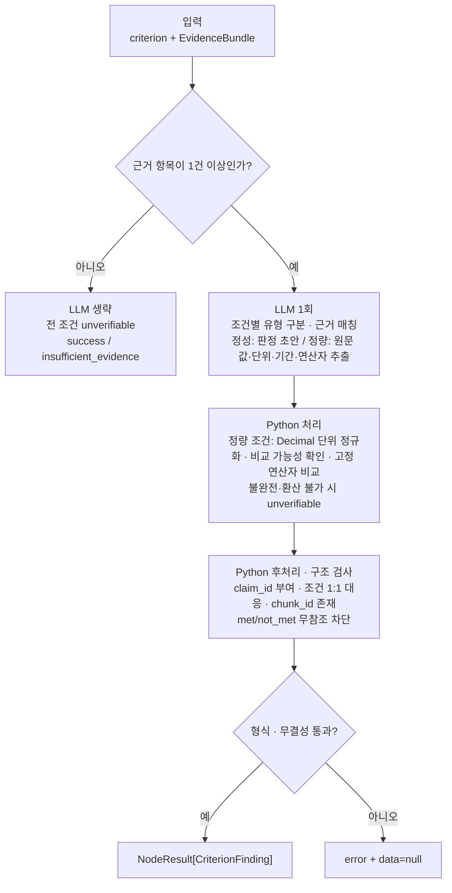

# N-06 · evaluate_criterion — 기준 조건별 판정

> **상태:** **MVP 개념 계약 확정(2026-11-28)** — 조건 단위 판정 전용(기준 단위 `all`/`any` 최종 집계는 T-02 책임), `claim_text` + `evidence_refs[]` 기반 N-03 연동, 정성(AI)·정량(AI 구조화 추출 + Python `Decimal` 결정적 비교) 하이브리드 판정, 무참조 `met`/`not_met` 실행 오류 차단, N-03 탈락 시 보정 호출 미도입(후속 벤치마크 연구) 확정. 실제 Python 타입·단위 환산표·프롬프트·구현/테스트는 미완료.

## 1. 단일 책임과 경계

구조화된 검토 기준 1건의 **개별 조건(`condition`)**과 N-02의 `EvidenceBundle`을 대조해 조건별 **`met`(충족) / `not_met`(미충족) / `unverifiable`(확인 불가)** 판정 초안(`CriterionFinding`)을 생성한다.

- **하는 일:** 조건별 판정, 정량 임계값의 결정적 수치 비교(내부 Python 계산기), N-03 검증에 필요한 `claim_id`·`claim_text`·`evidence_refs[]` 구성.
- **하지 않는 일:** 기준 분해(N-05), 근거 검색(N-01), 원문 조회·문맥 확장(N-02), 판정의 근거 정합성 최종 검증(N-03), **기준 단위 `all`/`any` 최종 논리 집계(T-02)**, 사용자용 최종 답변 문장 작성(N-11).
- **부재 추론 금지 원칙:**
  - **`met`:** 조건 충족을 직접 뒷받침하는 원문 근거가 있을 때만 판정한다.
  - **`not_met`:** 조건 위반을 직접 입증하는 반대·위반 근거가 있거나, 기준이 요구하는 문서 범위 전체를 빠짐없이 확인한 완전성 근거가 확보된 경우에만 판정한다. **검색에서 찾지 못했다는 이유만으로 `not_met`으로 단정하지 않는다.**
  - **`unverifiable`:** 근거가 부족하거나, 수치·단위·시점·대상 범위가 불분명하거나, 정량 비교 입력이 불완전할 때 판정한다.

## 2. 입력 계약 (MVP 개념 필드 확정)

| 입력 필드 | 요구 | 의미 |
|---|---|---|
| `request_ref` | 필수 | 상위에서 받은 요청 ID 그대로 사용 |
| `criterion` | 필수 | N-05 `CriteriaSet.criteria[]` 항목 1건 (`criterion_id`, `original_text`, `operator`, `conditions[]`) |
| `evidence_bundle` | 필수 | N-02의 `NodeResult.data: EvidenceBundle`; `context_text`, 원문 참조/문서 버전 및 표 청크의 사전 보존된 `table_context`(표 제목·행/열 헤더·단위) 사용 |

- 입력 `request_ref`와 `evidence_bundle.request_ref`는 일치해야 한다. 불일치하거나 `evidence_bundle=null` 또는 `criterion.conditions[]`가 비어 있으면 입력 무결성 오류(`status=error`)다.
- `criterion.operator`는 기준의 원래 맥락 참고용으로만 전달되며, **N-06은 `operator`를 사용해 기준 전체 합산 판정을 산출하지 않는다.** 최종 `all`/`any` 3값 논리 집계는 N-03 검증이 끝난 뒤 [T-02](../big-nodes/T-02.md)가 수행한다.
- 근거 항목이 0개인 정상 `EvidenceBundle`(`evidence_items: []`)은 정상 입력으로 취급해 LLM을 호출하지 않고 모든 조건을 `unverifiable`로 반환한다([5절](#5-예외-처리-및-반환-상태-mvp-확정)).

## 3. 출력 계약: `NodeResult[CriterionFinding]` (MVP 개념 필드 확정)

공통 `NodeResult[T]`의 `status`, `data`, `diagnostics`, `outcome`은 그대로 사용한다([공통 반환 계약](common-result-contract.md)).

| `data: CriterionFinding` | 요구 | 의미 |
|---|---|---|
| `request_ref` | 필수 | 상위 요청 ID 그대로 보존 |
| `criterion_id` | 필수 | 입력 `criterion.criterion_id` 그대로 보존 |
| `condition_findings[]` | 필수 | 입력 `criterion.conditions[]`와 1:1 대응하는 조건별 판정 목록 (누락·중복 금지) |

각 `condition_findings[]` 요소는 다음 필드를 사용한다.

| 요소 필드 | 요구 | 의미 |
|---|---|---|
| `condition_id` | 필수 | N-05가 발급한 조건 ID 그대로 보존 |
| `claim_id` | 필수 | **N-06 생성 단계에서 Python이 부여**; 같은 요청 내 유일, N-03에서 재발급 금지 |
| `verdict` | 필수 | `"met"` / `"not_met"` / `"unverifiable"` |
| `claim_text` | 필수 | 판정 결론과 판단 이유를 담은 한 문장 (정량 비교 시 원문 값·환산 값·비교식 포함). N-03이 원문과 대조하는 검증 대상 문장 |
| `evidence_refs[]` | 필수 | 판정에 사용한 N-02 근거 항목의 `chunk_id` 목록. **`met`/`not_met`는 1개 이상 필수**, `unverifiable`만 빈 배열 허용 |
| `numeric_check` | 선택 | 정량 임계값 비교를 수행한 조건에만 기록. 원문 값·원문 단위·환산 값(`Decimal`)·기준 임계값·비교 연산자·기간/대상 범위를 남겨 감사 추적과 검증 대조에 활용 |

- 원문 출처(문서 ID·버전·페이지·블록 위치·확장 문맥)는 N-02의 `EvidenceBundle`에 `chunk_id` 기준으로 이미 보존되어 있으므로, **MVP에서는 별도 원문 인용 문자열 추출을 필수로 강제하지 않고 `evidence_refs[]`(`chunk_id`)로 추적**한다. 문장 내부 정밀 하이라이트(span/quote)는 필요 시 후속 확장한다.

### 가상 출력 예시 (정량 + 정성 복합 조건)

원본 기준: *"2025년 경상운영비는 4,000백만원 이상이고, 예산 집행 점검 계획이 기재되어 있어야 한다."* (`operator: "all"`)

```json
{
  "status": "success",
  "data": {
    "request_ref": "req_001",
    "criterion_id": "criterion_001",
    "condition_findings": [
      {
        "condition_id": "condition_001",
        "claim_id": "claim_c001_001",
        "verdict": "met",
        "claim_text": "2025년 경상운영비는 4,566백만원으로 기준(4,000백만원 이상, 4566 >= 4000)을 충족한다.",
        "evidence_refs": ["chunk_014"],
        "numeric_check": {
          "raw_value": "4,566",
          "raw_unit": "백만원",
          "normalized_value": "4566",
          "threshold_value": "4000",
          "normalized_unit": "백만원",
          "operator": ">=",
          "period": "2025년",
          "passed": true
        }
      },
      {
        "condition_id": "condition_002",
        "claim_id": "claim_c001_002",
        "verdict": "unverifiable",
        "claim_text": "전달된 근거에서 예산 집행 점검 계획의 기재 여부를 확인할 수 없다.",
        "evidence_refs": []
      }
    ]
  },
  "diagnostics": {},
  "outcome": "partial_evaluation"
}
```

## 4. 내부 워크플로 — 정성·정량 하이브리드 판정 (MVP 확정)

**기준당 LLM 1회 호출 → Python 결정적 수치 비교(정량 조건) 및 후처리·구조 검사**로 실행한다. 내부 계산기와 검사 함수는 **N-06 내부 Python 함수**이며, 별도 Small/Tiny Node로 분할하지 않는다.



### 정성 조건 vs 정량 조건 처리 규칙

- **정성 조건** *(문서 기재 여부, 정책·절차 포함 여부, 문맥 해석 등)*:
  - LLM이 `EvidenceBundle` 원문을 보고 `met` / `not_met` / `unverifiable`, 판정 이유 문장(`claim_text`), 참고한 `evidence_refs[]`를 생성한다.
- **정량 임계값 조건** *(예: `4,000백만원 이상`, `10% 이하`, `전년 대비 증가`)*:
  1. **구조화 추출 (LLM):** 원문에서 지표명, 대상·범위(예: 연결/별도), 기간, 원문 수치, 원문 단위, 비교 연산자, 임계값, `evidence_refs[]`를 추출한다.
  2. **정규화 및 비교 가능성 검사 (Python `Decimal`):** `억원 ↔ 백만원` 등 명시적으로 정의된 단위 환산만 적용하고, 부호(괄호 음수 등)·`%` vs `%p`·기간·대상 일치 여부를 확인한다. **필수 값이나 단위가 빠졌거나, 환산할 수 없는 단위가 섞였거나, 기간/대상이 맞지 않거나, 원문 근거가 충돌하면 억지 계산하지 않고 `unverifiable`로 반환한다.**
  3. **결정적 연산자 판정 (Python):** `이상(>=)`, `초과(>)`, `이하(<=)`, `미만(<)`, `동일(==)`, `당기 > 전기` 등 고정 연산자로 `met` / `not_met`을 확정한다.
  4. **검증 연결:** 원문 값·환산 값·비교식을 `claim_text`와 `numeric_check`에 함께 기록해, 뒤의 N-03이 **"계산 결과"뿐 아니라 "원문에서 올바른 숫자·단위·기간을 뽑았는지"**까지 대조할 수 있게 한다.

### Python 구조·무결성 검사

- 입력 `criterion.conditions[]`의 모든 `condition_id`가 `condition_findings[]`에 **정확히 1건씩** 대응해야 한다(누락·중복 금지).
- `claim_id`는 Python 후처리에서 안정적으로 발급한다.
- 제시된 `evidence_refs[]`는 모두 입력 `EvidenceBundle`에 실제 존재하는 `chunk_id`여야 한다.
- **`met` 또는 `not_met` 판정에 `evidence_refs[]`가 비어 있으면 실행 오류(`error`)로 차단**한다.
- 단, Python 검사는 형식·존재·산술 비교의 정확성을 보장할 뿐, 추출한 값이나 정성 해석이 원문 의미와 완전히 일치하는지까지 보증하지 않는다. 의미·출처 정합성 최종 검사는 N-03의 책임이다.

## 5. 예외 처리 및 반환 상태 (MVP 확정)

**업무상 판정(`not_met`, `unverifiable`)과 노드 실행 실패(`error`)를 엄격히 구분**한다. N-06은 기준당 LLM 1회 호출 + Python 검사 구조이므로 N-04·N-05와 동일하게 **`status=partial`을 사용하지 않는다.**

| 상황 | `status` | `data` | `outcome` |
|---|---|---|---|
| 모든 조건이 `met` 또는 `not_met`으로 정상 판정됨 | `success` | `CriterionFinding` (전 조건 판정 완료) | `null` |
| 일부 조건은 `met`/`not_met`, 일부 조건은 `unverifiable` | `success` | `CriterionFinding` (판정·확인 불가 함께 보존) | `"partial_evaluation"` |
| 입력 근거가 0건이거나 모든 조건이 `unverifiable` | `success` | `CriterionFinding` (전 조건 `unverifiable`) | `"insufficient_evidence"` |
| **`met` 또는 `not_met` 판정 중 하나라도 `evidence_refs[]`가 비어 있음** | **`error`** | **`null`** | **`null`** |
| `EvidenceBundle`에 없는 `chunk_id` 참조, `condition_id` 누락·중복 | `error` | `null` | `null` |
| LLM 호출 실패·타임아웃, 출력 JSON 파싱·구조 검증 실패 | `error` | `null` | `null` |
| `request_ref` 불일치, `evidence_bundle=null`, 빈 `conditions[]` 등 입력 무결성 오류 | `error` | `null` | `null` |

- **무참조 확정 판정 차단:** `met`이나 `not_met`은 반드시 1개 이상의 유효한 `chunk_id`를 연결해야 한다. 근거 ID 없이 확정 판정을 내린 경우 조용히 `unverifiable`로 바꾸거나 통과시키지 않고 `error`로 차단하고 `diagnostics`에 기록한다.
- **정량 비교 불가와 실행 오류 구분:** 원문에 단위가 빠졌거나 숫자가 없어서 계산을 못 한 것은 프로그램 장애가 아니라 업무상 `unverifiable`이다. 반면 LLM이 스키마를 깨뜨려 숫자를 파싱할 수 없거나, 존재하지 않는 `chunk_id`를 지어낸 것은 `error`다.
- **상위 N-02의 `partial`과의 관계:** 앞 단계 N-02가 `partial`이었더라도 유효한 `EvidenceBundle`을 넘겨받아 N-06이 정상 완료했다면 N-06 자체의 `status`는 `success`다. 근거 수집 누락 여부(`evidence_incomplete`)는 상위 T-02가 조합한다.

## 6. N-03 연동 및 보정 미도입 정책 (MVP 확정)

### N-03 추적 계약

- 상위 요청에서 받은 `request_ref`를 유지하고, 조건별 판정마다 **N-06 생성 단계에서 안정적인 `claim_id`**를 부여해 `claim_text`, `evidence_refs[]`(및 정량 조건의 `numeric_check`)와 함께 넘긴다.
- **기준 원문 충실도 검증 연동 (2026-11-28 추가):** 상위 T-02는 N-06의 판정 초안(주장마다 `condition_id` 포함)과 함께 **`original_criterion`(`criterion_id`, 사용자 기준 원문 `criterion.original_text`, 구조화된 `conditions[]`)**을 N-03에 전달한다([N-03 입력](N-03.md#2-최소-입출력-개념-수준)). 이를 통해 N-05·N-06 단계에서 연산자(`이하`↔`이상`)나 임계값이 원문 기준과 어긋난 경우에도 N-03에서 걸러 `unverifiable`로 하향할 수 있다.
- N-03은 ID를 재발급하지 않고 **받은 `request_ref`와 `claim_id`를 그대로 사용**한다([N-03 추적 계약](N-03.md)).
- `verdict=unverifiable`이고 `evidence_refs=[]`인 조건은 검증할 근거 참조가 없으므로 N-03 검증을 건너뛴다.

### 검증 탈락 시 보정 호출 미도입 (MVP 확정)

- T-01(N-04)과 달리 **MVP의 N-06은 N-03 검증에서 `contradicted`가 나와도 1회 보정 호출을 수행하지 않는다.**
- N-03에서 `contradicted` 또는 `insufficient`로 판정되거나 검증 실행에 실패한 조건은 상위 T-02가 **`unverifiable`로 하향**한 뒤 최종 `all`/`any` 3값 논리 집계를 수행한다.
- 기준 판정에서 1회 보정 호출을 도입했을 때의 정확도 향상 vs 결론 끼워맞춤(과잉 확신) 위험과 비용은 **추후 벤치마크 실험으로 연구**한다([아이디어 백로그 4.5](../idea-backlog.md#45-n-06-후속-연구--검증-탈락-판정의-1회-보정-벤치마크-2026-11-28)).

## 7. 후속 구현·검증 항목

1. `CriterionFinding` 및 `numeric_check`의 실제 Python/Pydantic 타입과 직렬화 스키마 확정
2. 한국어 보고서 단위 환산표(`원/천원/백만원/억원/조원`, `%`/`%p`, 괄호 음수, 반올림 경계 처리)와 Python `Decimal` 비교기 단위 테스트
3. 정량 추출 실패(병합 표 헤더·기간·연결/별도 오인)와 정성 판정 정확도의 사람 정답 평가셋 검증
4. 검증 탈락 조건에 대한 보정 없음 vs 1회 보정 벤치마크 비교 및 `diagnostics` 세부 오류 코드 확정

**경계:** 기준별 반복 실행, N-03 검증 후 조건 하향, Strong Kleene 3값 논리 `all`/`any` 최종 집계는 [T-02](../big-nodes/T-02.md)에 둔다. N-06 내부 계산기와 검사 함수를 별도 Tiny Node로 분할하지 않는다.

> **설계 근거 주석 (참고 문헌·실무 기준)**
> - **조건별 3값 판정과 집계 분리:** 문서 규제·계약 검토 연구(*ContractNLI*, EMNLP Findings 2021; *ARCCS*, EMNLP 2026; *ComplexBench*, NeurIPS 2024)를 근거로 조건 단위 `met`/`not_met`/`unverifiable` 판정에 집중하고, 논리 집계는 사후 근거 검증이 끝난 뒤 T-02에서 수행하도록 경계를 나눴다.
> - **정성(AI) + 정량(AI 추출 → Python `Decimal` 비교) 하이브리드:** 수치 추론 연구(*FinQA*, EMNLP 2021; *TAT-QA*, ACL 2021; *Program of Thoughts*, 2022)에서 LLM 단독 수치 비교의 계산 논리 오류를 코드 실행으로 제거하되, 추출·단위·헤더 오인 오류(TAT-QA/PoT 오류의 주원인)를 추적할 수 있도록 원문 값·단위·비교식·`evidence_refs[]`를 함께 남겨 N-03이 대조하게 설계했다.
> - **무참조 확정 판정 차단 & 보정 미도입:** 인용 충실도 검증(*ALCE*, EMNLP 2023; *Regulatory Evidentiary Closure*, 2026)에 따라 근거 연결 없는 `met`/`not_met`은 계약 위반 오류로 차단하며, 검증 탈락 시 보정 재판정 도입 여부는 *RARR* (ACL 2023)류 사후 수정의 이득과 과잉 확신 위험을 비교하는 후속 벤치마크 과제로 보류했다.

[Small Node 문서 목록](README.md) · [공통 반환 계약](common-result-contract.md) · [N-05 기준 구조화](N-05.md) · [N-03 검증](N-03.md) · [명칭 통일](../naming-conventions.md)
