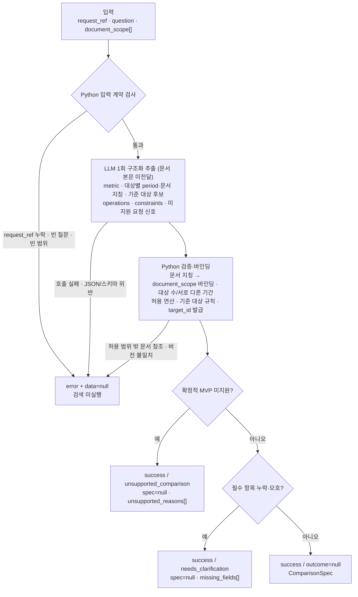

# N-07 · define_comparison — 비교 축 정의

> **상태:** **MVP 개념 계약 확정(2026-11-28)** — MVP 1차 범위를 **단일 문서 · 정량 지표 1개 · 서로 다른 명시적 기간 2개**로 한정(팀 이슈 #9 A안 · #10), N-10은 권한·범위 고정과 작업 분류만 맡고 N-07은 **LLM 1회 구조화 + Python 결정적 검증·바인딩**(#9 B안), 반환은 `NodeResult[ComparisonDefinition]`(#9 ②안)으로 `data`를 사용자 공개 가능 구조로 유지, 모호한 비교 요청의 기본 동작(연산 미지정 = 나란히 보기, 방향 없는 금액 차이 = 이전 시점 기준, 방향 없는 증감률 = 명확화) 확정. 실제 Python 타입·프롬프트·구현/테스트는 미완료.

## 1. 단일 책임과 경계

**T-03(비교 분석)의 첫 단계**로서, 사용자 질문 원문과 허용 문서 범위를 받아 **무엇을(지표) · 어느 시점끼리(대상 2개) · 어떻게(연산·기준 대상) 비교할지**를 담은 의미적 비교 정의 `ComparisonSpec`을 만든다. 비교가 불가능하거나 정보가 부족하면 검색 전에 그 사유를 구조화해 돌려준다.

- **하는 일:**
  1. LLM 1회 호출로 질문 원문에서 지표(`metric`), 대상별 기간(`period`)·문서 지칭, 기준 대상 후보, 요청 연산(`operations[]`), 명시된 제약(`constraints[]`) 추출
  2. Python 결정적 검증: 출력 JSON/스키마, 대상 수(정확히 2개 · 서로 다른 기간), 허용 연산, 기준 대상 규칙(4.3절) 검사
  3. Python 바인딩: `target_id` 안정 발급, **`document_scope` 안에서만** 각 대상의 `document_id`·`document_version` 연결
- **하지 않는 일:**
  - 권한·버전 사전 검증과 허용 문서 범위 확정(N-10·하네스), 작업 유형 분류(N-10)
  - **대상별 검색어 조립과 N-01/N-02 반복 호출(T-03)**, 원문 조회(N-02)
  - 기간·단위·집계 기준의 실제 비교 가능성 판정(N-08), 차이·증감률 계산(N-09), 근거 검증(N-03), 사용자 문장 작성(N-11)
  - 질문 재작성·쿼리 증폭(H-12 백로그), 사용자가 말하지 않은 지표·기간·연산·제약의 임의 추가

### 1.1 MVP 1차 지원 범위 (이슈 #9 A안 · #10 확정)

| 구분 | 범위 | 처리 |
|---|---|---|
| **지원** | 사용자가 허용한 **단일 PDF(문서 1개)** 안에서 **정량 지표 1개**를 **서로 다른 명시적 기간(연도 등) 2개**로 비교 | `ComparisonSpec` 생성 |
| **지원 연산** | 값 나란히 보기(`operations: []`), 금액 차이(`difference`), 증감률(`percent_change`) — 하나 또는 둘 다 | `operations[]`에 기록 |
| **후속 범위 (MVP 미지원)** | 서로 다른 문서 간 비교, 다중 지표 동시 비교, 3개 이상 기간 추이, 정성 비교, 증감 원인(인과) 분석 | `success / unsupported_comparison` |

- **`period`는 데이터가 가리키는 시점**이다. 문서 발행연도가 아니므로 한 PDF 안에 2024년 결산과 2025년 예산처럼 두 시점이 함께 있을 수 있다.
- **확장 호환성:** MVP에서는 두 대상의 `document_id`·`document_version` 쌍이 같아야 한다. 그래도 각 대상(`targets[]`)에 문서 ID·버전을 미리 두어, 추후 다중 문서 비교로 넓힐 때 스키마를 깨지 않게 한다.

## 2. 입력 계약 (MVP 개념 필드 확정)

| 입력 필드 | 요구 | 의미 |
|---|---|---|
| `request_ref` | 필수 | 상위 요청 식별 ID (그대로 보존) |
| `question` | 필수 | N-10이 변형 없이 전달한 사용자 질문 원문 |
| `document_scope[]` | 필수 (1건 이상) | N-10·하네스가 `requested_documents ∩ authorized_scope`로 고정한 허용 문서 ID·버전 목록 *(분류용 제목 등 최소 메타데이터 포함 가능)* |
| `reference_period` | 선택 | 상위 입력이 **명시적으로** 전달한 상대 기간의 기준 시점 *(기본 단일 채팅 UI에서는 없음)* |

- `request_ref` 누락, 빈 `question`, 빈 `document_scope[]` 등 시스템 입력 계약 위반은 LLM을 호출하지 않고 `status="error"`, `data=null`로 차단한다.
- **간접 프롬프트 인젝션 차단:** LLM에는 **문서 본문을 전달하지 않고** 질문 원문과 허용 문서의 최소 메타데이터(개수·제목)만 준다([N-10](N-10.md#2-입력-계약-mvp-개념-필드-확정)과 같은 원칙). 모델 실행 경계(로컬 전용·개발 클라우드 공개 자료 게이트)는 하네스 어댑터 책임으로 [백로그 4.11](../idea-backlog.md#411-하네스-모델-실행-경계--로컬-전용-강제-및-개발-클라우드-공개-자료-검증-정책-2026-11-28)에서 관리한다.

## 3. 출력 계약: `NodeResult[ComparisonDefinition]` (MVP 개념 필드 확정)

공통 `NodeResult[T]`의 `status`, `data`, `diagnostics`, `outcome`은 그대로 사용한다([공통 반환 계약](common-result-contract.md)).

- **`data`는 사용자 공개 가능한 구조화 객체만 담는다.** 명확화 필요·미지원 사유도 `data`에 구조화해 두고, `diagnostics`는 내부 단계 진단 전용으로 유지한다. 내부 오류 상세를 사용자 응답에 노출하지 않는 [N-11 원칙](N-11.md#전달-및-노출-원칙-2026-11-28-확정)과 맞춘다.
- **`data: null`은 실행 실패(`status="error"`)에만 사용한다.**

### 3.1 `data: ComparisonDefinition`

| 필드 | 요구 | 의미 |
|---|---|---|
| `request_ref` | 필수 | 상위 요청 ID 그대로 보존 |
| `spec` | 필수 (`null` 가능) | 정상 확정 시 `ComparisonSpec`, `needs_clarification`·`unsupported_comparison`이면 `null` |
| `missing_fields[]` | 필수 (빈 배열 가능) | 명확화가 필요한 항목. 개념 값: `metric` · `period` · `baseline_target` · `document` |
| `unsupported_reasons[]` | 필수 (빈 배열 가능) | 확정적 MVP 미지원 사유. 개념 값: `cross_document` · `multiple_metrics` · `more_than_two_periods` · `qualitative_comparison` · `causal_analysis` · `unsupported_operation` |

- **불변 조건:** 아래 대응은 **`status="success"`일 때만** 적용한다(`status="error"`도 `outcome=null`이지만 `data=null`이다). `status="success"`이고 `outcome=null`이면 `spec≠null`이고 `missing_fields`·`unsupported_reasons`는 둘 다 빈 배열이다. `outcome`이 `needs_clarification`이면 `missing_fields`가 1개 이상, `unsupported_comparison`이면 `unsupported_reasons`가 1개 이상이다. 실제 스키마는 `outcome`을 판별자로 한 `oneOf` + `const`로 고정한다.
- 사유 코드는 개념 값이며 표준 코드명은 구현 시 확정한다. 사용자용 안내 문장은 N-11이 코드에서 정형 템플릿으로 만든다.

### 3.2 `spec: ComparisonSpec`

| 필드 | 요구 | 의미 |
|---|---|---|
| `request_ref` | 필수 | 상위 요청 ID 그대로 보존 |
| `original_question` | 필수 | 질문 원문 보존 *(하네스가 입력에서 복사, LLM 출력에서 받지 않음)* |
| `metric` | 필수 | 두 대상에 공통으로 적용할 정량 지표 1개 (예: `경상운영비`) |
| `targets[]` | 필수 (정확히 2개) | 비교 대상. 요소 필드는 아래 표 |
| `operations[]` | 필수 (빈 배열 가능) | `[]`(나란히 보기) 또는 `["difference"]` / `["percent_change"]` / 둘 다 |
| `baseline_target_id` | 조건부 | `operations=[]`이면 `null`, 계산 연산이 있으면 필수 (`targets[]`의 `target_id` 중 하나) |
| `baseline_source` | 조건부 | `"explicit"`(사용자가 기준 명시) · `"default_earlier_period"`(방향 없는 금액 차이의 기본 규칙) · `null`(`operations=[]`) |
| `constraints[]` | 필수 (빈 배열 가능) | 사용자가 **명시한** 제약만 `{type, value}`로 기록. 예: 집계 범위(연결/별도, 기관 전체/부서), 수치 성격(`value_nature`: 예산/결산/실적, 본예산/추경), 요청 단위. 명시가 없으면 `[]` |

| `targets[]` 요소 필드 | 요구 | 의미 |
|---|---|---|
| `target_id` | 필수 | **Python이 발급**(`target_001`, `target_002`, 질문 내 등장 순서). LLM이 만들지 않음 |
| `period` | 필수 | 데이터가 가리키는 시점. 원문 표기(`label`), 단위(`granularity`: 연도·반기·분기 등), 정규화 값(`value`) |
| `document_id` · `document_version` | 필수 | `document_scope[]` 안에서 Python이 바인딩. MVP에서는 두 대상이 같은 쌍 |

- **연산 의미:** `difference`는 기준 대상 대비 차이, `percent_change`는 기준 대상 대비 증감률이다. N-07은 **연산 종류와 기준 대상만 정의**하며, 실제 산식과 예외(기준값 `0`·음수 기준값 등)는 [N-09 기준값 정책](N-09.md#43-기준값-0음수-기준값-증감률-정책-n-07-산식-충돌-해소)을 따른다. 계산은 **N-09**, 단위·기간·집계 기준의 비교 가능성 판정은 **N-08**이 한다.

## 4. 내부 워크플로 (MVP 확정)

**Python 입력 계약 검사 → LLM 1회 구조화 추출 → Python 결정적 검증·바인딩 → 상태 우선순위(5절)에 따른 반환** 순서로 실행한다. 내부 검사·바인딩 함수는 N-07 내부 Python 함수이며 별도 Small/Tiny Node로 나누지 않는다([N-05](N-05.md)와 같은 패턴).



### 4.1 LLM 구조화 추출 규칙

- 질문에 **쓰인 표현만** 추출한다. 지표·기간·연산·제약을 문서 내용이나 일반 상식으로 보충하지 않는다.
- 3개 이상 기간, 여러 지표, 원인 질문(*"왜 늘었어?"*), 정성 비교처럼 MVP 범위 밖 요청은 버리지 않고 **미지원 요청 신호로 함께 보고**하게 해, Python이 `unsupported_reasons[]`로 바꾼다.
- `original_question`, `document_id`, `document_version`, `target_id`는 LLM 출력에서 받지 않는다([N-10 하네스 인자 고정 원칙](N-10.md#31-실행-가능-시-statussuccess-outcomenull)과 같음).

### 4.2 Python 결정적 검증·바인딩 규칙

| 검사 | 통과 조건 | 미충족 시 |
|---|---|---|
| 출력 JSON·스키마 | 정의된 필드·열거값만 사용 | `error` |
| 문서 바인딩 | 문서 지칭이 `document_scope[]` 안의 문서로만 해석됨. 범위에 1건이면 두 대상 모두 그 문서 | 범위 밖 문서·버전 불일치 → `error` · 여러 문서가 허용됐는데 어느 1문서 비교인지 불명확 → `needs_clarification`(`document`) · 서로 다른 두 문서 비교가 명시됨 → `unsupported_comparison`(`cross_document`) |
| 지표 | 공통 정량 지표 정확히 1개 | 없음·모호 → `needs_clarification`(`metric`) · 2개 이상 → `unsupported_comparison`(`multiple_metrics`) |
| 대상·기간 | 대상 정확히 2개, 서로 다른 기간 | 1개뿐·같은 기간 2개·해석 불가 → `needs_clarification`(`period`) · 3개 이상 → `unsupported_comparison`(`more_than_two_periods`) |
| 연산 | `difference` · `percent_change`만 (또는 없음) | 평균·순위 등 허용 목록 밖 연산 요청 → `unsupported_comparison`(`unsupported_operation`) |
| 기준 대상 | 4.3절 규칙 | 4.3절 표 |
| `target_id` | Python이 질문 내 등장 순서로 발급 | — |

### 4.3 모호한 비교 요청의 기본 동작 (MVP 확정)

| 요청 형태 (예시) | `operations` | `baseline_target_id` | `baseline_source` | 결과 |
|---|---|---|---|---|
| **연산 미지정** *("2024년과 2025년 경상운영비 비교해줘")* | `[]` | `null` | `null` | `success / null` — 두 값·단위·출처를 나란히 표시. 차이·증감률을 임의로 추가하지 않음 |
| **방향 명시** *("2024년 대비 2025년 증가액과 증가율")* | `["difference", "percent_change"]` | 명시된 기준 대상(2024년) | `"explicit"` | `success / null` |
| **방향 없는 금액 차이** *("2024년과 2025년 경상운영비 차이가 얼마야?")* | `["difference"]` | **시간상 이전 시점**(2024년), 질문 나열 순서와 무관 | `"default_earlier_period"` | `success / null` — 계산식은 `이후 − 이전`. **N-09·N-11은 기준식(`2025년 − 2024년`)을 사용자에게 반드시 표시** |
| **방향 없는 증감률** *("2024년과 2025년이 몇 % 차이야?")* | — | — | — | `success / needs_clarification`, `missing_fields: ["baseline_target"]` — 분모에 따라 수치 자체가 달라지므로 추정 금지 |
| **선후를 확정할 수 없는 대상**에 방향 없는 계산 요청 *(비시계열 대상, 겹치는 기간 등)* | — | — | — | `success / needs_clarification`, `missing_fields: ["baseline_target"]` |
| **상대 기간 + 기준 시점 명시** *("2025년 전년 대비")* | 요청대로 | 요청대로 | 요청대로 | 2024년·2025년으로 변환 후 정상 진행 |
| **상대 기간 + 기준 시점 없음** *("작년 대비 올해")* | — | — | — | `success / needs_clarification`, `missing_fields: ["period"]` — **시스템 날짜나 PDF 제목으로 추측하지 않음** |

- 상대 기간은 질문 안의 명시적 시점이나 상위 입력 `reference_period`가 있을 때만 변환한다.
- `difference`와 `percent_change`가 함께 요청됐는데 방향이 없으면 증감률 규칙이 우선해 `needs_clarification`(`baseline_target`)이다. 금액 차이만 기본 규칙으로 계산해 일부만 답하지 않는다.

## 5. 예외 처리 및 반환 상태 (MVP 확정)

**판정 우선순위: `error` → 확정된 `unsupported_comparison` → `needs_clarification` → 정상 완료(`success/null`).** N-07은 LLM 1회 + Python 검사 구조이므로 N-05·N-06과 같이 `status=partial`을 사용하지 않는다.

| 상황 | `status` | `outcome` | `data` |
|---|---|---|---|
| 정상 확정 | `success` | `null` | `{request_ref, spec: {...}, missing_fields: [], unsupported_reasons: []}` |
| 필수 항목 누락·모호 (지표·기간·분모 기준, 또는 여러 문서가 허용됐는데 1문서 비교인지 불명확) | `success` | `"needs_clarification"` | `{request_ref, spec: null, missing_fields: [...], unsupported_reasons: []}` |
| 확정적 MVP 미지원 (서로 다른 두 문서 비교 명시, 다중 지표, 3개 이상 기간, 정성 비교, 원인 분석, 허용 밖 연산) | `success` | `"unsupported_comparison"` | `{request_ref, spec: null, missing_fields: [...확인된 경우 보존], unsupported_reasons: [...]}` |
| 실행 실패 (LLM 호출·타임아웃, JSON 파싱·스키마 위반, 입력 계약 위반, 허용 범위 밖 문서 참조·버전 불일치) | `error` | `null` | `null` *(단계별 실패는 `diagnostics`에만 기록)* |

- **미지원 우선 (N-05와의 차이):** N-05는 독립 기준마다 따로 처리할 수 있지만, N-07 MVP는 **요청 전체에 `ComparisonSpec` 하나**를 만든다. 따라서 확정적 미지원과 지표 누락이 섞이면 지표를 되물어도 실행할 수 없으므로 `unsupported_comparison`을 우선하고, 확인된 `missing_fields`는 함께 보존한다.
- **fail-closed:** 허용 범위 밖 문서 참조와 버전 불일치는 명확화나 미지원으로 바꾸지 않고 `error`로 막는다. 범위 밖 문서의 존재 여부·버전은 `data`에 남기지 않는다.
- **분류기 장애와 업무 결과 구분:** LLM 타임아웃·파싱 실패를 `needs_clarification`이나 `unsupported_comparison`으로 위장하지 않는다.

### 가상 반환 예시 1 — 정상 확정 (KISTEP 자료, 2024 vs 2025 경상운영비)

사용자 입력: *"이 KISTEP 예산 자료에서 2024년 대비 2025년 경상운영비 증가액과 증가율을 본예산 기준으로 알려줘."* (`document_scope`에 문서 1건, 문서명·값은 설명용 가상 데이터)

```json
{
  "status": "success",
  "data": {
    "request_ref": "req_101",
    "spec": {
      "request_ref": "req_101",
      "original_question": "이 KISTEP 예산 자료에서 2024년 대비 2025년 경상운영비 증가액과 증가율을 본예산 기준으로 알려줘.",
      "metric": "경상운영비",
      "targets": [
        {
          "target_id": "target_001",
          "period": {"label": "2024년", "granularity": "year", "value": "2024"},
          "document_id": "doc_01",
          "document_version": "sha256:example"
        },
        {
          "target_id": "target_002",
          "period": {"label": "2025년", "granularity": "year", "value": "2025"},
          "document_id": "doc_01",
          "document_version": "sha256:example"
        }
      ],
      "operations": ["difference", "percent_change"],
      "baseline_target_id": "target_001",
      "baseline_source": "explicit",
      "constraints": [
        {"type": "value_nature", "value": "본예산"}
      ]
    },
    "missing_fields": [],
    "unsupported_reasons": []
  },
  "diagnostics": {
    "validate_input": {"status": "success"},
    "extract_comparison": {"status": "success"},
    "validate_and_bind": {"status": "success"}
  },
  "outcome": null
}
```

### 가상 반환 예시 2 — `needs_clarification` (상대 기간 + 분모 모호)

사용자 입력: *"올해랑 작년 경상운영비 몇 % 차이야?"* (기준 시점 입력 없음)

```json
{
  "status": "success",
  "data": {
    "request_ref": "req_102",
    "spec": null,
    "missing_fields": ["period", "baseline_target"],
    "unsupported_reasons": []
  },
  "diagnostics": {
    "validate_input": {"status": "success"},
    "extract_comparison": {"status": "success"},
    "validate_and_bind": {"status": "success"}
  },
  "outcome": "needs_clarification"
}
```

### 가상 반환 예시 3 — `unsupported_comparison` (다중 문서 + 지표 누락 혼합)

사용자 입력: *"A 보고서랑 B 보고서 비교해 줘."* (`document_scope`에 문서 2건)

```json
{
  "status": "success",
  "data": {
    "request_ref": "req_103",
    "spec": null,
    "missing_fields": ["metric"],
    "unsupported_reasons": ["cross_document"]
  },
  "diagnostics": {
    "validate_input": {"status": "success"},
    "extract_comparison": {"status": "success"},
    "validate_and_bind": {"status": "success"}
  },
  "outcome": "unsupported_comparison"
}
```

## 6. T-03 연동 경계 (MVP 확정)

- **검색 시작 조건:** `status="success"`이고 `outcome=null`(유효한 `spec`)일 때만 T-03이 대상별 N-01/N-02 검색을 시작한다. `needs_clarification` · `unsupported_comparison` · `error`이면 **검색 전에 종료**하고 결과를 N-11로 넘긴다.
- **검색어 조립은 T-03 책임:** N-07은 의미적 `ComparisonSpec`만 출력한다. `metric`·대상별 `period`(필요 시 `constraints[]`)로 *"2024년 경상운영비"*, *"2025년 경상운영비"* 같은 대상별 검색어를 만들고 N-01/N-02를 반복 호출하는 일은 T-03이 맡는다. 세부 조립 규칙은 T-03 문서에서 확정한다.
- **후속 노드 의무:** `baseline_source="default_earlier_period"`이면 N-09 결과와 N-11 안내에 **계산 기준식(예: `2025년 − 2024년`)을 반드시 표시**해 사용자가 바로 확인·정정할 수 있게 한다.
- **ID 보존:** `request_ref`와 `target_id`는 N-08·N-09·N-03까지 그대로 유지하고 재발급하지 않는다.

## 7. 테스트 체크리스트

| # | 사례 | 입력 예시 | 기대 결과 |
|---|---|---|---|
| 1 | 정상 확정 | *"2024년 대비 2025년 경상운영비 증가액"* (문서 1건) | `success / null`, 대상 2개 같은 문서로 바인딩, `operations: ["difference"]` |
| 2 | 방향 명시 | *"2024년 대비 2025년 증가액과 증가율"* | `baseline_target_id`=2024년 대상, `baseline_source: "explicit"` |
| 3 | 방향 없는 금액 차이 (B안) | *"2025년과 2024년 경상운영비 차이가 얼마야?"* (나열 순서 역순) | 기준=2024년 대상, `baseline_source: "default_earlier_period"` |
| 4 | 방향 없는 증감률 | *"2024년과 2025년이 몇 % 차이야?"* | `needs_clarification`, `missing_fields: ["baseline_target"]` |
| 5 | 연산 미지정 | *"2024년과 2025년 경상운영비 비교해줘"* | `operations: []`, `baseline_target_id: null`, `baseline_source: null` |
| 6 | 상대 기간 | *"작년 대비 올해"* / *"2025년 전년 대비"* | 전자는 `needs_clarification`(`period`), 후자는 2024년·2025년으로 변환 |
| 7 | 다중 문서 미지원 | *"A 보고서랑 B 보고서 비교해 줘"* (문서 2건) | `unsupported_comparison`(`cross_document`), 확인된 `missing_fields` 보존 |
| 8 | 허용 범위 밖 문서 | 질문이 `document_scope`에 없는 문서를 지칭 | `error`, `data=null`, 범위 밖 문서 정보 비노출, 검색 미실행 |
| 9 | JSON 파싱 실패 | LLM이 스키마를 깨뜨린 출력 반환 | `error`, `data=null`, `diagnostics`에 단계 실패 기록 |

## 8. 후속 구현·검증 항목

1. `ComparisonDefinition`·`ComparisonSpec`·`period` 정규화 값의 실제 Python/Pydantic 타입과 `outcome` 판별 `oneOf` 스키마 확정
2. `missing_fields`·`unsupported_reasons`·`constraints[].type` 표준 코드 확정 및 N-11 정형 안내 템플릿 연동
3. 한국어 기간 표현(회계연도·반기·분기·"전년 대비") 정규화와 선후 판정 규칙 단위 테스트
4. 7절 체크리스트 기반 평가셋 구축 및 N-10 라우팅 오분류(비교가 아닌 요청 유입)가 N-07에서 어떻게 드러나는지 측정
5. **후속 범위 확장:** 다중 문서 비교(`targets[]` 문서 바인딩 해제), 다중 지표, 3개 이상 기간 추이, 정성 비교 — MVP 평가 후 결정

**경계:** 권한·범위 확정과 작업 분류(N-10), 검색어 조립·대상별 검색 반복(T-03), 비교 가능성 판정(N-08), 계산(N-09), 사용자 안내 문장(N-11)은 이 문서에 두지 않는다. 내부 추출·검증·바인딩 함수를 Tiny Node로 분할하지 않는다.

> **설계 근거 주석 (참고 문헌·실무 기준)**
> - **단일 문서 · 지표 1개 · 기간 2개 범위와 `metric`/`period`/문서 바인딩 분리:** [*FinQA*](https://aclanthology.org/2021.emnlp-main.300/) (Chen 외, EMNLP 2021), [*DocFinQA*](https://aclanthology.org/2024.acl-short.42/) (Reddy 외, ACL 2024), [*ConvFinQA*](https://aclanthology.org/2022.emnlp-main.421/) (Chen 외, EMNLP 2022)의 재무 수치 비교·다단계 계산 과제에서 오류가 값·기간·대상 매칭에서 크게 발생함을 근거로, MVP는 비교 축을 가장 좁은 형태로 고정했다. 지표·기간·출처를 독립 차원으로 두는 구조는 [*XBRL Open Information Model 1.0*](https://www.xbrl.org/Specification/oim/REC-2021-10-13/oim-REC-2021-10-13.html) (2021)의 concept·period 차원 분리와 [*W3C Data on the Web Best Practices*](https://www.w3.org/TR/dwbp/) BP 7·11 (2017)의 메타데이터·버전 명시 원칙을 참고했다.
> - **N-10 분류 → N-07 LLM 1회 구조화 + Python 검증·바인딩:** [*Enterprise Integration Patterns — Content-Based Router*](https://www.enterpriseintegrationpatterns.com/patterns/messaging/ContentBasedRouter.html) (Hohpe·Woolf, 2003)와 [*Building Effective Agents*](https://www.anthropic.com/research/building-effective-agents) (Anthropic, 2024)의 라우팅·워크플로 분리를 따라 N-10은 작업 분류만, N-07은 비교 정의만 맡긴다. 앞 단계 분류 오류가 뒤로 전파될 수 있다는 [*Qin 외*](https://aclanthology.org/D19-1214/) (EMNLP 2019)의 지적을 고려해 N-07이 스키마·대상 수·연산을 다시 검사한다. 출력 형식은 [*OpenAI Structured Outputs*](https://openai.com/index/introducing-structured-outputs-in-the-api/) (2024)처럼 스키마로 제한하되 최종 판정은 Python이 하며, 문서 ID·버전·질문 원문을 LLM 출력에서 받지 않고 문서 본문도 넣지 않는 것은 [*OWASP LLM01: Prompt Injection*](https://genai.owasp.org/llm2026/llm012026-prompt-injection/) (2026) 대응이다.
> - **모호한 비교의 기본 동작:** 증감률·증감액은 기준 연도를 분모·감수로 둔다는 재정 통계 관행([*국회예산정책처 《2025 대한민국 재정》*](https://www.nabo.go.kr/ko/report/analysisView.do?idx=8684&key=2509250001), 2025)에 따라 방향 없는 금액 차이는 이전 시점을 기본 기준으로 하되 계산식을 공개한다. 분모에 따라 값이 달라지는 증감률은 [*AmbigQA*](https://aclanthology.org/2020.emnlp-main.466/) (Min 외, EMNLP 2020)와 [*CLAMBER*](https://aclanthology.org/2024.acl-long.578/) (Zhang 외, ACL 2024)의 모호 질의 연구에 따라 추정 대신 명확화한다. 기본값을 쓸 때 사용자가 즉시 확인·정정할 수 있게 하는 원칙은 [*Microsoft Guidelines for Human-AI Interaction*](https://www.microsoft.com/en-us/haxtoolkit/ai-guidelines/) G9–G11 (Amershi 외, 2019)을, 상대 기간은 기준 시점이 있을 때만 해석한다는 원칙은 [*SUTime*](https://aclanthology.org/L12-1122/) (Chang & Manning, LREC 2012)의 기준 시점 의존 시간 표현 정규화를 참고했다.
> - **`data` 공개 구조 · `diagnostics` 내부 전용 · `outcome` 판별 스키마:** [*RFC 9457*](https://www.rfc-editor.org/rfc/rfc9457.html#section-3) §§3–5 (2023)의 문제 상세 구조화, [*OWASP Error Handling Cheat Sheet*](https://cheatsheetseries.owasp.org/cheatsheets/Error_Handling_Cheat_Sheet.html)와 [*MITRE CWE-209*](https://cwe.mitre.org/data/definitions/209.html)의 내부 오류 정보 비노출 원칙에 따라 사용자에게 보일 사유는 `data`에 코드로, 실행 진단은 `diagnostics`에만 둔다. `outcome`별 `data` 형태는 [*OpenAPI 3.1.2 Discriminator*](https://spec.openapis.org/oas/v3.1.2.html#discriminator-object)와 [*JSON Schema 2020-12 `const`*](https://json-schema.org/draft/2020-12/json-schema-validation#section-6.1.3)로 고정해 명확화·미지원이 빈 정상 결과로 오인되지 않게 한다.

[Small Node 문서 목록](README.md) · [공통 반환 계약](common-result-contract.md) · [N-05 기준 구조화](N-05.md) · [N-10 요청 라우팅](N-10.md) · [N-11 결과 전달](N-11.md) · [명칭 통일](../naming-conventions.md)
