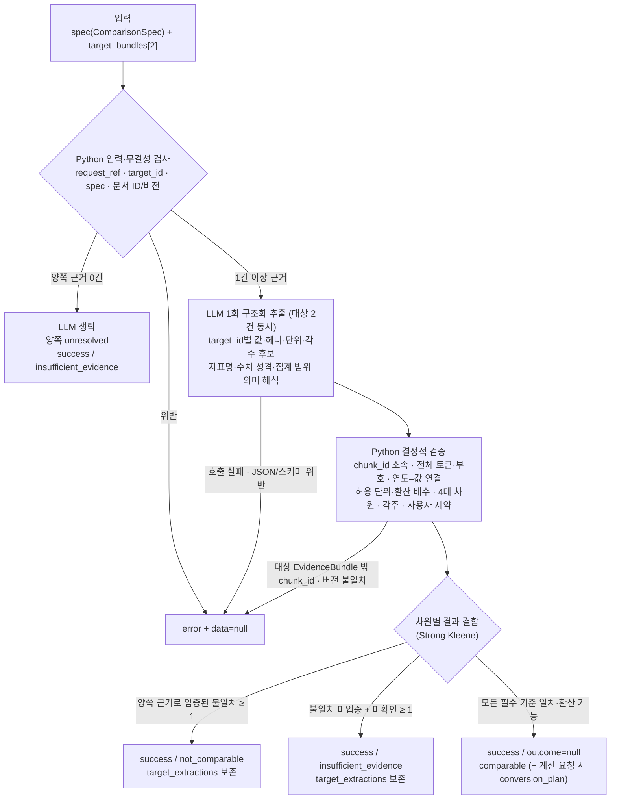

# N-08 · check_comparability — 비교 가능성 검사

> **상태:** **MVP 개념 계약 확정(2026-11-28)** — N-07의 `ComparisonSpec`과 대상별 `EvidenceBundle`을 받아 **Python 입력·무결성 검사 → LLM 1회 구조화 추출(대상 2건 동시) → Python 결정적 검증** 순서로 두 대상의 값·연도·부호·단위·수치 성격·집계 범위·각주를 대조하고, `comparable` / `not_comparable` / `insufficient_evidence` 3분류와 대상별 추출 근거를 `NodeResult[ComparabilityReport]`로 반환한다(팀 이슈 #10). 전체 숫자 토큰·부호·연도 검증의 Python 책임, 단위·수치 성격·집계 범위·기간 정합성 4대 차원, Strong Kleene 혼합 우선순위, 판정과 무관한 부분 값 보존, 출처 경계·fail-closed 오류 확정. 실제 Python 타입·단위 환산표·프롬프트·구현/테스트는 미완료.

## 1. 단일 책임과 경계

**T-03(비교 분석)의 검색·원문 조회 다음 단계**로서, N-07이 정의한 두 비교 대상 각각의 원문 근거에서 **비교할 값과 그 값의 기준(연도·부호·단위·수치 성격·집계 범위·각주)**을 확정하고, 두 값이 같은 기준에서 비교 가능한지 판정한다.

- **하는 일:**
  1. 대상 2건의 `EvidenceBundle`에서 값·헤더·단위·각주 후보를 **LLM 1회 호출로 동시에** 구조화 추출
  2. Python 결정적 검증: 참조·버전·범위 유효성, **전체 숫자 토큰·부호 일치**, 연도–값 연결, 허용 단위·환산 배수, 4대 차원(3.4절)·각주·사용자 제약 판정
  3. 계산 연산이 요청된 경우 N-09가 그대로 따를 **단위 환산 계획(`conversion_plan`)** 작성
  4. 판정 결과와 무관하게 대상 2건의 추출 결과·출처(`target_extractions[]`) 보존
- **하지 않는 일:** 검색·원문 조회(N-01/N-02), **실제 단위 환산·차이/증감률 계산(N-09)**, 원문 대조 최종 사실 검증(N-03), 사용자 문장 작성(N-11), 비교 대상·연산 재정의(N-07)

## 2. 입력 계약 (MVP 개념 필드 확정)

| 입력 필드 | 요구 | 의미 |
|---|---|---|
| `request_ref` | 필수 | 상위 요청 ID 그대로 사용 |
| `spec` | 필수 | 유효한 N-07 결과 `ComparisonSpec`(`status="success"`, `outcome=null`). 대상 정확히 2건, `operations[]`, `baseline_target_id`, `constraints[]` 포함 |
| `target_bundles[]` | 필수 (정확히 2건) | `spec.targets[]`의 각 `target_id`에 대응하는 대상별 근거. 요소: `target_id`, `bundle_state`, `evidence_bundle` |

| `target_bundles[]` 요소 필드 | 요구 | 의미 |
|---|---|---|
| `target_id` | 필수 | N-07이 발급한 대상 ID 그대로 |
| `bundle_state` | 필수 | `"retrieved"`(N-02 `EvidenceBundle` 확보) · `"no_candidates"`(N-01 정상 0건으로 N-02 생략) · `"not_retrieved"`(앞 단계 실패로 미확보, 실패 상세는 T-03 진단에 보존) |
| `evidence_bundle` | 조건부 | `bundle_state="retrieved"`일 때 N-02의 `NodeResult.data: EvidenceBundle`(`context_text`, `source_refs[]`, `expanded_source_refs[]`, 표 청크의 `table_context`), 그 외 `null` |

- **LLM 호출 전 `error` 차단:** `request_ref` 불일치(입력 ↔ `spec` ↔ 각 `EvidenceBundle`), `target_bundles[]`의 `target_id` 누락·중복·`spec`과 불일치, `spec` 무결성 위반(대상 2건 아님, 계산 연산이 있는데 `baseline_target_id` 없음 등), 근거 항목의 `document_id`·`document_version`이 해당 대상의 허용 문서·버전과 다름 → `status="error"`, `data=null`.
- **정상 0건은 오류가 아님:** 정상 검색 후 한쪽 또는 양쪽의 근거가 비어 있으면(`no_candidates`, `not_retrieved`, 빈 `evidence_items[]`) 업무상 `insufficient_evidence`로 처리하고 빈 대상은 `unresolved`로 남긴다. 양쪽이 모두 비면 LLM을 호출하지 않는다.
- **간접 프롬프트 인젝션 주의:** 원문 문맥은 판정 대상 데이터로만 전달하고, 원문 안의 지시문을 실행 지시로 따르지 않도록 시스템 지침으로 분리한다.

## 3. 출력 계약: `NodeResult[ComparabilityReport]` (MVP 개념 필드 확정)

공통 `NodeResult[T]`의 `status`, `data`, `diagnostics`, `outcome`은 그대로 사용한다([공통 반환 계약](common-result-contract.md)). `data: null`은 실행 실패(`status="error"`)에만 사용한다.

### 3.1 `data: ComparabilityReport`

| 필드 | 요구 | 의미 |
|---|---|---|
| `request_ref` | 필수 | 상위 요청 ID 그대로 보존 |
| `comparability` | 필수 | `"comparable"` · `"not_comparable"` · `"insufficient_evidence"` *(`status="success"`일 때 공통 `outcome`과 항상 일치: `comparable` ⇔ `outcome=null`. `status="error"`도 `outcome=null`이지만 `data=null`이므로 이 대응을 적용하지 않음)* |
| `target_extractions[]` | 필수 (정확히 2건) | N-07의 `target_id` 2건별 추출 결과. **판정과 무관하게 항상 유지** (3.2절) |
| `conversion_plan` | 조건부 | `comparable`이고 계산 연산이 있을 때 필수, 그 외 `null` (3.3절) |
| `incomparability_reasons[]` | 필수 (빈 배열 가능) | `not_comparable`이면 1건 이상. 양쪽 근거로 입증된 필수 기준 불일치 |
| `insufficiency_reasons[]` | 필수 (빈 배열 가능) | `insufficient_evidence`이면 1건 이상. `not_comparable`일 때도 함께 확인된 미확인 사유는 보존 |

- 사유 요소는 `{dimension, code, target_ids[]}`로 기록한다. `dimension` 개념 값: `value` · `sign` · `period` · `unit` · `value_nature` · `aggregation_scope` · `footnote` · `constraint`. 세부 `code`는 구현 시 확정한다.
- **불변 조건:** `insufficient_evidence`이면 `incomparability_reasons=[]`다(입증된 불일치가 있으면 `not_comparable`이 우선하기 때문). `comparable`이면 두 사유 배열이 모두 비고 두 대상이 모두 `extracted`다. 실제 스키마는 `comparability`를 판별자로 한 `oneOf` + `const`로 고정한다.

### 3.2 `target_extractions[]` 요소

| 필드 | 요구 | 의미 |
|---|---|---|
| `target_id` | 필수 | N-07 대상 ID 그대로 |
| `extraction_status` | 필수 | `"extracted"`(값·기준 후보 확정) · `"unresolved"`(미확보·거부·모호) |
| `raw_value_text` | 조건부 | 원문에서 **토큰 경계까지 다시 읽은 전체 숫자 토큰**(부호·쉼표·소수점·붙은 단위 포함, 예: `"4,532"`, `"△34"`). `unresolved`면 `null` |
| `parsed_decimal_str` | 조건부 | 부호를 반영해 정규화한 10진 문자열(예: `"4532"`, `"-34"`). 부동소수점으로 바꾸지 않음. `unresolved`면 `null` |
| `raw_unit` | 조건부 | 원문 단위 표기(`"백만원"`, `"%"`, `"%p"` 등). `%`와 `%p`는 서로 다른 단위로 보존 |
| `period_label` · `resolved_period` | 조건부 | 원문 연도 표기(`"2024년"`, `"’24년"`, `"FY2024"`)와, 연도를 유일하게 확정한 경우의 N-07 `period` 대응 값 |
| `metric_label` | 조건부 | 값이 속한 원문 지표명·행 라벨 |
| `value_nature` | 조건부 | 원문 정의로 식별한 수치 성격(본예산·추경·결산·실적·계획 또는 `"unconfirmed"`) |
| `aggregation_scope` | 조건부 | 원문에서 확인한 집계 범위(합계/하위 항목, 연결/별도, 기관 전체/부서 등 또는 `"unconfirmed"`) |
| `footnotes_applied[]` | 조건부 | 수치 정의·집계 기준에 반영한 각주 표기와 근거 위치 |
| `evidence_refs[]` | 조건부 | 값·헤더·단위·각주를 확인한 `chunk_id` 목록. `extracted`면 1개 이상 필수 |
| `issue_reasons[]` | 필수 (빈 배열 가능) | `unresolved` 사유 또는 `extracted`라도 남겨야 할 경고 |

- **`extracted`는 N-08 추출 결과일 뿐이다.** 사용자에게 값을 공개할지는 후속 T-03 흐름에서 N-03의 `supported` 판정이 최종 결정한다.
- **출처 경계:** 헤더·단위·각주가 같은 근거 항목의 확장 문맥 안에 있으면 그 `chunk_id` 1개를 기록한다(원래·확장 위치는 N-02의 `source_refs[]` + `expanded_source_refs[]`가 보존). 별도 청크에 있으면 **해당 대상의 `EvidenceBundle` 안에 있는** 값·헤더·각주 `chunk_id`를 함께 기록한다. 다른 대상의 `EvidenceBundle`에만 있는 청크를 빌려 쓰지 않는다.

### 3.3 `conversion_plan`

| 필드 | 요구 | 의미 |
|---|---|---|
| `target_unit` | 필수 | 계산에 사용할 공통 단위. 사용자 제약의 요청 단위(*"억원으로 표시"*)가 있으면 그 단위, 없으면 기준 대상(`baseline_target_id`)의 원문 단위 |
| `conversions[]` | 필수 (대상 2건) | 대상별 `{target_id, from_unit, factor_decimal_str, rule_ref}` |
| `conversions[].factor_decimal_str` | 필수 | `from_unit` 값에 곱할 배수의 10진 문자열(예: 백만원 → 억원 `"0.01"`, 같은 단위 `"1"`) |
| `conversions[].rule_ref` | 필수 | 적용한 허용 환산 규칙 ID·버전(감사 추적용, 예: `"krw_scale_v1"`) |

- `operations: []`(나란히 보기)에서는 환산하지 않고 원문 단위를 유지하므로 `conversion_plan: null`이다.
- N-08은 **계획만** 기록한다. 실제 곱셈·차이·증감률 계산은 N-09가 `Decimal`로 수행한다.

## 4. 내부 워크플로 (MVP 확정)

**Python 입력·무결성 검사 → LLM 1회 구조화 추출(대상 2건 동시) → Python 결정적 검증 → `NodeResult[ComparabilityReport]` 반환**으로 실행한다. N-05·N-06·N-07과 같이 **`status="partial"`을 사용하지 않으며**, 내부 검사 함수는 N-08 내부 Python 함수로 두고 Tiny Node로 나누지 않는다.



### 4.1 LLM 추출 vs Python 결정적 검증 경계

| 책임 | 내용 |
|---|---|
| **LLM** | `target_id`별 값·헤더·단위·각주 후보 선택, 지표명·수치 성격(예산·결산·실적·계획)·집계 범위의 의미 해석, 부호 기호 해석 근거(범례·같은 행 설명) 위치 제시 |
| **Python** | 참조·버전·범위 유효성, **전체 숫자 토큰·부호 일치**, 허용 단위·환산 배수, 신뢰 가능한 표 셀–헤더 및 명시적 연도–금액 쌍 검증(행 번호·증감 열 제외), 차원별 결과 결합 |

- 표 구조가 소실되는 등으로 **연도–값 연결이 불명확하면 추정하지 않고 `insufficient_evidence`로 보류**한다.

### 4.2 원문 토큰·부호·연도 검증 규칙

- **전체 숫자 토큰 대조 (부분 문자열 매칭 금지):** Python이 참조된 원문 셀·필드에서 후보 위치의 **토큰 경계를 다시 읽어** 부호·쉼표·소수점·붙어 있는 단위까지 확인한다. LLM 후보가 전체 토큰과 다르면 거부한다(예: `△34`에서 `34`만 뽑은 후보). 유효한 세 자리 묶음 쉼표와 소수점만 제거·정규화해 `parsed_decimal_str`로 만든다.
- **부호 표기:**
  - `+`, `-`, `−`는 원문 그대로 보존한 뒤 정규화한다.
  - `△`, `▲`, `(123)`은 **문서 범례·회계 표기 관례·같은 행 설명으로 의미가 확인될 때만** 해석한다. 괄호만 보고 음수로 단정하지 않는다.
  - **단독 `-`는 문서가 의미를 명시하기 전까지 `0`으로 채우지 않는다.** 확인되지 않으면 `unresolved`다.
- **단위·연도:**
  - `%`와 `%p`는 별도 단위로 보존한다.
  - `’24년`·`24년`은 연도 헤더나 명시적 연도–금액 쌍에서 **4자리 연도를 유일하게 확정할 수 있을 때만** 해석한다.
  - `FY2024`는 회계연도 표기로 보존하며 달력연도·분기·누적과 같은 것으로 보지 않는다. 문서가 회계연도 기간을 명시해 N-07 `period`와 연결할 수 있을 때만 대응시킨다.
- 토큰 불일치·부호 미확인·연도 모호처럼 **원문은 있으나 후보를 확정할 수 없는 경우**는 실행 오류가 아니라 해당 대상의 `unresolved`(업무상 `insufficient_evidence`)다. 반면 **해당 대상 `EvidenceBundle`에 없는 `chunk_id`를 참조**한 것은 출처 무결성 위반이므로 `error`다.

### 4.3 비교 가능성 4대 차원 · `table_context` · 각주 · 사용자 제약

| 차원 | 일치·환산 가능 (`comparable` 유지) | 불일치 입증 (`not_comparable`) | 대조 불가 (`insufficient_evidence`) |
|---|---|---|---|
| **① 단위** | 같은 단위, 또는 동일 통화 배수(`원 ↔ 천원 ↔ 백만원 ↔ 억원`) 허용 환산 | 서로 다른 통화, 비율 vs 절대액, `%` vs `%p` | 단위 표기를 확보하지 못함 |
| **② 수치 성격** | 양쪽이 같은 성격(예: 둘 다 본예산)으로 원문 정의에서 확인 | MVP 연도별 증감 비교에서 예산 vs 실적·결산, 본예산 vs 추경 혼합 | 한쪽 또는 양쪽 성격 미확인 *(한쪽에만 '예산' 표기 → 다른 쪽은 미확인)* |
| **③ 집계 범위** | 같은 항목·같은 포함 범위 | 합계 vs 하위 항목, 연결 vs 별도, 기관 전체 vs 특정 부서. **항목명이 같아도 상위 항목·포함 범위가 다르면 불일치** | 상위 항목·포함 범위 확인 불가 |
| **④ 기간 정합성** | 요청 연도와 연결되고 회계연도 기준·집계 방식이 같음 | 연간 누계 vs 분기/반기, 분기 단독 vs 분기 말 누계 등 | 라벨만으로 기준·집계 방식 확정 불가 |

- **`table_context`:** N-02가 전달한 표 제목·행/열 헤더 경로·단위 표기를 `context_text`·출처 참조와 대조한다. N-08도 표 구조를 추측해 보충하지 않는다([N-02 표 문맥 전달 계약](N-02.md#4-문맥-확장-방식-mvp-확정)).
- **각주:**
  - 각주가 수치 정의·집계 기준을 바꾸면 판정에 반영한다. 원문에 같은 기준으로 다시 작성한 비교값이 있으면 그 값을 사용한다.
  - `*`·`주1` 같은 참조 기호만 보이고 **판정에 영향을 줄 수 있는 각주 본문을 확보하지 못하면 `insufficient_evidence`로 보류**한다.
- **사용자 제약(`spec.constraints[]`):**
  - 원문 속성이 제약과 다름이 확인되면 `not_comparable`, 확인할 수 없으면 `insufficient_evidence`다.
  - 출력 단위만 지정한 제약(*"억원으로 표시"*)은 판정 기준이 아니라 동일 통화 허용 환산의 `target_unit`으로 적용한다.

## 5. 3분류 판정 · 혼합 우선순위 · 반환 상태 (MVP 확정)

| 판정 | 조건 | `status` | `outcome` | 필수 사유 |
|---|---|---|---|---|
| `comparable` | 두 대상 모두 값·연도·단위·기준이 확인되고 같거나 허용 환산 가능 | `success` | `null` | — |
| `not_comparable` | 같은 지표와 각 대상의 지정 연도에 귀속된 **양쪽 근거로 필수 기준 하나의 불일치가 명시적으로 입증**됨 | `success` | `"not_comparable"` | `incomparability_reasons[]` ≥ 1 |
| `insufficient_evidence` | 값 미발견, 연도 연결 모호, 단위·헤더·각주 불명확 등으로 필수 기준 대조 불가 | `success` | `"insufficient_evidence"` | `insufficiency_reasons[]` ≥ 1 |
| 실행 실패 | 입력 계약·`spec` 무결성 위반, 대상 `EvidenceBundle` 밖 `chunk_id` 참조, 문서 ID·버전 불일치, LLM 호출·타임아웃·JSON 파싱 실패 | `error` | `null` | `data=null`, 단계별 실패는 `diagnostics`에 기록 |

- **혼합 우선순위 (Strong Kleene `FALSE AND UNKNOWN = FALSE`):** 불일치와 미확인이 함께 있으면, **필수 기준 하나의 불일치가 양쪽 근거로 독립 입증된 경우에만 `not_comparable`을 우선**한다. 그렇지 않으면 `insufficient_evidence`다. 한쪽 근거만으로 추정한 불일치는 입증으로 보지 않는다.
- **`operations: []`(나란히 보기) 처리:**
  - 백만원 ↔ 억원처럼 환산 가능한 표기 차이만으로는 `not_comparable`로 만들지 않고 원문 단위를 유지한다.
  - 예산 vs 결산처럼 기준 차이가 확인되면 `not_comparable` 경고를 유지한다. 대신 양쪽 `target_extractions[]`와 출처를 보존해, T-03/N-03 검증을 통과한 개별 값을 경고와 함께 나란히 표시할 수 있게 한다.
- **부분 값 보존:** 정상 처리된 요청은 판정과 무관하게 `target_extractions[]`에 대상 2건을 항상 유지한다. 확보 대상은 `extracted` + `evidence_refs[]`, 미확보 대상은 `unresolved` + 값 `null` + `issue_reasons[]`다.
- **업무 판정과 실행 실패 구분:** 비교 불가·근거 부족은 정상 판정이므로 `error`나 `partial`로 바꾸지 않는다. LLM 장애·파싱 실패를 `insufficient_evidence`로 위장하지 않는다.

### 가상 반환 예시 1 — `comparable` + 단위 환산 계획 (KISTEP 2024 vs 2025 경상운영비)

N-07 `spec`: `operations: ["difference", "percent_change"]`, `baseline_target_id: "target_001"`, `constraints: [{"type": "value_nature", "value": "본예산"}, {"type": "unit", "value": "억원"}]`. 수치·청크 ID는 설명용이다.

```json
{
  "status": "success",
  "data": {
    "request_ref": "req_101",
    "comparability": "comparable",
    "target_extractions": [
      {
        "target_id": "target_001",
        "extraction_status": "extracted",
        "raw_value_text": "4,532",
        "parsed_decimal_str": "4532",
        "raw_unit": "백만원",
        "period_label": "2024년",
        "resolved_period": "2024",
        "metric_label": "경상운영비",
        "value_nature": "본예산",
        "aggregation_scope": "기관 전체 합계",
        "footnotes_applied": [],
        "evidence_refs": ["chunk_014"],
        "issue_reasons": []
      },
      {
        "target_id": "target_002",
        "extraction_status": "extracted",
        "raw_value_text": "4,566",
        "parsed_decimal_str": "4566",
        "raw_unit": "백만원",
        "period_label": "2025년",
        "resolved_period": "2025",
        "metric_label": "경상운영비",
        "value_nature": "본예산",
        "aggregation_scope": "기관 전체 합계",
        "footnotes_applied": [],
        "evidence_refs": ["chunk_014"],
        "issue_reasons": []
      }
    ],
    "conversion_plan": {
      "target_unit": "억원",
      "conversions": [
        {"target_id": "target_001", "from_unit": "백만원", "factor_decimal_str": "0.01", "rule_ref": "krw_scale_v1"},
        {"target_id": "target_002", "from_unit": "백만원", "factor_decimal_str": "0.01", "rule_ref": "krw_scale_v1"}
      ]
    },
    "incomparability_reasons": [],
    "insufficiency_reasons": []
  },
  "diagnostics": {
    "validate_input": {"status": "success"},
    "extract_candidates": {"status": "success"},
    "verify_and_judge": {"status": "success"}
  },
  "outcome": null
}
```

### 가상 반환 예시 2 — `not_comparable` (예산 vs 실적, 나란히 보기 경고 + 양쪽 값 보존)

N-07 `spec`: `operations: []`. 2024년 값은 실적, 2025년 값은 예산으로 원문 정의에서 각각 확인된 경우.

```json
{
  "status": "success",
  "data": {
    "request_ref": "req_104",
    "comparability": "not_comparable",
    "target_extractions": [
      {
        "target_id": "target_001",
        "extraction_status": "extracted",
        "raw_value_text": "4,410",
        "parsed_decimal_str": "4410",
        "raw_unit": "백만원",
        "period_label": "2024년",
        "resolved_period": "2024",
        "metric_label": "경상운영비",
        "value_nature": "실적",
        "aggregation_scope": "기관 전체 합계",
        "footnotes_applied": [],
        "evidence_refs": ["chunk_021"],
        "issue_reasons": []
      },
      {
        "target_id": "target_002",
        "extraction_status": "extracted",
        "raw_value_text": "4,566",
        "parsed_decimal_str": "4566",
        "raw_unit": "백만원",
        "period_label": "2025년",
        "resolved_period": "2025",
        "metric_label": "경상운영비",
        "value_nature": "본예산",
        "aggregation_scope": "기관 전체 합계",
        "footnotes_applied": [],
        "evidence_refs": ["chunk_014"],
        "issue_reasons": []
      }
    ],
    "conversion_plan": null,
    "incomparability_reasons": [
      {"dimension": "value_nature", "code": "budget_vs_actual", "target_ids": ["target_001", "target_002"]}
    ],
    "insufficiency_reasons": []
  },
  "diagnostics": {
    "validate_input": {"status": "success"},
    "extract_candidates": {"status": "success"},
    "verify_and_judge": {"status": "success"}
  },
  "outcome": "not_comparable"
}
```

### 가상 반환 예시 3 — `insufficient_evidence` (한쪽 값 확보 + 다른 쪽 연도 모호·각주 본문 미확보)

2025년 대상 근거에 `’25` 표기만 있어 연도–값 연결을 유일하게 확정할 수 없고, 값 옆 `주1)` 각주 본문도 확보하지 못한 경우.

```json
{
  "status": "success",
  "data": {
    "request_ref": "req_105",
    "comparability": "insufficient_evidence",
    "target_extractions": [
      {
        "target_id": "target_001",
        "extraction_status": "extracted",
        "raw_value_text": "4,532",
        "parsed_decimal_str": "4532",
        "raw_unit": "백만원",
        "period_label": "2024년",
        "resolved_period": "2024",
        "metric_label": "경상운영비",
        "value_nature": "본예산",
        "aggregation_scope": "기관 전체 합계",
        "footnotes_applied": [],
        "evidence_refs": ["chunk_014"],
        "issue_reasons": []
      },
      {
        "target_id": "target_002",
        "extraction_status": "unresolved",
        "raw_value_text": null,
        "parsed_decimal_str": null,
        "raw_unit": null,
        "period_label": null,
        "resolved_period": null,
        "metric_label": null,
        "value_nature": null,
        "aggregation_scope": null,
        "footnotes_applied": [],
        "evidence_refs": [],
        "issue_reasons": ["year_binding_ambiguous", "footnote_body_missing"]
      }
    ],
    "conversion_plan": null,
    "incomparability_reasons": [],
    "insufficiency_reasons": [
      {"dimension": "period", "code": "year_binding_ambiguous", "target_ids": ["target_002"]},
      {"dimension": "footnote", "code": "footnote_body_missing", "target_ids": ["target_002"]}
    ]
  },
  "diagnostics": {
    "validate_input": {"status": "success"},
    "extract_candidates": {"status": "success"},
    "verify_and_judge": {"status": "success"}
  },
  "outcome": "insufficient_evidence"
}
```

## 6. 상하위 연동 경계 (MVP 확정)

- **호출 조건:** T-03은 N-07이 `success / outcome=null`이고 대상별 검색·원문 조회를 마친 뒤 N-08을 호출한다. 정상 0건이나 앞 단계 실패로 근거가 없는 대상도 `bundle_state`로 표시해 넘긴다.
- **N-09 연동:** `comparable`이면 N-09는 `target_extractions[].parsed_decimal_str`과 `conversion_plan`만으로 계산하고, 단위·배수를 다시 해석하지 않는다. `not_comparable`·`insufficient_evidence`이면 N-09는 계산을 생략하고 `extracted` 대상의 값 주장만 구성한다([N-09 `values_only_hold`](N-09.md#1-단일-책임과-경계)). 기준값 `0`·음수일 때의 증감률 처리도 [N-09](N-09.md#43-기준값-0음수-기준값-증감률-정책-n-07-산식-충돌-해소)를 따른다.
- **N-03 연동:** `extracted` 값과 `evidence_refs[]`는 후속 검증 대상의 근거 연결에 쓰인다. 사용자 공개 여부는 N-03의 `supported` 판정이 최종 결정한다.
- **근거 수집 완전성:** 검색기 일부 실패 등 `evidence_incomplete` 조합은 상위 T-03이 맡는다. N-08의 `status`는 N-08 자체 실행 상태만 나타낸다.
- **ID 보존:** `request_ref`와 `target_id`를 재발급하지 않는다.

## 7. 테스트 체크리스트

| # | 사례 | 입력 예시 | 기대 결과 |
|---|---|---|---|
| 1 | 정상 `comparable` | 2024년 `4,532`백만원 · 2025년 `4,566`백만원, 같은 본예산·같은 범위 | `success / null`, 양쪽 `extracted` |
| 2 | 단위 환산 계획 생성 | 위 사례 + 요청 단위 *"억원"* 또는 한쪽 `억원` 표기 | `conversion_plan.target_unit`과 대상별 `factor_decimal_str`·`rule_ref` 기록, 계산은 미수행 |
| 3 | `△34` 부호 누락 거부 | LLM이 `△34`에서 `34`만 후보로 제시 | 후보 거부 → 해당 대상 `unresolved`(`sign`), `insufficient_evidence` |
| 4 | 단독 `-` 0 치환 금지 | 값 칸이 `-`이고 범례 없음 | `0`으로 채우지 않음 → `unresolved`, `insufficient_evidence` |
| 5 | `%` vs `%p` 비교 불가 | 한쪽 `%`, 다른 쪽 `%p` | `not_comparable`(`unit`) |
| 6 | 예산 vs 결산 + 부분 값 보존 | 2024년 결산 · 2025년 예산 | `not_comparable`(`value_nature`), 양쪽 `extracted` 값·출처 보존 |
| 7 | 각주 본문 누락 | 값 옆 `주1)`만 있고 각주 본문 미확보 | `insufficient_evidence`(`footnote`) |
| 8 | 한쪽 근거만 확보 | 2025년 대상 `no_candidates` | 2024년 `extracted` 보존, 2025년 `unresolved`, `insufficient_evidence` |
| 9 | 허용 `EvidenceBundle` 밖 `chunk_id` | LLM이 다른 대상 묶음에만 있는 `chunk_id`를 참조 | `error`, `data=null`, `diagnostics`에 실패 기록 |

## 8. 후속 구현·검증 항목

1. `ComparabilityReport`·`target_extractions[]`·`conversion_plan`의 실제 Python/Pydantic 타입과 `comparability` 판별 `oneOf` 스키마 확정
2. 원화 배수 환산표(`원/천원/백만원/억원/조원`)와 `rule_ref` 버전 관리, 숫자 토큰 경계·부호 기호·연도 표기 파서 단위 테스트
3. 사유 `dimension`·`code` 표준 목록과 N-11 정형 안내 템플릿 연동
4. 7절 체크리스트 기반 평가셋으로 **(a) 값·헤더 후보 선택 → (b) 토큰·부호·연도 검증 → (c) 4대 차원 판정** 단계별 정확도 분리 측정([백로그 4.6](../idea-backlog.md#46-n-06-후속-과제--정량-추출근거-연결-오류-집중-검증-2026-11-28)과 같은 관점)
5. 정성 비교·다중 문서 비교로 확장할 때의 차원 추가 여부는 N-07 후속 범위와 함께 결정

**경계:** 대상별 검색·반복 호출(T-03), 실제 환산·계산(N-09), 최종 사실 검증(N-03), 사용자 안내 문장(N-11)은 이 문서에 두지 않는다. 내부 추출·검증·판정 함수를 Tiny Node로 분할하지 않는다.

> **설계 근거 주석 (참고 문헌·실무 기준)**
> - **값·연도·부호·단위의 결정적 검증과 LLM 후보 선택 분리:** 실제 공공기관 예산서(*KISTEP 2025년도 사업계획 및 예산(안)*, 2024)의 표 표기와 *XBRL iXBRL Tagging Features* (2019)의 부호·배수(scale) 표기 주의 사례를 근거로, `△`·괄호·단독 `-`를 범례 확인 없이 해석하지 않고 전체 토큰을 Python이 다시 읽도록 했다. 재무 수치 QA 연구(*FinQA*, Chen 외, EMNLP 2021; *TAT-QA*, Zhu 외, ACL 2021)는 계산보다 값·단위·셀 선택 오류가 크다고 보고하며, *FEVEROUS* (Aly 외, NeurIPS 2021)는 표 셀 단위 근거 연결의 필요성을 보여 준다.
> - **수치 성격·집계 범위·기간·단위 4대 차원:** 예산과 실적은 같은 기준에서만 비교한다는 *IPSAS 24* §§7, 14, 47–48 (IPSASB, 2006), 지표·기간·단위를 독립 차원으로 두는 *XBRL Open Information Model 1.0* §3.5.1 (2021), 계층형 표 헤더 경로의 중요성을 다룬 *HiTab* (Cheng 외, ACL 2022), 명시적 단위 환산 규칙을 정의하는 *UCUM* §17을 참고했다.
> - **3분류와 Strong Kleene 혼합 우선순위:** 근거 부족을 반증과 구분하는 *FEVER* (Thorne 외, NAACL 2018)의 `NotEnoughInfo`, 출처에 귀속 가능한 경우에만 지지로 보는 *Rashkin 외* (Computational Linguistics, 2023)의 귀속 기준, 미확인이 있어도 확정된 거짓이 결론을 정하는 *PostgreSQL 17 Logical Operators*의 3값 논리를 따랐다. 원문 위치 기록은 *W3C Web Annotation Data Model* §4.2.5 (2017)의 텍스트 위치 선택자 원칙과 맞춘다.
> - **출처·10진 문자열·판별 스키마:** 추출값의 출처와 적용 규칙(`rule_ref`)을 남기는 것은 *W3C PROV-DM*의 계보 기록 원칙을, 값을 부동소수점이 아닌 10진 문자열로 보존하는 것은 *RFC 8259* §6의 수치 상호운용성 주의를 따른다. `comparability`별 `data` 형태는 *OpenAPI 3.1.2 Discriminator*와 *JSON Schema 2020-12 `const`*로 고정한다.

[Small Node 문서 목록](README.md) · [공통 반환 계약](common-result-contract.md) · [N-02 원문 조회](N-02.md) · [N-06 기준 판정](N-06.md) · [N-07 비교 축 정의](N-07.md) · [명칭 통일](../naming-conventions.md)
