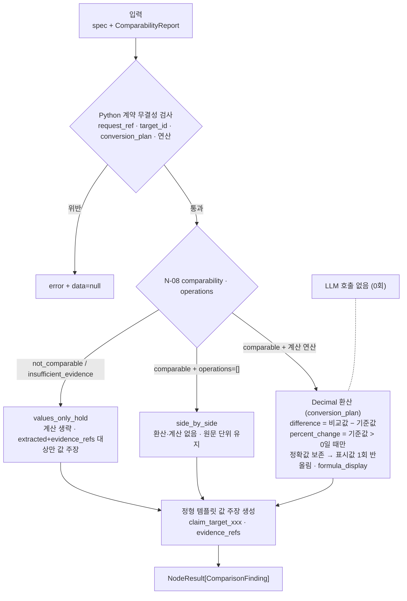

# N-09 · build_comparison — 비교 결과 구성

> **상태:** **MVP 개념 계약 확정(2026-11-28)** — MVP 범위(단일 문서 · 정량 지표 1개 · 기간 2개, 연산 `[]` / `difference` / `percent_change`)에서 **LLM 호출 0회, 100% Python 결정적 실행**. N-08 `ComparabilityReport`의 `conversion_plan`대로 `Decimal` 환산·계산, 정확값(`exact_decimal_str`/`exact_ratio`)과 표시값(`display_value`) 분리 및 최종 1회 반올림(기본 `ROUND_HALF_UP`), **기준값 ≤ 0이면 증감률 미산출**, 비교 보류 시 `values_only_hold`로 개별 값 주장만 구성, N-03 검증용 대상별 원문 값 주장(최대 2건)과 `target_id` 기반 안정 `claim_id` 확정(팀 이슈 #10). 실제 Python 타입·구현/테스트는 미완료.

## 1. 단일 책임과 경계

**T-03(비교 분석)의 비교 가능성 검사 다음 단계**로서, N-07의 `ComparisonSpec`과 N-08의 `ComparabilityReport`를 받아 **비교 결과(`ComparisonFinding`)를 결정적으로 구성**하고, 사용자 공개 전에 원문 대조가 필요한 **대상별 원문 값 주장**을 N-03 입력 형태로 만든다.

- **LLM을 호출하지 않는다.** MVP의 계산·주장 문장은 모두 Python 코드와 정형 템플릿으로 만든다. 향후 정성 비교를 확장하면 그 경로는 이 결정적 계산 경로와 분리한다.
- **하는 일:**
  1. `ComparabilityReport`·`ComparisonSpec` 계약 무결성 검사(`request_ref`, `target_id`, `conversion_plan` 등)
  2. `comparable` + 계산 요청 시 `conversion_plan`의 `factor_decimal_str`로 `Decimal` 단위 환산, `difference` / `percent_change` 계산
  3. 계산식 표시(`formula_display`, 특히 `baseline_source="default_earlier_period"`일 때 필수)와 환산·계산 계보 기록
  4. **N-03 검증용 대상별 원문 값 주장(`claims_for_verification[]`)**을 정형 템플릿으로 생성하고, `target_id` 기반 안정 `claim_id`와 `evidence_refs[]` 부여
- **비교 보류에서도 호출 (`values_only_hold`):** N-08이 `not_comparable` 또는 `insufficient_evidence`이면 계산은 생략하되, `extraction_status="extracted"`이고 `evidence_refs[]`가 있는 대상만 값 주장으로 만든다. 주장 생성 책임을 N-09 한 곳에 유지하기 위해서다.
- **하지 않는 일:** LLM 자유 요약·해석 작성(N-11), 비교 가능성 재판정·단위 배수 재해석(N-08), 원문 대조 사실 검증(N-03), 비교 대상·연산 재정의(N-07)

## 2. 입력 계약 (MVP 개념 필드 확정)

| 입력 필드 | 요구 | 의미 |
|---|---|---|
| `request_ref` | 필수 | 상위 요청 ID 그대로 사용 |
| `spec` | 필수 | N-07의 유효한 `ComparisonSpec` (`metric`, `targets[2]`, `operations[]`, `baseline_target_id`, `baseline_source`) |
| `comparability_result` | 필수 | N-08의 `NodeResult[ComparabilityReport]` 외피 전체. **먼저 외피의 `status`·`outcome`을 검사**하고(`status="success"`만 허용, `outcome`과 `data.comparability` 일치 확인), 통과한 뒤에만 `data`의 `comparability`, `target_extractions[2]`, `conversion_plan`을 사용 |

- N-09는 N-08의 판정·추출값·환산 배수를 **그대로 신뢰해 사용**하며 다시 해석하지 않는다. 대신 계약이 깨진 입력은 계산 전에 `error`로 막는다(5절).

## 3. 출력 계약: `NodeResult[ComparisonFinding]` (MVP 개념 필드 확정)

공통 `NodeResult[T]`의 `status`, `data`, `diagnostics`, `outcome`은 그대로 사용한다([공통 반환 계약](common-result-contract.md)). `data: null`은 실행 실패(`status="error"`)에만 사용한다. **모든 수치는 10진 문자열로 직렬화하며 `float`를 쓰지 않는다.**

### 3.1 `data: ComparisonFinding`

| 필드 | 요구 | 의미 |
|---|---|---|
| `request_ref` | 필수 | 상위 요청 ID 그대로 보존 |
| `comparison_mode` | 필수 | `"calculated"`(`comparable` + 계산 연산) · `"side_by_side"`(`comparable` + `operations=[]`) · `"values_only_hold"`(N-08 `not_comparable`/`insufficient_evidence`) |
| `metric` | 필수 | `spec.metric` 그대로 |
| `baseline_target_id` · `baseline_source` | 필수 (`null` 가능) | `spec`에서 그대로 복사. `baseline_source`: `"explicit"` · `"default_earlier_period"` · `null` |
| `formula_display` | 조건부 | 계산 방향 표시식(예: `"2025년 − 2024년"`). **`calculated` 모드에서 필수**, 그 외 `null` |
| `target_values[]` | 필수 (정확히 2건) | 대상별 값 (3.2절). 미확보 대상도 값 `null`로 자리를 유지 |
| `unit_conversions[]` | 필수 (빈 배열 가능) | 적용한 환산 `{target_id, from_unit, to_unit, factor_decimal_str, rule_ref}`. `calculated`에서만 채움. **`to_unit`은 N-08 `conversion_plan.target_unit`을 그대로 복사**한다(N-08 `conversions[]`에는 대상별 `to_unit`이 없음) |
| `calculations[]` | 필수 (빈 배열 가능) | 요청 연산별 계산 결과 (3.3절). `side_by_side`·`values_only_hold`에서는 `[]` |
| `claims_for_verification[]` | 필수 (빈 배열 가능) | N-03 입력용 값 주장 (3.4절, 최대 2건) |

### 3.2 `target_values[]` 요소

| 필드 | 의미 |
|---|---|
| `target_id` | N-07 대상 ID 그대로 |
| `raw_value_text` · `parsed_decimal_str` · `raw_unit` | N-08 `target_extractions[]`의 원문 토큰·정규화 10진 문자열·원문 단위 그대로 (미확보 대상은 `null`) |
| `converted_decimal_str` · `converted_unit` | `calculated` 모드에서 `conversion_plan`을 적용한 값·단위. `side_by_side`·`values_only_hold`에서는 `null`(원문 단위 유지) |
| `claim_id` | 이 대상의 값 주장 ID(`claim_target_001` 등). 주장을 만들지 않은 대상은 `null` |
| `evidence_refs[]` | N-08이 기록한 이 대상의 `chunk_id` 목록 그대로 |

- **환산값 표기:** `converted_decimal_str` = `parsed_decimal_str × factor_decimal_str`의 `Decimal` 결과다. 값은 그대로 두고, 소수점 아래 끝자리 `0`만 지운 고정 소수점 문자열로 기록한다(지수 표기 금지, 예: `1.2 × 100 → "120"`).

### 3.3 `calculations[]` 요소

| 필드 | 의미 |
|---|---|
| `operation` | `"difference"` · `"percent_change"` |
| `status` | `"computed"` · `"not_applicable"` |
| `formula_ref` | 적용 산식 ID·버전(예: `"difference_v1"`, `"percent_change_v1"`). 근삿값 계산 정밀도도 이 버전에 고정 |
| `operand_target_ids[]` | `[비교 대상, 기준 대상]` 순서 |
| `exact_decimal_str` | 유한소수로 정확히 표현되는 결과(예: `difference`). 순환소수면 `null` |
| `exact_ratio` | 순환소수 결과의 기약분수 문자열(예: `"850/1133"`). 유한소수면 `null` |
| `approx_decimal_str` | 순환소수 결과의 10진 근삿값(`formula_ref`에 고정한 정밀도). 유한소수면 `null` |
| `display_value` · `display_scale` · `rounding_mode` | 표시용 값, 소수 자릿수(**정수 또는 `null`**; `not_applicable`이면 `null`), 반올림 모드 (4.2절) |
| `unit` | `difference`는 `converted_unit`, `percent_change`는 `"%"` |
| `reason` | `not_applicable` 사유(`"baseline_zero"` · `"negative_baseline"`), `computed`면 `null` |
| `sign_transition` | 선택 메타: `"negative_to_positive"` · `"positive_to_negative"` · `null` (4.3절) |

### 3.4 `claims_for_verification[]` 요소

| 필드 | 의미 |
|---|---|
| `claim_id` | `target_id`로부터 코드로 결정적 발급(`target_001` → `claim_target_001`) |
| `target_id` | 대상 ID |
| `claim_text` | **원문 표기 그대로** 쓴 정형 문장. 예: `"2024년 경상운영비는 4,532백만원이다(본예산, 기관 전체 합계)."` (괄호 안은 N-08이 확인한 수치 성격·집계 범위, `unconfirmed`이면 생략) |
| `evidence_refs[]` | 해당 대상의 `evidence_refs[]` 그대로 |

- 주장 문장은 N-08의 `period_label`·`metric_label`·`raw_value_text`·`raw_unit`으로 만든다. 환산값이나 계산값은 넣지 않는다. **`raw_value_text`에 단위가 이미 붙어 있으면(예: `"4,532백만원"`) `raw_unit`을 다시 붙이지 않는다.** 조사(`은/는`)는 마지막 글자의 받침으로 Python이 고른다.

## 4. 내부 워크플로 — 순수 Python 결정적 실행 (MVP 확정)



### 4.1 `Decimal` 산술 규칙

- 모든 수치는 N-08이 검증한 10진 문자열(`parsed_decimal_str`, `factor_decimal_str`)에서 Python `Decimal`로 만든다. `float`를 거치지 않는다.
- 환산 → 차이 → 증감률 순으로 계산하며 **중간 단계에서 반올림하지 않는다.**
- 증감률은 분수로 정확값을 먼저 구한다. 기약분수의 분모가 2와 5 이외의 소인수를 가지면 순환소수이므로 `exact_ratio`와 `approx_decimal_str`를 기록하고, 아니면 `exact_decimal_str`만 기록한다.

### 4.2 표시값 반올림 규칙

- 표시용 반올림은 **최종 표시 단계에서 정확값(분수)에 대해 한 번만** 적용한다. 근삿값 문자열을 다시 반올림하지 않는다(이중 반올림 방지).
- 반올림 모드는 원문·적용 기준이 명시하면 그것을 따르고, 그 외에는 **프로젝트 기본값 `ROUND_HALF_UP`**을 쓴다(예: `0.745` → 소수 둘째 자리 `0.75`).
- 기본 표시 자릿수는 `percent_change` 소수 둘째 자리이고, 원문·적용 기준이나 UI 설정이 다르면 그 자릿수를 쓴다(예: 첫째 자리 `"0.8"`). `difference`는 유한소수이므로 정확값을 그대로 표시한다.
- `display_scale`과 `rounding_mode`를 항상 함께 기록해, 표시값만 보고도 반올림 기준을 알 수 있게 한다.

### 4.3 기준값 `0`·음수 기준값 증감률 정책 (N-07 산식 충돌 해소)

| 기준값 (환산 후) | `difference` | `percent_change` |
|---|---|---|
| **> 0** | 계산 (`비교값 − 기준값`) | 계산: `(비교값 − 기준값) ÷ 기준값 × 100` |
| **= 0** | 계산 (`0 → 0`도 `0`) | `not_applicable`, `reason: "baseline_zero"` (나눗셈 미정의) |
| **< 0** | 계산 (부호 있는 차이) | `not_applicable`, `reason: "negative_baseline"` |

- **음수 기준값 미산출 이유:** 분모를 `기준값`으로 할지 `|기준값|`으로 할지에 따라 결과 부호와 해석이 달라지고, 부호가 바뀌는 구간에서 직관을 크게 왜곡한다. 그래서 **ReportAnchor 해석 정책으로 증감률을 내지 않고**, 두 원문 값과 부호 있는 `difference`를 제공한다. N-07 문서의 연산 정의는 이 절을 참조한다.
- **부호 반전 표식 (선택 메타):** 음수 → 양수는 `sign_transition: "negative_to_positive"`(흑자전환 성격), 양수 → 음수는 `"positive_to_negative"`(적자전환 성격)로 기록할 수 있다.
- **팀 합의 대상:** 양수 → 음수(기준값 > 0)는 MVP 기본 규칙상 통상 증감률로 계산된다(예: `100 → −50` = `−150%`). 이 경우도 대칭적으로 미산출(`reason: "sign_change"`)할지는 구현·평가 단계에서 정한다. **MVP 기본은 기준값 ≤ 0일 때만 미산출**이다.

## 5. 예외 처리 및 반환 상태 (MVP 확정)

N-09는 결정적 단일 실행이므로 **`status="partial"`을 사용하지 않는다.** 일부 연산 미산출은 실행 실패가 아니라 업무상 `outcome`으로 구분한다.

| 상황 | `status` | `outcome` | `data` |
|---|---|---|---|
| 요청 연산 전부 `computed` (`calculated`) 또는 나란히 보기 (`side_by_side`) | `success` | `null` | `ComparisonFinding` |
| 요청 연산 중 일부만 `computed` (예: `difference` 계산 + `percent_change` 기준값 0) | `success` | `"partial_calculation"` | `ComparisonFinding` |
| 요청 계산 연산이 모두 `not_applicable` (예: `percent_change` 단독 + 기준값 ≤ 0) | `success` | `"calculation_not_applicable"` | `ComparisonFinding` |
| N-08 비교 보류에서 개별 값 주장만 구성 (`values_only_hold`, 주장 0건 포함) | `success` | `"values_only_hold"` | `ComparisonFinding` |
| 입력 계약 위반 | `error` | `null` | `null` *(상세는 `diagnostics`에만 기록)* |

**입력 계약 위반 (`error`) 예:**
- `request_ref` 불일치(입력 ↔ `spec` ↔ `comparability_result.data`)
- `target_id`가 `spec`과 `target_extractions[]` 사이에서 누락·중복·불일치
- `comparable` + 계산 요청인데 `conversion_plan` 누락, 대상 누락, 비정상 배수(0 이하·10진 문자열 아님), `from_unit`이 원문 단위와 다름, `target_unit` 누락
- 허용 밖 연산, 계산 연산이 있는데 `baseline_target_id` 없음
- `extracted`인데 `parsed_decimal_str`이 없거나 `evidence_refs[]`가 빈 값
- `comparability`와 N-08 `outcome`의 모순, N-08 `status="error"` 결과 입력

### 가상 반환 예시 1 — 정상 계산 완료 (KISTEP 2024 vs 2025 경상운영비)

N-07 `spec`: `operations: ["difference", "percent_change"]`, `baseline_target_id: "target_001"`, `baseline_source: "explicit"`, 단위 제약 없음. N-08: `comparable`, `conversion_plan.target_unit: "백만원"`(두 대상 배수 `"1"`). 검산: `4,566 − 4,532 = 34`, `34 ÷ 4,532 × 100 = 850/1133 %`.

```json
{
  "status": "success",
  "data": {
    "request_ref": "req_101",
    "comparison_mode": "calculated",
    "metric": "경상운영비",
    "baseline_target_id": "target_001",
    "baseline_source": "explicit",
    "formula_display": "2025년 − 2024년",
    "target_values": [
      {
        "target_id": "target_001",
        "raw_value_text": "4,532",
        "parsed_decimal_str": "4532",
        "raw_unit": "백만원",
        "converted_decimal_str": "4532",
        "converted_unit": "백만원",
        "claim_id": "claim_target_001",
        "evidence_refs": ["chunk_014"]
      },
      {
        "target_id": "target_002",
        "raw_value_text": "4,566",
        "parsed_decimal_str": "4566",
        "raw_unit": "백만원",
        "converted_decimal_str": "4566",
        "converted_unit": "백만원",
        "claim_id": "claim_target_002",
        "evidence_refs": ["chunk_014"]
      }
    ],
    "unit_conversions": [
      {"target_id": "target_001", "from_unit": "백만원", "to_unit": "백만원", "factor_decimal_str": "1", "rule_ref": "krw_scale_v1"},
      {"target_id": "target_002", "from_unit": "백만원", "to_unit": "백만원", "factor_decimal_str": "1", "rule_ref": "krw_scale_v1"}
    ],
    "calculations": [
      {
        "operation": "difference",
        "status": "computed",
        "formula_ref": "difference_v1",
        "operand_target_ids": ["target_002", "target_001"],
        "exact_decimal_str": "34",
        "exact_ratio": null,
        "approx_decimal_str": null,
        "display_value": "34",
        "display_scale": 0,
        "rounding_mode": null,
        "unit": "백만원",
        "reason": null,
        "sign_transition": null
      },
      {
        "operation": "percent_change",
        "status": "computed",
        "formula_ref": "percent_change_v1",
        "operand_target_ids": ["target_002", "target_001"],
        "exact_decimal_str": null,
        "exact_ratio": "850/1133",
        "approx_decimal_str": "0.7502206531332744924977934687",
        "display_value": "0.75",
        "display_scale": 2,
        "rounding_mode": "ROUND_HALF_UP",
        "unit": "%",
        "reason": null,
        "sign_transition": null
      }
    ],
    "claims_for_verification": [
      {
        "claim_id": "claim_target_001",
        "target_id": "target_001",
        "claim_text": "2024년 경상운영비는 4,532백만원이다(본예산, 기관 전체 합계).",
        "evidence_refs": ["chunk_014"]
      },
      {
        "claim_id": "claim_target_002",
        "target_id": "target_002",
        "claim_text": "2025년 경상운영비는 4,566백만원이다(본예산, 기관 전체 합계).",
        "evidence_refs": ["chunk_014"]
      }
    ]
  },
  "diagnostics": {
    "validate_contract": {"status": "success"},
    "compute": {"status": "success"},
    "build_claims": {"status": "success"}
  },
  "outcome": null
}
```

표시 자릿수를 소수 첫째 자리로 설정하면 같은 정확값(`850/1133`)에서 `display_value: "0.8"`, `display_scale: 1`이 된다.

### 가상 반환 예시 2 — `partial_calculation` (기준값 `0`백만원 vs 비교값 `1.2`억원)

N-08: `comparable`, `conversion_plan.target_unit: "백만원"`(기준 대상 원문 단위), 비교 대상 배수 억원 → 백만원 `"100"`.

```json
{
  "status": "success",
  "data": {
    "request_ref": "req_106",
    "comparison_mode": "calculated",
    "metric": "경상운영비",
    "baseline_target_id": "target_001",
    "baseline_source": "explicit",
    "formula_display": "2025년 − 2024년",
    "target_values": [
      {
        "target_id": "target_001",
        "raw_value_text": "0",
        "parsed_decimal_str": "0",
        "raw_unit": "백만원",
        "converted_decimal_str": "0",
        "converted_unit": "백만원",
        "claim_id": "claim_target_001",
        "evidence_refs": ["chunk_031"]
      },
      {
        "target_id": "target_002",
        "raw_value_text": "1.2",
        "parsed_decimal_str": "1.2",
        "raw_unit": "억원",
        "converted_decimal_str": "120",
        "converted_unit": "백만원",
        "claim_id": "claim_target_002",
        "evidence_refs": ["chunk_032"]
      }
    ],
    "unit_conversions": [
      {"target_id": "target_001", "from_unit": "백만원", "to_unit": "백만원", "factor_decimal_str": "1", "rule_ref": "krw_scale_v1"},
      {"target_id": "target_002", "from_unit": "억원", "to_unit": "백만원", "factor_decimal_str": "100", "rule_ref": "krw_scale_v1"}
    ],
    "calculations": [
      {
        "operation": "difference",
        "status": "computed",
        "formula_ref": "difference_v1",
        "operand_target_ids": ["target_002", "target_001"],
        "exact_decimal_str": "120",
        "exact_ratio": null,
        "approx_decimal_str": null,
        "display_value": "120",
        "display_scale": 0,
        "rounding_mode": null,
        "unit": "백만원",
        "reason": null,
        "sign_transition": null
      },
      {
        "operation": "percent_change",
        "status": "not_applicable",
        "formula_ref": "percent_change_v1",
        "operand_target_ids": ["target_002", "target_001"],
        "exact_decimal_str": null,
        "exact_ratio": null,
        "approx_decimal_str": null,
        "display_value": null,
        "display_scale": null,
        "rounding_mode": null,
        "unit": "%",
        "reason": "baseline_zero",
        "sign_transition": null
      }
    ],
    "claims_for_verification": [
      {
        "claim_id": "claim_target_001",
        "target_id": "target_001",
        "claim_text": "2024년 경상운영비는 0백만원이다.",
        "evidence_refs": ["chunk_031"]
      },
      {
        "claim_id": "claim_target_002",
        "target_id": "target_002",
        "claim_text": "2025년 경상운영비는 1.2억원이다.",
        "evidence_refs": ["chunk_032"]
      }
    ]
  },
  "diagnostics": {
    "validate_contract": {"status": "success"},
    "compute": {"status": "success"},
    "build_claims": {"status": "success"}
  },
  "outcome": "partial_calculation"
}
```

### 가상 반환 예시 3 — `values_only_hold` (N-08 `insufficient_evidence`, 한쪽만 `extracted`)

N-08 [예시 3](N-08.md#가상-반환-예시-3--insufficient_evidence-한쪽-값-확보--다른-쪽-연도-모호각주-본문-미확보)처럼 `target_001`만 `extracted`이고 `target_002`는 `unresolved`인 경우.

```json
{
  "status": "success",
  "data": {
    "request_ref": "req_105",
    "comparison_mode": "values_only_hold",
    "metric": "경상운영비",
    "baseline_target_id": "target_001",
    "baseline_source": "explicit",
    "formula_display": null,
    "target_values": [
      {
        "target_id": "target_001",
        "raw_value_text": "4,532",
        "parsed_decimal_str": "4532",
        "raw_unit": "백만원",
        "converted_decimal_str": null,
        "converted_unit": null,
        "claim_id": "claim_target_001",
        "evidence_refs": ["chunk_014"]
      },
      {
        "target_id": "target_002",
        "raw_value_text": null,
        "parsed_decimal_str": null,
        "raw_unit": null,
        "converted_decimal_str": null,
        "converted_unit": null,
        "claim_id": null,
        "evidence_refs": []
      }
    ],
    "unit_conversions": [],
    "calculations": [],
    "claims_for_verification": [
      {
        "claim_id": "claim_target_001",
        "target_id": "target_001",
        "claim_text": "2024년 경상운영비는 4,532백만원이다(본예산, 기관 전체 합계).",
        "evidence_refs": ["chunk_014"]
      }
    ]
  },
  "diagnostics": {
    "validate_contract": {"status": "success"},
    "build_claims": {"status": "success"}
  },
  "outcome": "values_only_hold"
}
```

## 6. N-03 검증 및 T-03 공개 게이트 (MVP 확정)

- **검증 대상은 입력값 주장뿐:** N-09는 대상별 원문 값 주장을 **최대 2건**만 만들어 N-03에 넘긴다. **Python 계산값(차이·증감률·환산·반올림)은 LLM 검증기에 다시 검증시키지 않는다.** LLM의 산술 한계를 고려해 계산 정확성은 N-09 코드와 단위 테스트로 보장한다.
- **안정 ID:** `claim_id`는 `target_id`에서 결정적으로 만들므로, 한쪽 대상이 빠져도 남은 주장의 ID는 바뀌지 않는다. N-03은 `request_ref`·`claim_id`를 재발급하지 않는다([N-03 추적 계약](N-03.md#상위-id-재사용-및-추적-규칙-mvp-확정)).
- **주장 0건:** `values_only_hold`에서 `extracted` 대상이 없으면 `claims_for_verification: []`이고 상위 T-03은 N-03 호출을 생략한다.
- **T-03 공개 게이트:**
  - **개별 값**은 해당 값 주장이 N-03 `supported`일 때만 사용자에게 공개한다.
  - **차이·증감률**은 **N-08 `comparable` + 해당 연산 `computed` + 양쪽 입력값 주장 모두 N-03 `supported`**일 때만 공개한다.
  - `baseline_source="default_earlier_period"`이면 공개하는 계산 결과와 함께 `formula_display`(예: `2025년 − 2024년`)를 반드시 표시한다.

## 7. 테스트 체크리스트

| # | 사례 | 입력 예시 | 기대 결과 |
|---|---|---|---|
| 1 | 정상 계산·KISTEP 검산 | 2024년 `4,532` · 2025년 `4,566`백만원 | 차이 `"34"`, 증감률 `exact_ratio: "850/1133"`, `display_value: "0.75"`, 주장 2건 |
| 2 | 단위 환산 `Decimal` | `1.2`억원 → 백만원 배수 `"100"` | `converted_decimal_str: "120"`, `float` 미사용 |
| 3 | 중간값 반올림 경계 | 기준 `2,000` → 비교 `2,014.9` (증감률 정확값 `0.745`) | `ROUND_HALF_UP` 둘째 자리 `"0.75"`, 중간 단계 반올림 없음 |
| 4 | 기준값 `0` | `0 → 120`, `0 → 0` | 차이 계산, 증감률 `not_applicable`/`baseline_zero` |
| 5 | 음수 기준값 | `−100 → −50`, `−100 → +50` | 차이 `50`/`150`, 증감률 `not_applicable`/`negative_baseline`, 후자 `sign_transition: "negative_to_positive"` |
| 6 | 나란히 보기 | `operations=[]`, `comparable` | `side_by_side`, `calculations: []`, 원문 단위 유지, 주장 2건 |
| 7 | `values_only_hold` 1건·0건 | N-08 `insufficient_evidence`, `extracted` 1건 / 0건 | 주장 1건(`claim_target_001` 유지) / 0건, 계산 없음 |
| 8 | 기본 기준식 출력 | `baseline_source: "default_earlier_period"` + `difference` | `formula_display: "2025년 − 2024년"` 필수 기록 |
| 9 | 잘못된 `conversion_plan` | `comparable` + 계산 요청인데 `conversion_plan` 누락 또는 배수 `"0"` | `error`, `data=null` |

## 8. 후속 구현·검증 항목

1. `ComparisonFinding`·`calculations[]`의 실제 Python/Pydantic 타입과 `comparison_mode` 판별 `oneOf` 스키마 확정
2. `formula_ref`별 근삿값 정밀도, 순환소수 판별, 표시 자릿수 설정 위치(원문 기준 / UI 기본값) 확정 및 단위 테스트
3. 양수 → 음수 전환 증감률의 대칭 미산출(`sign_change`) 여부 팀 합의
4. N-09 `outcome`(`partial_calculation` · `calculation_not_applicable` · `values_only_hold`)을 T-03이 `WorkflowResult.outcome`으로 조립하고, **N-11은 N-09 노드 결과가 아니라 T-03 `WorkflowResult.outcome`을 매핑**해 정형 안내 템플릿을 고르도록 연동 (T-03·N-11 정리 단계에서 확정)
5. 정성 비교 확장 시 결정적 계산 경로와 분리된 별도 경로 설계

**경계:** 비교 가능성 판정(N-08), 원문 대조 검증(N-03), 공개 게이트 적용과 `WorkflowResult` 조립(T-03), 사용자 안내 문장(N-11)은 이 문서에 두지 않는다. 내부 계산·템플릿 함수를 Tiny Node로 분할하지 않는다.

> **설계 근거 주석 (참고 문헌·실무 기준)**
> - **LLM 0회 결정적 계산 · 계산값 LLM 재검증 금지 · 입력값 주장만 원자 단위 검증:** 산술을 코드 실행에 맡기면 정확도가 오른다는 *PAL* (Gao 외, ICML 2023)과 *Program of Thoughts* (Chen 외, TMLR 2023), 숫자만 바꿔도 LLM 추론 성능이 흔들린다는 *GSM-Symbolic* (Mirzadeh 외, ICLR 2025), 재무 수치 계산 과제 *FinQA* (Chen 외, EMNLP 2021)를 근거로 계산은 Python이 하고, 검증은 원자적 사실 단위로 나누는 *FActScore* (Min 외, EMNLP 2023) 관점에 따라 대상별 원문 값 주장만 N-03에 넘긴다.
> - **10진 문자열 · 정확값/표시값 분리 · 최종 1회 반올림:** 수치를 문자열로 보존하는 *xBRL-JSON Design 1.0* (2021)과 *RFC 8259* §6, 반올림된 표시값과 계산 정합성을 구분하는 *XBRL Calculations 1.1* (2023), 중간 단계 반올림을 피하라는 *Eurostat Rounding of Numbers* (2025), *Python `decimal` Documentation*의 정확한 10진 산술·반올림 모드를 따랐다.
> - **기준값 0·음수 기준값 증감률 미산출:** 증감률은 양의 기준값에서만 직관적으로 해석된다는 *Eurostat Percentage Change* 지침과 국내 재정 통계의 증감률 표기(*국회예산정책처 《2026 대한민국 재정》*, 2026), 음수 기준이나 적자·흑자 전환 구간에서 증감률 대신 전환 표기를 쓰는 실무 사례(*Comcast Proxy Statement*, SEC, 2024, p.50; *하나증권 RFHIC 실적분석*, 2024; *엘앤케이바이오메드 KIND 공시*, 2024)를 참고했다. 예시 수치 검산은 *KISTEP 2025년도 사업계획 및 예산(안)* (2024, p.112)의 경상운영비 표기를 바탕으로 했다.
> - **계보 기록과 판별 스키마:** 환산 규칙(`rule_ref`)·산식 버전(`formula_ref`)·피연산자를 남기는 것은 *W3C PROV-DM*의 계보 기록 원칙을 따른다. `comparison_mode`·`status`별 형태는 *OpenAPI 3.1.2 Discriminator*와 *JSON Schema 2020-12 `const`*로 고정한다.

[Small Node 문서 목록](README.md) · [공통 반환 계약](common-result-contract.md) · [N-03 근거 검증](N-03.md) · [N-07 비교 축 정의](N-07.md) · [N-08 비교 가능성 검사](N-08.md) · [명칭 통일](../naming-conventions.md)
