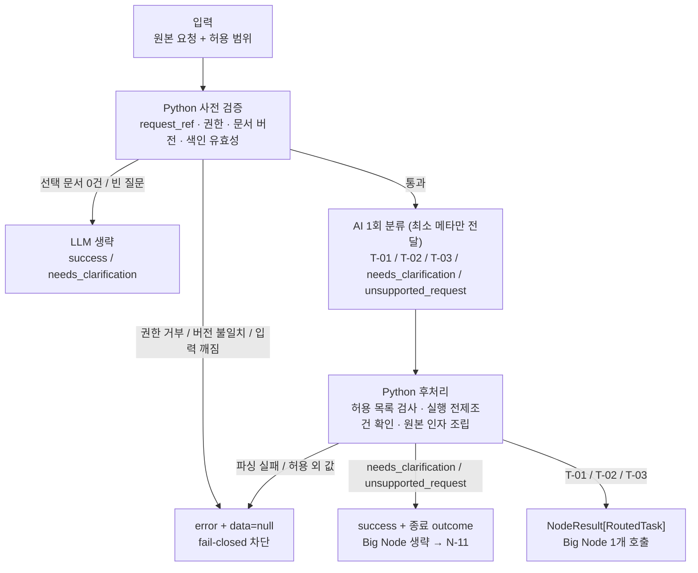

# N-10 · route_query — 요청 검증 및 워크플로 라우팅

> **상태:** **MVP 개념 계약 확정(2026-11-28)** — 사전 코드 권한·버전 검증(fail-closed) → AI 1회 호출 우선 라우팅(`T-01`/`T-02`/`T-03`/`needs_clarification`/`unsupported_request`) → 하네스 코드의 원본 인자 직접 조립 확정. 채팅 자연어 기준 검토 시 원문 1건을 `criteria_texts: [question]`으로 그대로 전달, 권한·버전 위반은 `error`, 명확화·미지원은 `success` 업무 종료, 범위 밖 요청은 전부 실행 전 종료, 최소 명확화 원칙 확정. 실제 Python 타입·프롬프트·구현/테스트는 미완료.

## 1. 단일 책임과 경계

**메인 에이전트의 입구 역할**로서, 사용자 요청의 형식·권한·허용 문서 범위·버전을 검증한 뒤 **실행 가능한 MVP Big Node(`T-01` / `T-02` / `T-03`) 딱 1개를 선택하고 `RoutedTask`를 조립**하거나, 실행할 수 없는 요청을 **실행 전 종료 사유**로 돌려보낸다.

- **하는 일:**
  1. 코드 기반 사전 검증: 요청 식별자(`request_ref`), 필수 입력 형식, 요청자 접근 권한, `요청 문서 ∩ 허용 문서 범위` 산정, 문서·색인 버전 유효성 검사
  2. AI 1회 분류: 유효한 요청을 `T-01`(문서 QA) / `T-02`(기준 검토) / `T-03`(비교 분석) / `needs_clarification` / `unsupported_request` 중 하나로 판별
  3. 하네스 인자 조립: 선택된 워크플로에 맞게 원본 요청과 서버 설정에서 `RoutedTask` 인자를 직접 채움
- **하지 않는 일:**
  - 문서 본문 검색(N-01), 원문 조회(N-02), 검토 기준 분해(N-05), 기준 판정(N-06), 근거 검증(N-03), 사용자 답변 문장 작성(N-11)
  - 질문 재작성·쿼리 증폭(H-12 백로그), Big Node 2개 이상 연쇄 호출, 문서 내용 기반 일반 대화 직접 답변

## 2. 입력 계약 (MVP 개념 필드 확정)

| 입력 필드 | 요구 | 의미 |
|---|---|---|
| `request_ref` | 필수 | 상위 실행 계층에서 발급한 요청 식별 ID |
| `question` | 필수 | 사용자가 입력한 질문·요청 원문 텍스트 (MVP에서 변형·재작성 금지) |
| `requested_documents[]` | 필수 (빈 배열 가능) | 사용자가 선택한 문서 ID·버전 참조 목록 |
| `authorized_scope[]` | 필수 | 서버·하네스가 확인한 요청자 접근 허용 문서 ID·버전 범위 |
| `criteria_texts[]` | 선택 | API·CLI 테스트 호출 등에서 기준 목록이 별도 전달된 경우에만 사용 *(기본 UI는 단일 채팅 입력창)* |
| `default_profiles` | 필수 | 서버가 승인한 기본 `retrieval_profile`, `context_profile` 설정 참조 |

- **간접 프롬프트 인젝션 차단:** 라우팅 AI 호출에는 **문서 본문을 전달하지 않고**, 분류에 필요한 최소 정보(`question` 원문, 선택 문서 개수·제목 등 메타데이터, `criteria_texts[]` 유무)만 제공한다.
- **모델 실행 경계 (미반영 · 백로그):** 문서 열람 권한 검사는 `question` 원문·문서 제목이 개발용 클라우드 엔드포인트로 전송되는 것을 막지 못한다. 제품 프로필 로컬 전용 강제와 개발 클라우드의 공개 자료 검증 게이트는 N-10이 아니라 **하네스 단일 모델 어댑터 책임**으로 [백로그 4.11](../idea-backlog.md#411-하네스-모델-실행-경계--로컬-전용-강제-및-개발-클라우드-공개-자료-검증-정책-2026-11-28)에서 관리한다.

## 3. 출력 계약: `NodeResult[RoutedTask]` (MVP 개념 필드 확정)

공통 `NodeResult[T]`의 `status`, `data`, `diagnostics`, `outcome`은 그대로 사용한다([공통 반환 계약](common-result-contract.md)).

### 3.1 실행 가능 시 (`status="success"`, `outcome=null`)

| `data: RoutedTask` | 요구 | 의미 |
|---|---|---|
| `request_ref` | 필수 | 상위 요청 ID 그대로 보존 |
| `target_tool` | 필수 | `"T-01"` / `"T-02"` / `"T-03"` 중 1개 *(AI가 허용 목록 안에서 선택)* |
| `question` | 필수 | 사용자 질문 원문 그대로 *(하네스가 원본에서 복사)* |
| `document_scope[]` | 필수 | `requested_documents ∩ authorized_scope`로 하네스가 확정한 문서 ID·버전 목록 |
| `retrieval_profile` | 필수 | 서버가 승인한 검색 프로필 참조 |
| `context_profile` | 필수 | 서버가 승인한 문맥 확장 프로필 참조 |
| `criteria_texts[]` | 조건부 (`T-02` 전용) | 별도 기준 입력이 있으면 그 목록 그대로; 채팅 자연어만 있으면 **`[question]`(원문 1건)** 그대로 채움 |

- **하네스 인자 고정 원칙 (2026-11-05 확정):** AI는 `target_tool`(또는 종료 분류)만 고르며, `document_scope`, `question`, `criteria_texts`, `retrieval_profile`, `context_profile`은 **AI 출력에서 받지 않고 하네스 코드가 원본 요청과 서버 설정에서 직접 채운다.** AI가 문서 범위를 넓히거나 질문을 변조할 수 없게 차단한다.
- **TOCTOU 방어:** N-10에서 확인한 `document_scope`(문서 ID·버전)는 하위 N-01·N-02 조회 시점에도 다시 검증한다.

### 3.2 실행 전 종료 시 (`status="success"`, `outcome`으로 사유 전달)

- `data`: `null` *(또는 종료 안내용 최소 메타데이터: `clarification_reason` / `unsupported_reason` — 실제 필드는 구현 시 확정)*
- `outcome`: `"needs_clarification"` 또는 `"unsupported_request"`
- 이 경우 Big Node(`T-01`/`T-02`/`T-03`)를 호출하지 않고 곧바로 **N-11 (`deliver_result`)**로 전달한다.

### 가상 출력 예시 — 채팅 자연어가 `T-02`로 라우팅된 경우

사용자 입력: *"이 계획서에서 최근 3년간 매출액과 영업이익이 모두 기재돼 있는지 검토해 줘."* (별도 기준 입력칸 없음)

```json
{
  "status": "success",
  "data": {
    "request_ref": "req_001",
    "target_tool": "T-02",
    "question": "이 계획서에서 최근 3년간 매출액과 영업이익이 모두 기재돼 있는지 검토해 줘.",
    "document_scope": [
      {"document_id": "doc_01", "document_version": "sha256:example"}
    ],
    "retrieval_profile": "hybrid-rrf-v1",
    "context_profile": "fixed-window-v1",
    "criteria_texts": [
      "이 계획서에서 최근 3년간 매출액과 영업이익이 모두 기재돼 있는지 검토해 줘."
    ]
  },
  "diagnostics": {
    "validate_access_and_input": {"status": "success"},
    "classify_intent": {"status": "success"}
  },
  "outcome": null
}
```

## 4. 내부 워크플로 (MVP 확정)

**Python 사전 검증(권한·범위·버전·빈 입력) → AI 1회 라우팅 분류 → Python 허용 목록·실행 가능성 검사 및 `RoutedTask` 조립** 순서로 실행한다.



### 라우팅 및 기준 전달 원칙 (2026-11-28 확정)

1. **AI 라우팅 우선 (단일 채팅 기본, MVP 확정):** 사용자 편의성을 위해 **단일 채팅 입력창**을 기본 UI로 전제하며, 사전 코드 검증을 통과한 유효 요청은 **AI 1회 호출**로 워크플로를 분류한다. *(API·CLI 테스트 등에서 `criteria_texts[]`가 별도 명시 전달된 경우에만 추후 코드 우선 분기 옵션을 고려한다.)*
2. **채팅 원문 기준 전달:** `T-02`로 라우팅됐을 때 별도 `criteria_texts[]`가 있으면 그대로 사용하고, 없으면 **질문 원문 1건을 그대로 `criteria_texts: [question]`으로 채워 N-05가 분해**하게 맡긴다. N-10이 기준을 미리 쪼개지 않는다.
3. **지원 범위 밖 요청 일괄 차단:** 문서 수정·작성, 문서 전체 요약(T-05 후속 계획), 개별 주장 독립 검증(T-04 후속 계획), 문서와 무관한 일반 대화는 모두 워크플로를 호출하지 않고 **`unsupported_request`**로 실행 전 종료한다.
4. **최소 명확화 원칙:** 선택 문서 0건, 질문 비어 있음, 대상 없는 비교 요청(*"비교해 줘"*), 기준이 전혀 없는 기준 검토 요청, 또는 다중 문서에서 어느 문서를 지칭하는지 불분명해 결론이 달라지는 경우처럼 **실행 불가 또는 가정 오류 영향이 큰 경우에만 `needs_clarification`**으로 종료한다. 유효하고 처리 가능하면 되묻지 않고 곧바로 실행한다.
5. **보안 정보 비노출:** 권한이 없는 문서가 요청에 포함되면 해당 문서의 존재 여부나 최신 버전을 응답·진단에 노출하지 않고 `error`로 차단한다.

## 5. 예외 처리 및 반환 상태 (MVP 확정)

`status=partial`은 사용하지 않는다. 라우팅은 **실행 가능(`RoutedTask` 1개)**, **실행 전 업무 종료(`needs_clarification` / `unsupported_request`)**, **실행·보안 오류(`error`)** 셋 중 하나로만 끝난다.

| 상황 | `status` | `data` | `outcome` |
|---|---|---|---|
| 유효 요청 → `T-01` / `T-02` / `T-03` 1개 확정 및 `RoutedTask` 조립 완료 | `success` | `RoutedTask` | `null` |
| 선택 문서 0건, 빈 질문, 비교 대상 누락, 대상 지칭 모호 등 **실행 불가·정보 부족** | `success` | `null` *(또는 종료 안내 메타)* | `"needs_clarification"` |
| 문서 수정·전체 요약·일반 잡담 등 **MVP 지원 범위 밖 요청** | `success` | `null` *(또는 종료 안내 메타)* | `"unsupported_request"` |
| **권한 없는 문서 접근 시도(`access_denied`), 문서 버전·색인 스냅샷 불일치** | **`error`** | **`null`** | **`null`** |
| AI 호출 실패·타임아웃, 출력 JSON 파싱 실패, 허용 목록 외 `target_tool` 반환 | `error` | `null` | `null` |
| `request_ref` 누락 등 시스템 입력 계약 위반 | `error` | `null` | `null` |

- **분류기 장애와 미지원 요청 구분:** AI 타임아웃이나 JSON 파싱 실패는 `unsupported_request`로 위장하지 않고 반드시 `error`로 기록한다.

## 6. 후속 구현·검증 항목

1. `RoutedTask` 및 실행 전 종료 안내 메타데이터의 실제 Python/Pydantic 스키마 확정
2. 전용 검토 기준 입력 UI 도입 시 코드 우선 분기 규칙 및 `T-01`/`T-02`/`T-03` 라우팅 정확도·오분류 평가셋 구축
3. `QA + 기준 검토` 혼합 의도 요청과 채팅 원문 내 인사말·출력 지시문 혼입 사례의 N-10 ↔ N-05 연동 테스트

**경계:** Big Node 실행, 사용자용 종료 안내 문장 구성(N-11), 기준 분해(N-05)는 이 문서에 두지 않는다. 내부 검증·조립 함수를 Tiny Node로 분할하지 않는다.

> **설계 근거 주석 (참고 문헌·실무 기준)**
> - **사전 코드 검증 + AI 1회 라우팅:** [*Building Effective Agents — Workflow Routing*](https://www.anthropic.com/research/building-effective-agents) (Anthropic, 2024)과 범위 밖 의도 탐지 연구([*Larson 외*](https://aclanthology.org/D19-1131/), EMNLP 2019)를 근거로, 처리 절차가 서로 다른 3개 고정 워크플로를 AI 분류로 분기하되 범위 밖 요청(`unsupported_request`)과 정보 부족(`needs_clarification`)을 실행 전에 분리했다.
> - **AI는 Tool 이름만 선택 & 하네스가 인자 직접 조립:** [*OWASP LLM06: Excessive Agency*](https://genai.owasp.org/llmrisk/llm062025-excessive-agency/) (2025), [*The Confused Deputy*](https://doi.org/10.1145/54289.871709) (Hardy, 1988), [*OWASP API1: BOLA*](https://api-security.owasp.org/editions/2023/en/0xa1-broken-object-level-authorization/) (2023) 및 [*OWASP LLM01: Prompt Injection*](https://genai.owasp.org/llmrisk/llm01-prompt-injection/) (2025)을 근거로, 문서 본문을 라우터에 넣지 않고 AI의 인자 변조 경로를 원천 차단하며 `요청 문서 ∩ 허용 범위`를 하네스가 강제한다.
> - **권한·버전 위반의 fail-closed `error` 분리 및 최소 명확화:** [*RFC 9110*](https://www.rfc-editor.org/rfc/rfc9110.html) (2022), [*Google AIP-154*](https://google.aip.dev/154), [*MITRE CWE-367*](https://cwe.mitre.org/data/definitions/367.html)(TOCTOU)을 따라 권한·버전 오류는 실행 오류로 차단하고 하위 조회에서도 재검증한다. 명확화 기준은 [*Clarify When Necessary*](https://aclanthology.org/2025.findings-naacl.306/) (NAACL Findings 2025)와 [*Microsoft Guidelines for Human-AI Interaction*](https://www.microsoft.com/en-us/haxtoolkit/ai-guidelines/) (2019)을 참고해 불필요한 되묻기를 줄이되 결론이 달라지는 모호함은 확인하도록 설계했다.
> - **채팅 원문 `[question]`의 N-05 위임:** [*Enterprise Integration Patterns — Content-Based Router*](https://www.enterpriseintegrationpatterns.com/patterns/messaging/ContentBasedRouter.html) (2003)의 단일 책임 원칙에 따라 N-10은 요청 유형 판별만 맡고 기준 분해는 N-05에 위임한다.

[Small Node 문서 목록](README.md) · [공통 반환 계약](common-result-contract.md) · [N-11 결과 전달](N-11.md) · [설계 취약점 정리](../design-risks-and-mitigations.md) · [명칭 통일](../naming-conventions.md)
