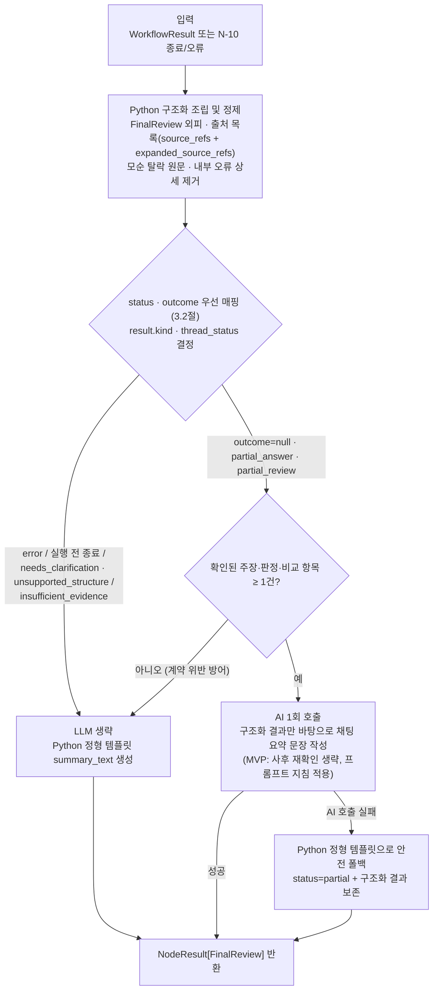

# N-11 · deliver_result — 최종 결과 구성 및 사용자 전달

> **상태:** **MVP 개념 계약 확정(2026-11-28)** — Python 코드의 구조화 UI 데이터(`FinalReview`) 100% 직접 조립 + 정상 결과에 한한 AI 1회 요약 문장 작성(실행 전 종료·확인 항목 0건·오류는 정형 템플릿), MVP 사후 문장 재확인 생략(프롬프트 지침만 적용·요약 왜곡 위험은 후속 평가 백로그 관리), 채팅 본문+구조화 데이터 동시 반환(공통 외피 + `result.kind` 분기), 모순 탈락 원문·내부 오류 상세의 서버측 제거 및 `evidence_incomplete` 명시 알림 확정. 실제 Python 타입·프롬프트·구현/테스트는 미완료.

## 1. 단일 책임과 경계

**메인 에이전트의 출구 역할**로서, Big Node(`T-01` / `T-02` / `T-03`)가 돌려준 `WorkflowResult` 또는 `N-10`의 실행 전 종료·오류 상태를 받아 **사용자와 단일 채팅 UI가 바로 소비할 수 있는 최종 결과(`FinalReview`)**로 구성한다.

- **하는 일:**
  1. 워크플로 결과·종료 사유를 **공통 외피 + 유형별 구조화 데이터(`FinalReview`)**로 100% 코드 조립
  2. 확인된 주장·판정·비교 결과가 1건 이상인 정상/부분 결과에 한해 **채팅 말풍선용 요약 문장(`summary_text`)을 AI 1회 호출로 작성**
  3. 실행 전 종료(`needs_clarification`, `unsupported_request`), **워크플로 `outcome`이 `needs_clarification` · `unsupported_structure` · `insufficient_evidence`인 경우**, 실행 오류(`error`)는 **AI 호출 없이 Python 정형 템플릿**으로 안내 문구 생성
  4. 모순 탈락 문장 원문·내부 오류 상세·스택 트레이스·권한 없는 문서 존재 여부를 **서버 응답 단계에서 제거**
- **하지 않는 일:**
  - 추가 검색(N-01), 원문 조회(N-02), 재검증(N-03), Big Node 재호출
  - 워크플로 결과에 **없는 사실을 덧붙이거나 새로운 판정·결론을 생성**

## 2. 입력 계약 (MVP 개념 필드 확정)

| 입력 필드 | 요구 | 의미 |
|---|---|---|
| `request_ref` | 필수 | 상위 요청 식별 ID (응답 및 문의 추적용으로 그대로 유지) |
| `source_stage` | 필수 | `"workflow"` (Big Node 실행 완료) 또는 `"routing"` (N-10 실행 전 종료/오류) |
| `workflow_result` | 조건부 (`source_stage="workflow"`) | `T-01` / `T-02` / `T-03`의 `WorkflowResult`(`status`·`outcome`·`evidence_incomplete` 3축 포함) 및 연결된 출처 참조 메타데이터 *(확인 항목의 `evidence_refs[]`가 가리키는 근거 항목별 문서 ID·버전·`source_refs[]`·`expanded_source_refs[]`)* |
| `routing_result` | 조건부 (`source_stage="routing"`) | `N-10`의 `NodeResult` (`needs_clarification` / `unsupported_request` / `error`) |

- `source_stage`와 전달된 결과 객체가 모순되거나 `request_ref`가 일치하지 않으면 입력 무결성 오류(`status=error`)로 처리한다.

## 3. 출력 계약: `NodeResult[FinalReview]` (MVP 개념 필드 확정)

공통 `NodeResult[T]`의 `status`, `data`, `diagnostics`, `outcome`은 그대로 사용한다([공통 반환 계약](common-result-contract.md)).

### 3.1 공통 외피 + 유형별 분기 (`FinalReview`)

서로 다른 워크플로 결과와 실행 전 종료를 **단일 채팅 UI가 혼동 없이 렌더링**할 수 있도록, 공통 최상위 필드와 **`result.kind`로 분기하는 태그드 유니온(Discriminated Union)** 구조를 사용한다.

| `data: FinalReview` 필드 | 요구 | 의미 |
|---|---|---|
| `schema_version` | 필수 | 출력 스키마 버전 (구버전 프론트 호환성 판별용) |
| `request_ref` | 필수 | 상위 요청 ID 그대로 보존 *(오류 문의 식별자 겸용)* |
| `thread_status` | 필수 | 단일 채팅 UI 스레드 상태 라벨: `"complete"`(`답변 완료`) · `"partial"`(`일부 확인`) · `"insufficient"`(`근거 부족`) · `"clarification"`(`명확화 필요`) · `"unsupported"`(`미지원 요청`) · `"error"`(`오류`) |
| `summary_text` | 필수 | 채팅 말풍선에 표시할 최종 안내/요약 문장 |
| `evidence_incomplete` | 필수 | 근거 수집 중 검색기/원문 조회 일부 누락 여부 (`true` / `false`) |
| `evidence_notice` | 조건부 | `evidence_incomplete=true`일 때 필수 포함. *"일부 자료 검색·조회에 실패해 확인되지 않은 내용이 있을 수 있습니다"* 등 영향 범위 안내 |
| `result` | 필수 | `kind`로 구분되는 유형별 구조화 결과 페이로드 *(아래 표 참조)* |
| `source_references[]` | 필수 (빈 배열 가능) | `근거 p.42 · p.23` 및 `근거 N개 보기` 렌더링용 출처 메타데이터 목록. 확인 항목이 인용한 `chunk_id`마다 문서 ID·버전과 N-02의 **원래 위치 `source_refs[]` + 확장 위치 `expanded_source_refs[]`를 함께** 담는다 *(N-03은 `context_text` 전체를 보고 판정하므로 확장 위치를 생략하지 않음, 2026-11-28)* |

| `result.kind` | 적용 상황 | 주요 포함 필드 (Python이 원본 결과에서 직접 조립) |
|---|---|---|
| `"document_qa"` | T-01 완료 | `verified_claims[]`, `unconfirmed_items[]` *(모순 탈락 문장의 `claim_text`는 제외하고 사유만 보존)* |
| `"criteria_review"` | T-02 완료 | `criteria_results[]`(기준별 최종 `met`/`not_met`/`unverifiable` + 조건별 판정·검증 상태), `unprocessed_criteria[]` |
| `"comparative_analysis"` | T-03 완료 | 비교 축·비교 결과·비교 불가 사유 *(세부 필드는 T-03 확정 시 고정)* |
| `"pre_execution_exit"` | N-10 실행 전 종료 | `reason_code`(`"needs_clarification"` \| `"unsupported_request"`), 안내 대상/지원 기능 목록 |
| `"error"` | N-10 또는 Big Node `error` | 공개 가능한 안전 안내 메시지, `request_ref` *(내부 오류 코드·스택 트레이스·미권한 문서 정보 제외)* |

- **실행 전 종료와 빈 검토 결과의 분리:** `pre_execution_exit`를 빈 `document_qa`나 빈 `criteria_review`로 표현하지 않는다. 프론트가 실행 전 종료를 *"검토했으나 이상 없음"*으로 오표시하는 사고를 막는다.
- **`WorkflowResult.outcome` 최우선 매핑 (2026-11-28 추가):** N-11은 확인 항목 개수(0건)보다 **`WorkflowResult.outcome`을 최우선으로 판별**한다. 특히 `T-02`가 N-05 실행 후 `outcome="unsupported_structure"` 또는 `outcome="needs_clarification"`을 반환한 경우, 확인 항목이 0건이더라도 `insufficient_evidence`(근거 부족)로 오표시하지 않는다. 이 경우 **`result.kind="criteria_review"`를 유지하면서 `thread_status`를 `"unsupported"` 또는 `"clarification"`으로 매핑**하고, `unprocessed_criteria[]`의 원문·미처리 사유를 그대로 보존해 Python 정형 템플릿으로 안내한다. 전체 규칙은 [3.2절](#32-워크플로-결과--사용자-상태-결정적-매핑-2026-11-28)의 표를 따른다.
- **프론트 알 수 없는 `kind` 폴백:** 구버전 프론트가 모르는 `result.kind`를 받더라도 정상 완료로 오표시하지 않고 안전한 기본 안내를 표시하도록 계약한다.

### 3.2 워크플로 결과 → 사용자 상태 결정적 매핑 (2026-11-28)

Python이 아래 표를 **위에서부터 순서대로** 적용한다. `status=error`와 `outcome`을 먼저 보고, 확인 항목 개수는 AI 요약 대상 여부를 정할 때만 쓴다. `evidence_incomplete`는 `thread_status`를 바꾸지 않고 `evidence_notice`로 별도 표시한다.

| 순서 | 입력 조건 | `result.kind` | `thread_status` | `summary_text` 작성 |
|---|---|---|---|---|
| 1 | N-10 또는 Big Node `status=error` | `error` | `error` | 정형 템플릿 |
| 2 | N-10 `outcome="needs_clarification"` | `pre_execution_exit` | `clarification` | 정형 템플릿 |
| 3 | N-10 `outcome="unsupported_request"` | `pre_execution_exit` | `unsupported` | 정형 템플릿 |
| 4 | T-02 `outcome="needs_clarification"` | `criteria_review` *(미처리 기준·사유 보존)* | `clarification` | 정형 템플릿 |
| 5 | T-02 `outcome="unsupported_structure"` | `criteria_review` *(미처리 기준·사유 보존)* | `unsupported` | 정형 템플릿 |
| 6 | T-01·T-02 `outcome="insufficient_evidence"` | `document_qa` / `criteria_review` | `insufficient` | 정형 템플릿 |
| 7 | T-01 `outcome="partial_answer"` · T-02 `outcome="partial_review"` | `document_qa` / `criteria_review` | `partial` | AI 1회 *(실패 시 정형 템플릿)* |
| 8 | T-01·T-02 `outcome=null` (`status=success` 또는 `partial`) | `document_qa` / `criteria_review` | `complete` | AI 1회 *(실패 시 정형 템플릿)* |
| — | T-03 | `comparative_analysis` | T-03 `outcome` 확정 시 이 표에 추가 | — |

- 7·8행이라도 확인 항목(검증 통과 주장, `met`/`not_met` 확정 기준, 비교 결과)이 0건이면 Big Node 계약 위반이므로 AI를 호출하지 않고 정형 템플릿을 쓴다.
- 표에 없는 `(Big Node, outcome)` 조합은 정상 완료로 추정하지 않고 입력 계약 위반(§5 `error`)으로 처리한다. Big Node가 `outcome` 값을 추가하면 이 표를 함께 갱신한다.

### 가상 출력 예시 — 기준 검토 일부 확인 + 근거 수집 누락 (`T-02`)

```json
{
  "status": "success",
  "data": {
    "schema_version": "1",
    "request_ref": "req_001",
    "thread_status": "partial",
    "summary_text": "검토 기준 2건 중 1건은 충족으로 확인되었고, 1건은 확보한 자료에서 확인되지 않았습니다. 일부 자료 검색에 실패해 누락된 근거가 있을 수 있습니다.",
    "evidence_incomplete": true,
    "evidence_notice": "일부 자료 검색·조회에 실패해 확인되지 않은 근거가 있을 수 있습니다.",
    "result": {
      "kind": "criteria_review",
      "criteria_results": [
        {
          "criterion_id": "criterion_001",
          "original_text": "2025년 경상운영비는 4,000백만원 이상이어야 한다.",
          "verdict": "met",
          "evidence_refs": ["chunk_014"]
        },
        {
          "criterion_id": "criterion_002",
          "original_text": "예산 집행 점검 계획이 기재되어 있어야 한다.",
          "verdict": "unverifiable",
          "reason": "확보한 자료에서 확인되지 않음",
          "evidence_refs": []
        }
      ],
      "unprocessed_criteria": []
    },
    "source_references": [
      {
        "chunk_id": "chunk_014",
        "document_id": "doc_01",
        "document_version": "sha256:example",
        "source_refs": [{"block_id": "block_031", "page": 42}],
        "expanded_source_refs": [{"block_id": "block_032", "page": 43}]
      }
    ]
  },
  "diagnostics": {
    "assemble_structured_result": {"status": "success"},
    "generate_summary_text": {"status": "success"}
  },
  "outcome": null
}
```

## 4. 내부 워크플로 (MVP 확정)

**Python 구조화 결과·출처 직접 조립 및 민감/탈락 원문 제거 → `status`·`outcome` 우선 매핑([3.2절](#32-워크플로-결과--사용자-상태-결정적-매핑-2026-11-28)) → (AI 요약 대상이고 확인 항목이 1건 이상인 경우만) AI 1회 채팅 요약 문장 작성 → 최종 `FinalReview` 반환**으로 실행한다.



### 전달 및 노출 원칙 (2026-11-28 확정)

1. **구조화 데이터 정본(Source of Truth):** 상태 라벨, 검증된 주장·판정 목록, 미확인 항목, 출처 참조(`source_references[]`), `evidence_incomplete`는 **AI가 건드리지 않고 Python이 워크플로 결과에서 100% 그대로 조립**한다.
2. **요약 문장 작성 경계 (MVP 사후 재확인 생략):**
   - 확인된 항목이 1건 이상인 정상/부분 결과에서만 AI가 1회 호출로 `summary_text`를 작성한다.
   - 프롬프트 지침으로 *"전달된 구조화 결과에 없는 사실·수치·인과관계를 덧붙이지 말고, `evidence_incomplete: true`면 누락 가능성을 함께 알릴 것"*을 강제한다.
   - **MVP에서는 별도 사후 문장 재확인 장치(코드 검사·재검증 LLM)를 두지 않는다.** 다만 검증된 항목을 자연어로 합치는 과정에서 발생하는 **마지막 단계 요약 왜곡(Synthesis Drift · 과잉 일반화)** 위험은 [설계 취약점 정리](../design-risks-and-mitigations.md)와 [백로그 4.10](../idea-backlog.md#410-n-11-후속-평가--마지막-단계-요약-왜곡synthesis-drift-측정-및-ai-요약-vs-템플릿-비교-실험-2026-11-28)에서 추적한다. 평가셋에서 **AI 요약과 정상 결과까지 정형 템플릿으로 렌더링하는 방식을 비교 실험**하고, 왜곡이 확인되면 Python 경량 숫자·판정 대조 + 템플릿 폴백(또는 전면 템플릿 전환)을 적용한다.
   - 모델 호출 시 로컬 전용/개발 클라우드 공개 자료 게이트는 하네스 어댑터 책임이며 MVP 계약에는 아직 반영하지 않았다([백로그 4.11](../idea-backlog.md#411-하네스-모델-실행-경계--로컬-전용-강제-및-개발-클라우드-공개-자료-검증-정책-2026-11-28)).
3. **모순 탈락 원문의 서버측 제거:** 보정 후에도 `contradicted`로 탈락한 문장 원문은 화면에서만 가리지 않고 **N-11 조립 단계에서 응답 객체 자체에서 제거**해 API·스트리밍·대화 내보내기 경로를 통한 유출을 차단한다. 대신 *"확보한 자료에서 확인되지 않음(원문과 불일치)"* 사유는 남겨 사용자가 검토 한계를 인지할 수 있게 한다.
4. **`evidence_incomplete` 분리 표시:** 검색·원문 조회 누락(`evidence_incomplete: true`)은 항목의 `확인 불가` 판정과 섞지 않고 별도 `evidence_notice`와 UI 알림으로 명확히 구분해 전달한다.
5. **보안·시스템 오류 비노출:** 권한 거부·문서 버전 불일치·내부 장애(`error`) 시 내부 오류 코드·스택 트레이스·권한 없는 문서의 존재 여부나 버전을 외부 응답에 절대 노출하지 않는다. 안전한 안내 문구와 문의 식별자(`request_ref`)만 반환하고 상세 원인은 서버 진단·아티팩트에만 남긴다.

## 5. 예외 처리 및 반환 상태 (MVP 확정)

| 상황 | `status` | `data` | `outcome` |
|---|---|---|---|
| 정상·부분 결과 구조화 조립 + AI 요약 성공 | `success` | `FinalReview` | `null` |
| 실행 전 종료(`needs_clarification` / `unsupported_request`) · T-02 `needs_clarification`/`unsupported_structure` · 근거 부족(`insufficient_evidence`) · 앞 단계 `error`를 정형 템플릿으로 정상 전달 | `success` | `FinalReview` (`result.kind`로 구분) | `null` *(앞 단계 종료·오류 상태는 `FinalReview.thread_status`와 `result.kind`에 보존)* |
| 구조화 조립은 성공했으나 **AI 요약 호출만 실패/타임아웃** | **`partial`** | `FinalReview` *(Python 정형 템플릿 요약으로 안전 폴백, 구조화 결과 100% 보존)* | `null` |
| 입력 계약 위반(`request_ref` 불일치, `workflow_result`/`routing_result` 누락, 3.2절 표에 없는 `outcome` 등)으로 안전한 응답 조립 불가 | `error` | `null` | `null` |

- **우아한 성능 저하(Graceful Degradation):** 이미 검증을 마친 `WorkflowResult`가 있는데 마지막 요약 AI 호출만 실패했다고 전체 결과를 버리지 않는다. Python 정형 요약 템플릿으로 폴백해 구조화 결과와 출처를 안전하게 반환하고, `diagnostics.generate_summary_text`에 실패를 기록하며 `status=partial`로 표시한다.

## 6. 후속 구현·검증 항목

1. `FinalReview` 및 `result.kind`별(`document_qa` / `criteria_review` / `comparative_analysis` / `pre_execution_exit` / `error`) 실제 Python/Pydantic 및 OpenAPI `oneOf + discriminator` 스키마 확정
2. 단일 채팅 프론트엔드([디자인 가이드](../../design/README.md))와의 상태 라벨·근거 펼침·원문 바로가기 연동 테스트
3. 평가셋에서 N-11 요약 문장의 **마지막 단계 요약 왜곡(새 숫자·인과관계 창작·과잉 일반화)** 발생률 측정, AI 요약 vs 정형 템플릿 비교 실험 및 필요 시 경량 코드 검사 도입 판단
4. 3.2절 매핑 표의 행별 단위 테스트(특히 T-02 `unsupported_structure`/`needs_clarification`이 `insufficient`로 표시되지 않는지)와 인접 블록 근거 사례의 `expanded_source_refs` 표시 테스트

**경계:** Big Node 실행, 라우팅 결정(N-10), 재검증(N-03), 프론트엔드 컴포넌트 렌더링 구현은 이 문서에 두지 않는다. 내부 조립·템플릿·요약 함수를 Tiny Node로 분할하지 않는다.

> **설계 근거 주석 (참고 문헌·실무 기준)**
> - **채팅 본문 + 구조화 데이터 동시 반환 & 코드 정본 조립:** [*Model Context Protocol (MCP) Tools Specification*](https://modelcontextprotocol.io/specification/2025-11-25/server/tools) (2025, `text` + `structuredContent` 병행)과 [*NN/G — Explainable AI in Chat Interfaces*](https://www.nngroup.com/articles/explainable-ai/) (2025)를 근거로, 상태·판정·출처는 Python이 원본에서 직접 조립해 모델의 임의 변조 경로를 막고 채팅 본문과 함께 반환한다.
> - **공통 외피 + `result.kind` 태그드 유니온:** [*GraphQL Specification §7*](https://spec.graphql.org/September2025/#sec-Response) (2025), [*OpenAPI 3.1.1 Discriminator*](https://spec.openapis.org/oas/v3.1.1.html#discriminator-object), [*JSON Schema Draft 2020-12 (`oneOf`)*](https://json-schema.org/draft/2020-12/json-schema-core#section-10.2.1.3), [*Google AIP-180*](https://google.aip.dev/180)을 참고해 실행 전 종료·오류와 정상 워크플로 결과를 명시적 태그로 분리하고, 실행 전 종료가 빈 정상 결과로 오표시되는 함정을 차단했다.
> - **모순 탈락 원문 서버측 제거 · `evidence_incomplete` 분리 · 보안 오류 비노출:** [*OWASP API3: BOPLA*](https://api-security.owasp.org/editions/2023/en/0xa3-broken-object-property-level-authorization/) (2023), [*MITRE CWE-209*](https://cwe.mitre.org/data/definitions/209.html), [*IETF RFC 9457 §5*](https://www.rfc-editor.org/rfc/rfc9457.html#section-5) (2023), [*RFC 9110 §15.5.4*](https://www.rfc-editor.org/rfc/rfc9110.html#section-15.5.4)에 따라 탈락 초안과 내부 오류·미권한 문서 존재 여부는 서버 응답에서 제거하고, [*Sufficient Context*](https://proceedings.iclr.cc/paper_files/paper/2025/hash/33dffa2e3d2ab74a783d1a8c292f66d9-Abstract-Conference.html) (ICLR 2025)와 [*FAccT 2024*](https://doi.org/10.1145/3630106.3658941) 불확실성 커뮤니케이션 연구를 근거로 수집 누락(`evidence_incomplete`)을 항목 판정과 분리해 알린다.
> - **MVP 사후 재확인 생략의 알려진 한계:** [*FRANK*](https://aclanthology.org/2021.naacl-main.383/) (NAACL 2021), *Cao 외* (2024), [*Generalization Bias in LLM Summarization*](https://doi.org/10.1098/rsos.241776) (Royal Society Open Science, 2025)은 검증된 사실을 합치는 요약 단계에서도 인과 창작·과잉 일반화가 발생함을 보고한다. MVP에서는 프롬프트 지침과 구조화 영역 정본 표시로 운영하되, 실제 왜곡률 측정과 경량 코드 검사 폴백을 후속 평가 백로그로 관리한다.

[Small Node 문서 목록](README.md) · [공통 반환 계약](common-result-contract.md) · [N-10 요청 라우팅](N-10.md) · [설계 취약점 정리](../design-risks-and-mitigations.md) · [명칭 통일](../naming-conventions.md)
