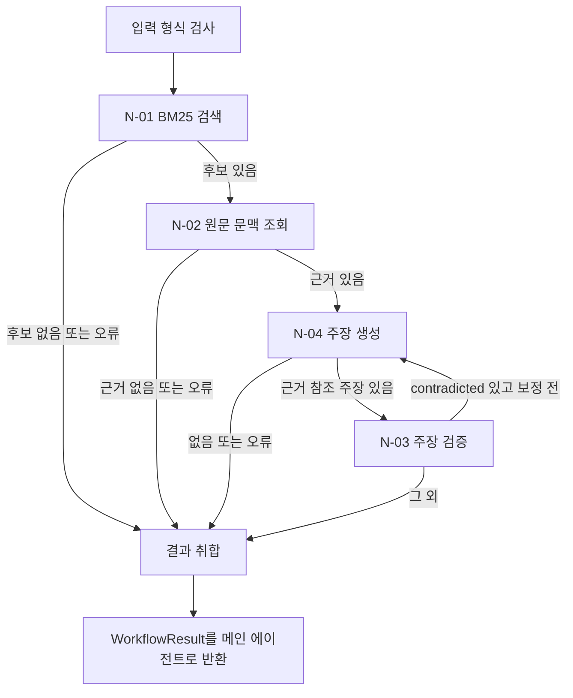

# T-01 Document QA — 실행·연동 가이드

T-01은 보고서 질문에 대한 근거 검색·문맥 조회·주장 생성·검증을 연결하는 LangGraph 고정 워크플로이다. 현재 구현 범위는 **기존 PyMuPDF blocks/chunks와 BM25 기준선**이다. 최종 Parser/VLM 어댑터, Dense/RRF, N-10 권한·라우팅, N-11 사용자용 답변, 웹 화면은 [자료함·T-01 웹](web-workspace.md)으로 연결하였다.

설계 기준은 JS [`ad430ab`](https://github.com/Jungminii-1114/ReportAnchor/blob/ad430ab123c61332e099765ab3e1a21c81c8dc7e/docs/big-nodes/T-01.md)이다. JS의 결과 필드는 개념 계약이며, 이 문서의 Python 자료형은 JM 연동용 구현이다. LangGraph의 노드·조건부 엣지는 [공식 Graph API](https://docs.langchain.com/oss/python/langgraph/graph-api)를 따른다. validate_input·assemble_result는 상태 처리 함수이며 추가 Small Node가 아니다.

## 1. 실행 흐름



- 기본 실행은 N-01 → N-02 → N-04 → N-03이다.
- contradicted 주장만 같은 질문·EvidenceBundle로 한 번 보정한다. N-04가 고친 주장만 N-03에 다시 전달한다.
- supported 주장은 처음 판정을 보존하고, insufficient 주장은 보정하지 않는다.
- 보정하지 못한 주장이나 재검증 실패는 미확인으로 남긴다. 다시 보정·검색·원문 조회하지 않는다.
- 검색은 최대 1회, 원문 조회는 최대 1회, N-04와 N-03 노드 호출은 각각 최대 2회이다. N-03은 주장별로 모델을 호출하므로 전체 모델 호출 수는 주장 수에 따라 달라진다.

## 2. 파일과 책임

| 파일 | 역할 |
| --- | --- |
| rag/contracts.py | RoutedTask, WorkflowResult, VerifiedClaim, UnconfirmedItem 등 공통 자료형 |
| rag/workflows/document_qa.py | LangGraph 상태·분기·결과 취합·CLI |
| rag/nodes/retrieve_evidence.py | N-01 검색 |
| rag/nodes/get_source_context.py | N-02 원문 문맥 |
| rag/nodes/draft_answer.py | N-04 생성 및 지정 주장 보정 |
| rag/nodes/verify_grounding.py | N-03 주장별 독립 검증 |
| tests/test_document_qa.py | 분기·보정 상한·출처·오류 및 실제 Small Node 연결의 모의 테스트 |

## 3. 하네스 입출력

`RoutedTask` 입력은 request_ref, question, document_scope, retrieval_profile, context_profile이다. question은 원문 그대로 검색·생성에 전달한다. N-10이 접근 가능한 문서 범위를 정하며 T-01은 그 범위를 넓히지 않는다. 버전이 색인·원문과 맞지 않으면 오류로 종료한다.

현재 기본 프로필은 `bm25-baseline-v1`, `fixed-context-v1`이다. 알 수 없는 프로필을 자동으로 다른 설정으로 대체하지 않는다. 문맥 프로필은 생성자에서 ContextExpansionConfig와 연결할 수 있다.

```python
from rag.contracts import DocumentRef, RoutedTask
from rag.nodes.draft_answer import DraftAnswerNode
from rag.nodes.get_source_context import build_chunk_lookup, load_block_lookup
from rag.retrieval.bm25 import BM25Retriever, load_chunks
from rag.workflows.document_qa import DocumentQAWorkflow

chunks = load_chunks("data/processed/.../chunks.jsonl")
blocks = load_block_lookup("data/processed/.../blocks.jsonl")
generator = DraftAnswerNode("설치한-모델명", "http://localhost:11434")
workflow = DocumentQAWorkflow(BM25Retriever(chunks), build_chunk_lookup(chunks), blocks, generator)

task = RoutedTask(
    request_ref="상위-요청-ID",
    question="사용자의 원래 질문",
    document_scope=[DocumentRef("허용된-doc_id", "해당-version_sha256")],
    retrieval_profile="bm25-baseline-v1",
    context_profile="fixed-context-v1",
)
result = workflow.run(task)
```

N-04와 N-03은 기본적으로 같은 OllamaClient를 사용하되 생성·검증 메시지와 대화 문맥은 분리한다. 독립 모델 교차 검증을 뜻하지 않는다.

### WorkflowResult

| 필드 | 의미 |
| --- | --- |
| request_ref | 상위 요청 ID 그대로 유지 |
| status | success / partial / error 실행 상태 |
| outcome | null / partial_answer / insufficient_evidence 확인 결과 |
| verified_claims | 마지막 판정이 supported인 주장만 포함 |
| unconfirmed_items | 미응답·무참조·근거 부족·모순·검증 실행 실패와 이유 |
| evidence_incomplete | 검색·원문 수집에서 일부 근거 누락이 알려진 경우 true |
| error | 전체 error일 때 node, error_code, retryable. 나머지는 null |

verified_claims에는 claim_id, claim_text, verdict, reason, evidence_refs, sources를 담는다. sources에는 chunk_id·document_id·document_version·source_refs·context_truncated를 보존한다. source_refs는 검색된 원문 구간이며 모든 확장 문맥을 문자 단위 인용했다는 의미는 아니다.

unconfirmed_items에는 origin, reason_code, reason, 선택형 claim_id·claim_text·evidence_refs를 담는다. N-04의 unanswered_items도 origin=N-04로 합친다. **마지막 판정이 contradicted인 문장은 claim_text=null로 반환**하며, insufficient 또는 검증 실행 실패인 문장은 미확인으로 표시하여 문장과 이유를 함께 남긴다. 정상적인 자료 부족은 “확보한 자료에서 확인되지 않음”으로 해석하며 문서 전체의 정보 부재를 확정하지 않는다.

### 상태 분류

| 상황 | status | outcome |
| --- | --- | --- |
| 모든 판정이 지지됨 | success | null |
| 일부 지지, 일부 근거 부족·보정 재실패 | success | partial_answer |
| 정상 검색이지만 후보 없음 | success | insufficient_evidence |
| 판정은 모두 정상이나 확인된 주장 없음 | success | insufficient_evidence |
| 일부 노드 partial, 사용할 결과 있음 | partial | 확인 결과에 따라 결정 |
| 보정·재검증 실행 오류, 기존 지지 주장 있음 | partial | partial_answer |
| 최초 N-01/02/04/03의 error | error | null |
| 보정·재검증 실행 오류, 지지 주장 없음 | error | null |

검색 후보 0개는 유효한 빈 결과이다. N-01이 partial이면 후보가 0개여도 partial을 보존한다. N-01 Dense/BM25 단계 실패, N-02 partial 또는 context_budget의 제외 후보가 있으면 evidence_incomplete=true이다. Reranker 단독 실패나 문맥 일부 잘림만으로는 이 표시를 켜지 않는다. 전체 error에서는 안전한 근거 수집 결과를 제공하지 않으므로 false이다.

숫자 참고 정보만 실패하고 N-03 판정이 완료되면 정상 결과를 유지한다. failed_items의 항목별 오류를 최종 사실 판정으로 바꾸지 않는다. N-03이 근거 참조 없는 주장을 건너뛴 경우 no_evidence_ref로 남긴다.

## 4. 설치·CLI

프로젝트의 Python 환경에서 추가 의존성을 설치한다. PyMuPDF는 추출 단계에서 별도로 필요하다.

```bash
python -m pip install -r requirements-rag.txt
```

프로젝트 루트에서 다음을 실행한다. model은 Ollama에서 실제 사용할 모델명으로 바꿔야 한다. Ollama 서버와 모델이 준비되어 있어야 하며 실행하면 실제 모델을 호출한다. scope의 문서 ID와 버전은 현재 KISTEP 예시이다. 다른 문서를 사용할 때에는 해당 manifest/chunks의 값으로 바꾼다.

```bash
python -m rag.workflows.document_qa \
  --chunks "data/processed/rag/kistep_2025_plan_0530d100e085/3382f591c928/chunks.jsonl" \
  --blocks "data/processed/pymupdf_demo/kistep_2025_plan_0530d100e085/blocks.jsonl" \
  --query "2025년 경상운영비는 얼마인가?" \
  --request-ref "t01-cli-demo" \
  --scope "doc_0530d100e08517b6" "0530d100e08517b60bb2acb9504d7ead70107f0c23a586738fb37e2191d1add8" \
  --model "설치한-모델명" \
  --top-k 3
```

- 표준 출력은 WorkflowResult JSON 한 개이다. 저장하려면 기존 outputs 디렉터리에 `> outputs/t01_result.json`을 붙인다.
- 종료 코드는 success/partial=0, error=2이다. partial 여부는 JSON status도 확인해야 한다.
- `--scope DOCUMENT_ID VERSION`은 반복 지정할 수 있다. 범위 자동 확장은 없다.
- `--max-context-chars`는 N-02의 전체 Unicode 문자 예산이며 기본값은 12,000자이다.
- `--timeout`은 각 모델 통신의 제한이며 기본값은 120초이다. 전체 요청의 wall-clock 예산은 아니다.
- 기본은 local이다. `--provider cloud`는 OLLAMA_API_KEY와 https://ollama.com을 사용하며 주장·질문·선택 근거가 외부로 전송된다.

## 5. 실행 기록·한계

`workflow.run_with_state(task)`는 최종 result와 실제 호출한 노드의 NodeResult를 함께 반환한다. n01, n02, n04, n03과 보정 시 n04_revision, n03_recheck를 남긴다. 호출하지 않은 노드 키는 생성하지 않는다. 하네스는 이 값을 H-02 아티팩트 입력으로 받을 수 있다. 상태에는 원문과 초안이 포함되므로 최종 사용자 답변에는 result만 사용한다.

새 요청마다 새 graph state로 실행한다. Checkpointer, 영속 실행 복구, 총 비용·시간 예산, 사용자 권한 판단, H-02 저장 및 N-11 최종 문장 생성은 이 구현에 포함하지 않는다. 로컬 웹은 T-01 실행·결과·원문 근거 확인을 지원한다. [웹 작업실 가이드](web-workspace.md)를 참고한다.

자동 테스트는 가짜 모델 응답을 사용한다. 실제 모델의 사실 판정 정확도, 문서 파싱 정확도, 검색 품질, 환각 억제 성능을 증명하지 않는다. supported도 확보한 추출 원문 기준 판정이며 PDF/OCR 정확도 보증이 아니다.

- [x] N-01 → N-02 → N-04 → N-03 연결
- [x] contradicted 주장만 한 번 보정·재검증
- [x] 기존 supported 유지·마지막 판정 취합·미확인 분리
- [x] 요청·범위·출처 보존 및 실패 분기 검사
- [x] CLI와 하네스 호출용 Python 진입점
- [ ] 실제 모델·사람 정답으로 품질 평가
- [ ] 하네스 N-10/N-11·H-02와 실제 연동
- [x] 웹 화면의 전체 T-01 실행·표시 — [웹 가이드](web-workspace.md)
