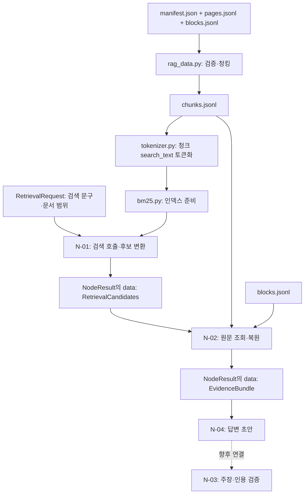
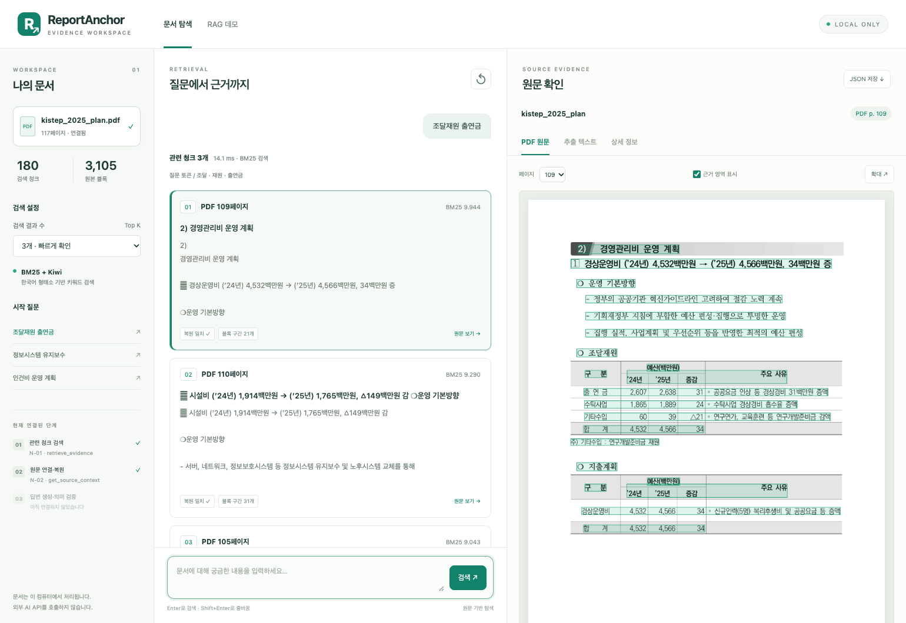

# ReportAnchor 검색 모듈과 T-01 Small Node 안내

이 문서는 ReportAnchor를 처음 보는 팀원이 **어떤 파일이 무엇을 받고, 무엇을 반환하며, 다음 단계와 어떻게 연결되는지** 이해하기 위한 안내이다.

**코드 확인 기준: 2026-11-02.** 아래에서 현재 구현과 설계 목표를 구분한다. 향후 코드·계약 변경 시 이 문서도 함께 갱신한다.

## 1. 이 폴더의 역할

ReportAnchor는 PDF/HWP 등에서 추출한 내용을 검색하고, 원문 근거에 기반한 답변과 검토 결과를 제공하는 프로젝트이다. 현재 이 영역은 이미 추출된 텍스트 청크를 입력으로 사용하는 BM25 기준선을 구현한다.

`retrieval/`은 검색 알고리즘과 토큰화 정책을 담는다. 사용자 요청을 처리하는 Small Node는 형제 폴더인 `nodes/`에 있다. **검색 엔진 모듈과 Small Node는 같은 계층이 아니다.**

```text
rag_data.py                 추출 데이터 검증·청킹
rag/
├── contracts.py            노드 사이의 공통 데이터 형식
├── retrieval/              검색 엔진과 전처리
│   ├── README.md           이 문서
│   ├── tokenizer.py        문자열 정규화·Kiwi 토큰화
│   ├── bm25.py             청크 로딩·BM25 인덱스·검색
│   └── dense.py            Dense 검색용 자리, 현재 미구현
└── nodes/                  업무별 Small Node
    ├── retrieve_evidence.py N-01: 검색 요청과 검색 엔진 연결
    ├── get_source_context.py N-02: 원문 조회·문맥 보강
    ├── draft_answer.py      N-04: 답변 초안·인용 검사·로컬/클라우드 호출
    └── verify_grounding.py  N-03: 주장·인용 검증, 구현 예정
```

## 2. T-01의 Small Node 구성

T-01(Document QA)은 문서에 대한 특정 질문을 원문 근거와 함께 답하는 고정 워크플로이다. 실행 순서는 **N-01 → N-02 → N-04 → N-03**이며, ID 번호순이 아니다.

| 순서 | Small Node / 파일 | 역할 | 입력 | 목표 반환 업무 데이터 | 현재 구현 범위 |
| --- | --- | --- | --- | --- | --- |
| ① | **N-01** [`retrieve_evidence.py`](../nodes/retrieve_evidence.py) | 질문에 관련된 청크 후보 검색 | `RetrievalRequest`, 준비된 `BM25Retriever`, 선택적 `index_ref`, `top_k` | `RetrievalCandidates`를 담은 `NodeResult` | 검색 호출·후보 변환·공통 반환 및 빈 검색 문구 검사 구현. 요청 문서 범위·버전 강제는 아직 미구현 |
| ② | **N-02** [`get_source_context.py`](../nodes/get_source_context.py) | 후보를 원문·블록·페이지·좌표와 연결하고 필요한 문맥 보강 | 검색 후보, 원문 청크 조회표, 블록 조회표 등 | `NodeResult[EvidenceBundle]` | 허용 문서·버전 검사, 원문 복원, 페이지 안 고정 길이 확장, 겹침 병합, 전체 문자 예산, 부분 실패와 공통 JSON 반환 구현 |
| ③ | **N-04** [`draft_answer.py`](../nodes/draft_answer.py) | 확보한 근거만 이용해 답변 초안 작성 | 질문 + `EvidenceBundle` | `NodeResult[ReviewDraft]` | 로컬/클라우드 호출·형식/인용 검사·CLI·웹 연결 구현 |
| ④ | **N-03** [`verify_grounding.py`](../nodes/verify_grounding.py) | 답변의 주장·숫자·인용이 근거와 맞는지 검사 | **계획:** 초안 + 근거 묶음 | **계획:** `VerificationReport` | 역할 표시만 있으며 실행 로직 없음 |

`EvidenceBundle`과 문맥·출처 타입은 현재 JM의 `contracts.py`에 구현되어 있다. `ReviewDraft`, `VerificationReport`는 후속 목표 개념명이며 아직 실행 타입·로직이 구현되지 않았다. N-02 상세 계약은 [원문 문맥 조회 안내](../../docs/n02-source-context.md)에 있다.

상위 요청 라우팅 N-10과 결과 전달 N-11은 이 네 노드 바깥의 공통 단계이다. 현재 파일들이 존재한다는 사실만으로 전체 T-01이 연결·완료된 것은 아니다.

## 3. 데이터가 이동하는 경로



문서 로딩·청크 토큰화·BM25 인덱스 생성은 준비 단계에서 수행하고, 준비된 검색기를 여러 질문에 재사용한다. 질문마다 PDF를 다시 파싱하는 구조가 아니다.

| 데이터 파일 | 저장 단위와 주요 용도 | 주로 사용하는 위치 |
| --- | --- | --- |
| `manifest.json` | 문서 식별·원본 버전·출처·페이지 수 등 | `rag_data.py` 입력 검증 |
| `pages.jsonl` | 페이지별 추출 텍스트와 메타데이터 | `rag_data.py` 입력 검증, 향후 페이지 문맥 조회 |
| `blocks.jsonl` | 원본 텍스트 블록, 블록 ID, 페이지·좌표 | 청킹, N-02 원문 복원 |
| `chunks.jsonl` | 검색 단위로 묶은 텍스트와 원문 참조 | BM25 입력, N-02 청크 조회 |
| `chunking_report.json` | 청킹 설정·개수·원문 커버리지 검사 등 | 전처리 진단. 검색 대상 텍스트 파일은 아님 |

### 서로 다른 두 `search_text`

| 위치 | 의미 | 예시 |
| --- | --- | --- |
| `chunk["text"]` | 청크에 보존한 원문 | `출연금 예산은\n20,496백만원이다.` |
| `chunk["search_text"]` | 검색용으로 정규화한 **문서 내용** | `출연금 예산은 20,496백만원이다.` |
| `request.search_text` | 이번 요청에서 검색할 **질문·검색 문구** | `2025년 출연금 예산` |

위 문장은 형식 설명용 예시이다. 두 `search_text`는 이름은 같지만 출처와 역할이 다르다. 문서 내용과 검색 문구 모두 같은 `tokenize()` 정책을 적용한다.

## 4. 검색 모듈의 함수와 입출력

### `tokenizer.py`: 문자열을 BM25 입력 토큰으로 변환

| 함수·값 | 입력 | 반환 | 처리 내용 |
| --- | --- | --- | --- |
| `normalize_text(text)` | 문자열 하나 | `str` | Unicode NFKC 정규화, 영문 소문자화, 연속 공백 정리 |
| `keep_token(token)` | Kiwi `Token` 객체 하나 | `bool` | 조사·어미 및 명시한 문장부호 태그를 제외할지 판단 |
| `tokenize(text)` | 청크 문자열 또는 검색 문구 하나 | `list[str]` | 정규화 → Kiwi 분석 → 유지할 토큰의 `form` 수집 |
| `TOKENIZER_VERSION` | 입력 없음 | 정책 버전 문자열 | 현재 `kiwi-bm25-v1`. 정책 추적용이며 그 자체가 색인 버전은 아님 |

`kiwi.tokenize()`는 Token 객체 목록을 반환하지만, 여기의 `tokenize()`는 그중 `form`을 꺼낸 문자열 목록을 반환한다. 명사만 남기는 정책은 아니며, 현재 제외 조건에 걸리지 않는 동사·숫자·영문 등의 토큰도 유지한다.

### `bm25.py`: 인덱스 구성과 후보 검색

| 함수·메서드 | 입력 | 반환 | 처리 내용 |
| --- | --- | --- | --- |
| `load_chunks(path)` | `chunks.jsonl` 경로 | `list[dict]` | JSONL 읽기와 `chunk_id`·`search_text` 최소 형식 검사 |
| `BM25Retriever(chunks)` | 청크 딕셔너리 목록 | 준비된 검색기 객체 | 각 `search_text` 토큰화, 중복 ID 검사, 빈 토큰 청크 제외, BM25 인덱스 생성 |
| `retriever.search(question, top_k=5)` | 질문 문자열, 양의 정수 | `list[dict]` | 질문 토큰화, 점수 계산, 토큰이 겹치는 후보를 순위대로 반환 |

검색 결과 한 건에는 다음 필드가 있다.

| 필드 | 의미 |
| --- | --- |
| `chunk_id` | 검색된 청크 ID |
| `rank` | 1부터 시작하는 결과 순위 |
| `score` | BM25 관련성 점수. 확률·정답률이 아님 |
| `matched_tokens` | 질문과 청크에 공통으로 등장한 토큰 |
| `chunk` | 원문·페이지·버전·블록 참조를 포함한 청크의 복사본 |

질문에 사용할 토큰이 없거나 공통 토큰이 있는 청크가 없으면 `[]`를 반환한다. 0점 이하라는 이유만으로 후보를 제거하지 않으며, 동점이면 인덱스 입력 순서를 유지한다. 현재 문서 범위를 인자로 받아 제한하는 기능은 없다.

### `dense.py`

현재 빈 파일이다. 임베딩·벡터 검색을 구현할 예정인 위치이며, Dense·Hybrid·RRF·reranker가 현재 검색 경로에 구현되어 있다는 뜻은 아니다.

## 5. N-01: 검색 결과를 공통 형식으로 연결

현재 대표 함수는 다음과 같다.

```python
retrieve_evidence(
    request: RetrievalRequest,
    retriever: BM25Retriever,
    *,
    index_ref: str | None = None,
    top_k: int = 5,
) -> NodeResult[RetrievalCandidates]
```

| 인자 | 역할 |
| --- | --- |
| `request` | 검색 문구, 요청 참조, 문서·버전 범위, 검색 프로필 |
| `retriever` | 이미 인덱스를 준비한 BM25 검색기 |
| `index_ref` | 실제 사용 색인을 추적할 참조. 생략하면 `index_refs`는 빈 딕셔너리 |
| `top_k` | 반환할 최대 후보 수. 현재 `RetrievalRequest`의 필드는 아님 |

`*` 뒤의 인자는 `index_ref=...`, `top_k=...`처럼 이름을 붙여 전달한다.

실행 순서는 **검색 문구 검사 → `search_for_request()`로 BM25 호출 → `RetrievalCandidate` 변환 → `RetrievalCandidates` 구성 → `NodeResult` 반환**이다.

### 검색 결과의 필드 매핑

| BM25·청크 데이터 | 공통 후보 필드 |
| --- | --- |
| `hit["chunk_id"]` | `chunk_id` |
| `hit["chunk"]["doc_id"]` | `document_id` |
| `hit["chunk"]["version_sha256"]` | `document_version` |
| `hit["rank"]` | `rank` |
| `hit["rank"]`, `hit["score"]` | `score_metadata`의 `bm25_rank`, `bm25_score` |

**현재 공통 후보에는 청크 본문·페이지·좌표가 직접 포함되지 않는다.** N-02가 후보의 ID·문서·버전을 이용해 저장된 원문을 조회한다. 추출 데이터의 `doc_id`를 `document_id`에 대응시키는 것은 현재 연결 방식이며, 향후 문서 등록 계층의 논리 ID 정책과 함께 조정할 수 있다.

### 현재 상태 처리와 남은 경계

| 상황 | 현재 동작 |
| --- | --- |
| 문자열이 아니거나 공백뿐인 검색 문구 | `status="error"`, `data=None`, `INVALID_SEARCH_TEXT` 진단 반환 |
| 검색 후보 있음 | `status="success"`, 후보 목록과 개수 반환 |
| 검색 후보 없음 | `status="success"`, 빈 후보 목록과 `count=0` 반환. `outcome=None` |
| 잘못된 `top_k`·검색 호출 예외 | 해당 예외를 공통 오류 결과로 바꾸는 처리는 아직 없음 |
| 요청의 `document_scope`와 색인 범위 불일치 | N-01에서 아직 강제 검증·필터링하지 않음 |

`success`는 검색 실행 결과를 반환했다는 의미이지, 정답 근거 확보나 사실 검증 완료를 뜻하지 않는다. 현재 범위 검사가 없으므로 요청에 허용 범위를 적었다는 사실만으로 그 범위만 검색한다고 가정하면 안 된다.

## 6. 공통 계약: `contracts.py`

| 데이터 타입 | 담는 내용 | 사용하는 위치 |
| --- | --- | --- |
| `DocumentRef` | `document_id`, `document_version` | 요청의 문서 범위 |
| `RetrievalRequest` | `request_ref`, `search_text`, `document_scope`, `retrieval_profile` | N-01 입력 |
| `RetrievalCandidate` | 청크·문서·버전 ID, 순위, 검색 점수 메타데이터 | 후보 한 건 |
| `RetrievalCandidates` | 요청 참조, 후보 목록, 색인 참조, 전략 버전 | N-01 업무 데이터 |
| `StepDiagnostic` | 단계 상태·오류 코드·사유·재시도 가능 여부·개수 | 내부 단계 진단 |
| `NodeResult[T]` | 노드 상태, 업무 데이터, 진단, 결과 코드 | 공통 반환 포장 |
| `ContextExpansionConfig` | 앞·뒤 문자 수와 전체 근거 본문 상한 | N-02 설정 |
| `SourceSpan` / `EvidenceAnchor` | 원본 블록 구간 / 원래 검색된 청크·순위 | N-02 출처 |
| `EvidenceItem` / `EvidenceBundle` | 병합된 문맥과 앵커 / 전체 근거·진단 요약 | N-02 업무 데이터 |

`NodeResult[RetrievalCandidates]`는 "공통 포장의 `data`에 검색 후보 묶음이 들어간다"는 의미이다.

| 공통 반환 필드 | 의미 |
| --- | --- |
| `status` | 노드 실행 상태: 현재 허용값은 `success`, `partial`, `error` |
| `data` | 업무 데이터 또는 `None` |
| `diagnostics` | 단계 이름별 `StepDiagnostic` |
| `outcome` | 업무별 결과 코드 또는 `None`. 현재 N-01은 `None` |

계약의 일부 타입에는 실행 시 검증이 있지만 모든 필드·상태 조합을 자동 검증하는 것은 아니다. 특히 `document_scope`를 선언하는 것과 실제 검색 범위를 제한하는 것은 별도 작업이다.

## 7. N-02: 원문 문맥 조회와 EvidenceBundle

현재 함수는 `get_source_context(retrieval, chunk_lookup, block_lookup, *, document_scope, config=None)`이다. 파일을 재로딩하거나 화면에 출력하지 않고 `NodeResult[EvidenceBundle]`을 반환한다.

| 함수 | 역할 |
| --- | --- |
| `build_chunk_lookup` / `lookup_chunk` | 청크 ID로 조회하고 중복·누락을 확인 |
| `load_block_lookup` / `group_blocks_by_page` | 블록 조회표와 문서·버전·페이지별 저장 순서 유지 |
| `get_source_for_candidate` / `reconstruct_chunk_text` | 후보와 원문 ID·버전·페이지·좌표·문자 구간 대조 및 청크 복원 |
| `get_source_context` | 허용 범위 검사 → 복원 → 고정 길이 문맥 → 겹침 병합 → 예산 적용 → 공통 결과 반환 |

개발 기본 설정은 앞 200자·뒤 200자, 전체 근거 본문 12,000자이다. 토큰 수가 아니라 원문 Unicode 문자 수이며 팀 전체의 최종 확정 값은 아니다. 같은 문서·버전·페이지 안에서만 확장한다. 여러 페이지 청크는 페이지별 근거로 분리한다.

같은 페이지에서 겹치는 문맥은 `EvidenceItem` 하나로 병합하되 원래 검색 후보는 `anchors`에 남긴다. 따라서 후보 수와 근거 항목 수가 같지 않을 수 있다. 전체 문자 예산을 넘으면 확장을 먼저 생략하며, 후보 원문 자체를 담지 못하면 부분 문자열을 몰래 자르는 대신 후보를 제외하고 진단한다.

원문 누락 등 일부 후보 실패는 안전한 근거를 보존한 `partial`로 반환한다. 문서·버전·좌표·원문 구간 무결성 오류는 `error`, `data=null`로 차단한다. 정상적인 빈 후보 입력은 `success`와 빈 묶음, `outcome="no_candidates"`이다.

**문맥 확장은 구조 추론이나 사실 검증이 아니다.** 표 헤더·각주를 의미적으로 찾아 붙이는 기능은 후속 고도화 대상이다. 원문 블록의 추출 검증 상태를 그대로 전달하며 여러 상태가 섞이면 `mixed`로 표시한다.

[설정·반환 필드·CLI·웹 연결·오류 정책](../../docs/n02-source-context.md)

## 8. CLI와 노드 함수의 차이

| 구분 | 역할 | 예 |
| --- | --- | --- |
| `main()`·`argparse` | 터미널 입력을 읽고 검색기·요청 객체 준비 | `--chunks`, `--query`, `--top-k` |
| 노드 함수 | 준비된 객체로 업무 수행·반환 | `retrieve_evidence(request, retriever, top_k=5)` |

하네스는 노드 함수를 직접 호출할 수 있다. 노드 함수가 터미널 인자를 직접 읽을 필요는 없다. 현재 N-01 CLI는 로딩한 청크의 문서·버전으로 요청 범위를 만들지만, 이것이 임의의 외부 요청에 대한 범위 검증을 구현한 것은 아니다.

다음 명령은 **설명용 경로를 실제 데이터 경로로 교체하고 저장소 루트에서 실행**한다. `python`은 `kiwipiepy`, `rank-bm25`가 설치된 프로젝트 실행 환경이어야 한다. 결과 JSON은 원하는 경로에 저장할 수 있다.

```bash
# 1. 검색 엔진의 후보·점수·원문 미리보기 확인
python -m rag.retrieval.bm25 \
  --chunks "/실제/데이터/경로/chunks.jsonl" \
  --query "2025년 출연금 예산" \
  --top-k 5

# 2. 공통 계약으로 변환한 N-01 결과 JSON 저장
python -m rag.nodes.retrieve_evidence \
  --chunks "/실제/데이터/경로/chunks.jsonl" \
  --query "2025년 출연금 예산" \
  --top-k 5 > retrieval_result.json

# 3. N-01 후보의 원문·문맥을 공통 JSON으로 반환
python -m rag.nodes.get_source_context \
  --chunks "/실제/데이터/경로/chunks.jsonl" \
  --retrieval-result retrieval_result.json \
  --blocks "/실제/추출/경로/blocks.jsonl" \
  --before-chars 200 --after-chars 200 --max-total-chars 12000 \
  > source_context_result.json
```

BM25 CLI 출력은 사람 확인용 텍스트이고, N-01 CLI 출력은 공통 결과 JSON이다. N-02 CLI도 공통 JSON만 출력하므로 파일로 저장할 수 있다. 오류 결과의 종료 코드는 2이다. CLI의 상대 입력 경로는 현재 작업 디렉터리 기준이다.

## 9. 웹 데모에서 검색 결과와 원문 확인

터미널 출력 외에 로컬 웹 화면에서도 기존 N-01 검색 결과와 N-02 원문 복원 결과를 확인할 수 있다. 화면은 **문서·검색 설정 / 관련 청크 / 원문 확인**의 세 영역으로 구성된다. 모델을 설정하면 검색 후 별도 버튼으로 N-04 답변 초안을 생성하며, 인용을 눌러 대응 원문으로 이동할 수 있다.



### 실행과 연결 구조

저장소 루트에서 다음 명령으로 실행한다. `python`은 기존 BM25를 실행하던 환경의 Python이며, `kiwipiepy`와 `rank-bm25`가 필요하다.

```bash
python scripts/run_rag_demo.py \
  --chunks "data/processed/rag/kistep_2025_plan_0530d100e085/3382f591c928/chunks.jsonl" \
  --blocks "data/processed/pymupdf_demo/kistep_2025_plan_0530d100e085/blocks.jsonl" \
  --pdf "data/raw/kistep_2025_plan.pdf"
```

시작 메시지가 나온 뒤 <http://127.0.0.1:8765>에 접속한다. PDF 렌더링에는 PyMuPDF가 필요하다. 현재 검색 환경에 PyMuPDF가 없으면 프로젝트 `.venv/bin/python`을 사용하며, 다른 환경은 `--pdf-python`으로 지정한다. 개인 환경의 정확한 실행 명령과 포트 변경 방법은 [데모 실행 안내](../../docs/rag-demo-ui.md)에 있다.

| 구성 파일 | 역할 |
| --- | --- |
| [`demo/`](../../demo/) | 검색 입력, 결과 선택, PDF·텍스트·메타데이터 표시 |
| [`scripts/run_rag_demo.py`](../../scripts/run_rag_demo.py) | 기존 BM25·N-01·N-02 보조 함수를 로컬 HTTP 화면에 연결 |
| [`scripts/render_rag_preview.py`](../../scripts/render_rag_preview.py) | 지정된 PDF 페이지와 참조 블록 영역을 PNG로 렌더링 |

서버는 시작 시 청크 전체를 원본 블록에서 복원해 일치를 검사하고, PDF를 지정하면 파일의 SHA-256과 청크의 문서 버전을 대조한다. BM25 인덱스는 한 번 구성해 여러 질문에서 재사용한다. 현재 데모는 한 문서·한 버전만 연결한다. 검색은 로컬에서 수행하며, 선택형 클라우드 생성은 질문·원문 근거를 외부로 전송한다.

### 웹 화면의 원문 대조 절차

1. 왼쪽의 `조달재원 출연금`을 누르거나 같은 문구를 입력하고 결과 수를 3개로 설정한다.
2. 가운데 결과 카드의 순위·BM25 점수·PDF 페이지를 확인한다.
3. 1위 카드를 선택하고 오른쪽 `PDF 원문`에서 109페이지와 초록색 참조 영역을 확인한다.
4. `추출 텍스트`에서 청크 전체 내용과 펼쳐 볼 수 있는 원본 블록의 문자 구간을 대조한다. 예를 들어 109페이지 출연금 행의 **2024년 2,607 / 2025년 2,638 / 증감 31백만원**이 PDF 화면과 추출 텍스트에서 대응되는지 확인한다.
5. `상세 정보`에서 청크 ID·문서 버전·페이지·N-01 응답 JSON을 확인한다. 다른 카드를 선택했을 때 원문도 해당 페이지로 바뀌어야 한다.
6. `JSON 저장`으로 N-01 응답(`retrieval`)과 정식 N-02 응답(`source_context`)을 보관할 수 있다. `source_context.data`가 `EvidenceBundle`이며 `sources`는 화면 호환을 위한 후보별 뷰이다. `추출 텍스트`에는 보강 문맥을 표시하고, `상세 정보`에는 N-02 JSON·문맥 길이·근거 ID도 표시한다.

**화면에서 원문을 대조하는 기능과 N-03의 자동 주장 검증은 별개이다.** 현재 PDF 강조는 원래 검색 청크가 참조한 블록 전체의 bbox이며, 추가 문맥은 추출 텍스트에서 확인한다. 일부 문자만 사용한 경우에도 블록 전체를 표시한다. `복원 일치`는 저장된 텍스트의 연결 검사이고, 표 구조 인식이나 질문에 대한 답의 정확성을 자동 검증한 결과는 아니다.

### 확인된 결과와 검증 범위

아래는 **2026-11-02에 수행한 웹·API 검사 기록**이다. 이번 README 검수에서는 저장된 검사 기록, 화면 캡처, JSON 내보내기 결과를 대조했다. 본문 수정 과정에서 생성 모델 실험이나 검색 정확도 평가를 새로 수행한 것은 아니다.

| 항목 | 확인된 결과 |
| --- | --- |
| 입력 규모 | 청크 180개, 원본 블록 3,105개. 서버 시작 시 전체 청크의 블록 기반 복원 검사 통과 |
| 실제 검색 | `조달재원 출연금`, Top K=3 → PDF 109·110·105페이지 순서 |
| 기존 결과와 대응 | BM25 점수 약 9.944·9.290·9.043, 원문 구간 수 21·31·28개 |
| PDF·텍스트 확인 | 109페이지 PDF 표시, 결과 선택 시 110페이지 전환, 강조 해제·확대, 전체 추출 텍스트와 블록 구간 표시 확인 |
| 응답 확인 | N-01 JSON 표시 및 원문을 포함한 JSON 다운로드 확인 |
| 오류·빈 결과 | 빈 검색어의 `INVALID_SEARCH_TEXT`, 후보 없음 안내, 이전 결과 제거 확인 |
| 화면·요청 동작 | 모바일 가로 넘침 없음, 브라우저 JavaScript 예외 없음, 외부 요청 없음 |
| 자동 검사 기록 | 웹·API 26개 검사 통과. 별도로 기존 BM25 5개·공통 계약 7개 테스트 통과 |

[웹·API 검사 기록 JSON](../../docs/reports/rag-demo-ui-checks.json)에서 26개 항목을 확인할 수 있다. 위 결과는 해당 데이터와 실행 환경의 기능 검사이며, Recall·nDCG 등의 검색 정확도나 OCR/VLM 인식 정확도를 나타내지 않는다.

데모의 `index_refs.bm25`는 청크 파일 SHA-256을 바탕으로 한 참조이다. 토큰화 코드·패키지 버전·검색 파라미터까지 포함하는 완전한 색인 버전 관리와는 구분해야 한다. 또한 데모 서버의 한 문서 제한과 입력 검사는 정식 N-01의 요청 범위·버전 강제 검증을 대신하지 않는다.

N-02 완성 후의 [추가 검사 기록](../../docs/reports/n02-validation.json)에는 N-02 단위·CLI 34개, 기존 테스트 22개, 웹·API 32개 통과와 실제 180개 청크의 원문 연결 결과를 기록했다. 이는 아래의 기존 26개 초기 웹 검사와 구분되는 후속 기록이다.

## 10. 상태 해석과 후속 개발

| 관찰한 결과 | 의미 | 아직 말할 수 없는 것 |
| --- | --- | --- |
| BM25 상위 후보가 나옴 | 관련 토큰이 있는 청크 검색 | 정답을 찾았다는 보장 |
| 후보 없음 | 이번 검색 조건으로 후보를 확보하지 못함 | 문서에 정보가 없다는 단정 |
| 원문 복원 일치 | 저장한 블록·구간과 청크 내용이 일치 | OCR·VLM 인식 정확성 |
| `verification_status="unverified"` | 추출 내용의 검증 상태가 미확인 | 검색 성공만으로 verified로 변경 불가 |

N-02는 현재 PyMuPDF 텍스트 입력·문서/버전 범위의 MVP를 구현했다. N-04 답변 생성·형식/인용 검사·웹 연결은 구현했다. 후속 개발은 N-01 범위·버전 검증 및 오류 정책 보완, N-03 주장·인용 검증, T-01/하네스 통합으로 연결한다. `search.py`는 현재 존재하지 않으며 검색은 `bm25.py`와 N-01이 맡는다. Dense·Hybrid 등은 같은 질문·정답 근거 집합으로 BM25 기준선과 비교하며 도입한다.

## 11. 관련 코드와 설명

- [공통 데이터 계약](../contracts.py)
- [청크 생성 코드](../../rag_data.py)
- [현재 청킹 규칙·입출력 설명](../../docs/rag-data-preparation.md)
- [BM25와 계약 연결 점검 스크립트](../../scripts/check_bm25_contracts.py): 개발용 점검이며 정식 N-01 구현이나 검색 정확도 평가를 대신하지 않음
- [로컬 웹 데모 실행·원문 확인 안내](../../docs/rag-demo-ui.md)
- [N-02 구현 계약과 실행 순서](../../docs/n02-source-context.md)

이 문서는 현재 저장된 코드와 2026-11-02의 웹 데모 검사 기록을 대조한 안내이다. 웹 표시·원문 연결 확인은 검색 정확도나 생성 성능 평가와 별개이다.

## 12. T-01 구현까지 남은 Node 체크리스트

체크 기준은 **현재 합의한 입력 범위의 MVP 구현·검증 여부**이다. N-02는 고정 길이 문맥·반환·오류 처리를 마쳤고, N-01은 범위·예외 처리가 남아 부분 구현 상태이다. 최종 Parser/VLM·하네스 계약 합의는 통합 단계에 남아 있다. 아래 순서는 실제 실행 순서인 N-01 → N-02 → N-04 → N-03 기준이다.

- [ ] **N-01 `retrieve_evidence` 마무리 — 부분 구현:** 요청의 문서·버전 범위를 검색 전에 강제하고, 색인·검색 프로필 대응 및 예외의 공통 오류 반환 정책을 정리한다. BM25 검색·후보 변환·빈 검색어 검사는 구현된 상태이다.
- [x] **N-02 `get_source_context` — 현재 입력의 MVP 완료:** 고정 길이 문맥, 출처 보존, 겹침 병합, 문자 예산, `EvidenceBundle`, 범위·무결성 오류 차단, 부분 실패, JSON CLI·웹 연결 및 테스트를 구현했다.
- [x] **N-04 `draft_answer` 구현 — 현재 텍스트 MVP:** 질문·근거로 로컬/클라우드 초안을 생성하고, JSON·근거 ID·원문 인용을 검사한다. 부족 상태·실행 오류를 구분하며 CLI·웹을 연결했다. [N-04 안내](../../docs/n04-draft-answer.md)에 범위와 한계가 있다.
- [ ] **N-03 `verify_grounding` 구현 — 미구현:** 인용·근거 ID·문서 범위·숫자·연도·단위를 검사하고, 의미적 정합성 평가와 구분해 결과를 반환한다. 검증 상태와 답변 제공 조건도 함께 정의한다.
- [ ] **T-01 실행부·하네스 통합:** 네 노드를 순서대로 연결하고 빈 근거·부분 실패·검증 실패의 처리와 최종 반환 형식을 합의한다. N-10 요청 라우팅·N-11 결과 전달은 T-01 바깥의 공통 단계이므로 하네스 담당자와 연동 경계를 정한다.
- [ ] **통합 검증:** 질문·정답 근거 집합으로 검색과 인용·답변 품질을 평가하고, 문서/버전 불일치 및 근거 부족 사례까지 점검한다. 현재 웹 동작 검사와 별도로 수행할 작업이다.
